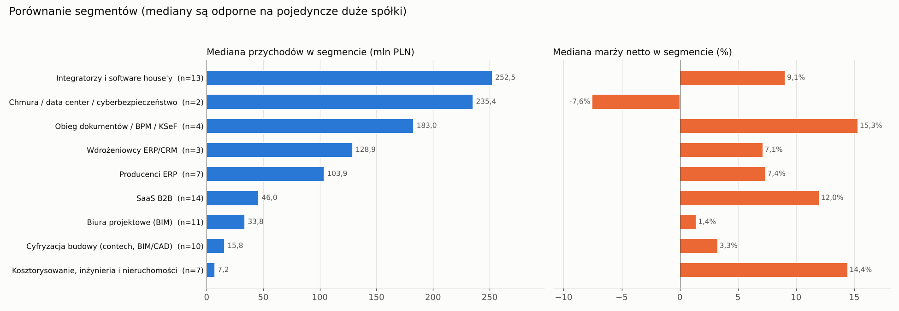

# Polskie spółki IT dla przedsiębiorstw i cyfryzacja budownictwa

*Stan na 20.11.2026 · 98 podmiotów · kwoty w tys. PLN · dane jednostkowe, o ile nie zaznaczono inaczej. `*` = dane z agregatora KRS/prasy, do weryfikacji.*

Pliki: [`raport_spolki_it_polska.html`](raport_spolki_it_polska.html) (wersja interaktywna) · [`spolki_it_polska_dane_finansowe.csv`](spolki_it_polska_dane_finansowe.csv) · [`charts/`](charts/) · [`reports/`](reports/)

## 1. Metodologia

**Zakres.** Zestawienie obejmuje firmy IT dla przedsiębiorstw działające w Polsce, ze szczególnym uwzględnieniem cyfryzacji budownictwa. Powstało w dwóch rundach: 20 spółek w pierwszej, ok. 80 w drugiej (biura projektowe, wdrożeniowcy, contech, kosztorysowanie, chmura i cyberbezpieczeństwo). Firmy pogrupowano w 9 segmentów.

**Identyfikacja (KRS, NIP, REGON).** Oficjalne API KRS i przeglądarka RDF blokowały adres IP środowiska badawczego. Numery ustalono ze źródeł wtórnych: stopek i regulaminów stron firm, rejestr.io, imsig.pl (MSiG), krs-pobierz.pl, aleo.com, bizraport.pl i raportów ESPI. **Żaden numer nie został potwierdzony bezpośrednio w eKRS.** Przed użyciem formalnym należy je sprawdzić w wyszukiwarce KRS.

**Dane finansowe mają dwa poziomy wiarygodności.**

- **raport** – liczby odczytane z formularza RR ESPI/EBI, sprawozdania ESEF lub raportu rocznego (głównie spółki z GPW i NewConnect);
- **agregator*** – liczby ze sprawozdań złożonych do KRS, odczytane pośrednio z serwisów agregujących (rejestr.io, bizraport, aleo, firmy.ai, okredo i in.) lub z prasy. Nie zostały zweryfikowane z dokumentem, a status badania przez biegłego jest nieznany.

**Rok obrotowy.** Ostatni pełny rok: 2025, gdy był dostępny, w przeciwnym razie 2024. Wyjątki (np. rok kończący się 31.03 lub 30.09) są zaznaczone. Nie użyto okresów częściowych. Dane są jednostkowe (spółka matka), chyba że kolumna typ raportu mówi inaczej.

**Związek z budownictwem** oceniono w skali: rdzeń / oferta dedykowana / pośredni / marginalny / brak. Każda ocena ma źródło w karcie firmy.

**Wskaźniki.** Marża netto = zysk netto / przychody. EBITDA obliczona jako EBIT + amortyzacja jest oznaczona.

## 2. Segmenty

| Segment | Spółek | Suma przychodów | Mediana przychodów | Mediana marży netto | Rdzeń / oferta budowlana |
|---|---:|---:|---:|---:|---:|
| Biura projektowe (BIM) | 12 | 725 728 | 33 833 | 1,4% | 12 |
| Wdrożeniowcy ERP/CRM | 11 | 473 806 | 128 935 | 7,1% | 2 |
| Producenci ERP | 7 | 2 483 361 | 103 887 | 7,4% | 2 |
| Integratorzy i software house'y | 14 | 4 650 466 | 252 459 | 9,1% | 2 |
| SaaS B2B | 16 | 1 286 549 | 46 036 | 12,0% | 1 |
| Obieg dokumentów / BPM / KSeF | 6 | 733 732 | 182 953 | 15,3% | 0 |
| Cyfryzacja budowy (contech, BIM/CAD) | 11 | 417 748 | 15 836 | 3,3% | 9 |
| Kosztorysowanie, inżynieria i nieruchomości | 9 | 61 635 | 7 232 | 14,4% | 9 |
| Chmura / data center / cyberbezpieczeństwo | 12 | 470 848 | 235 424 | -7,6% | 0 |

## 3. Tabela zbiorcza

| # | Firma | KRS | Segment | Główny produkt / usługa | Budownictwo | Rok | Przychody | Zysk netto | Marża | Dane |
|---|---|---|---|---|---|---|---:|---:|---:|---|
| 1 | Asseco Poland S.A. | 0000033391 | Integratorzy i software house'y | Własne systemy dla bankowości, ubezpieczeń, administracji, zdrowia, energetyki; wdrożenia ERP (m.in. Microsoft Dynamics) | pośredni | 2025 | 1 703 400 | 432 700 | 25,4% | [link](https://money2.wpcdn.pl/gielda/gpw/raporty/2026/03/20260331_191944_0510033759_YE25_Sprawozdanie_jednostkowe_Asseco_Poland.xhtml) |
| 2 | Comarch S.A. | 0000057567 | Producenci ERP | Comarch ERP XL / Optima / Altum, CRM i lojalność, OSS/BSS, systemy dla finansów i zdrowia, chmura/data center | pośredni | 2025 | 1 417 910* | 120 493* | 8,5% | [link](https://www.comarch.pl/files-pl/file_1234/Comarch-Raport-Roczny-2025.pdf) |
| 3 | ELEKTROTIM SPÓŁKA AKCYJNA | 0000035081 | Integratorzy i software house'y | Instalacje elektryczne i teletechniczne, sieci SN/nN i 110 kV, automatyka procesowa i elektroenergetyczna, rozdzielnice, inżynieria ruchu, generalne wykonawstwo instalacji | rdzeń | 2025 | 579 462 | 28 763 | 5,0% | [link](https://www.money.pl/gielda/komunikaty/7275068877111873.html) |
| 4 | COMP SA | 0000037706 | Integratorzy i software house'y | Systemy bezpieczeństwa IT i sieci, kryptografia, integracja, urządzenia fiskalne (Novitus) i usługi dla handlu | brak | 2025 | 561 467 | 48 759 | 8,7% | [link](https://www.money.pl/gielda/komunikaty/7275599672312897.html) |
| 5 | Asseco Business Solutions S.A. | 0000028257 | Producenci ERP | Macrologic ERP, Softlab ERP, WAPRO ERP (KSeF), Asseco HR, Mobile Touch (SFA), e-commerce B2B | oferta dedykowana | 2025 | 478 358 | 133 689 | 27,9% | [link](https://assecobs.pl/wp-content/uploads/2025/04/Jednostkowe_Sprawozdanie_finansowe_ABS_2025.xhtml) |
| 6 | WASKO S.A. | 0000026949 | Integratorzy i software house'y | Integracja systemów teleinformatycznych, oprogramowanie dedykowane, systemy transportu miejskiego, sieci szerokopasmowe, automatyka (OE SCADA, OE BMS) | pośredni | 2025 | 387 547 | 35 142 | 9,1% | [link](https://www.money.pl/gielda/raporty/raport,plhoga000041,7260090162005057.html) |
| 7 | Asseco Data Systems Spółka Akcyjna | 0000421310 | Obieg dokumentów / BPM / KSeF | Certum (certyfikaty kwalifikowane, SimplySign - podpis w chmurze, znaczniki czasu), systemy EOD i rozwiązania dla administracji i biznesu | brak | 2025 | 366 200* | 56 100* | 15,3% | [link](https://rejestr.io/krs/421310/asseco-data-systems) |
| 8 | Euvic S.A. | 0000332547 | Integratorzy i software house'y | Wytwarzanie oprogramowania, integracja systemów, outsourcing IT, infrastruktura (w tym AI), doradztwo | brak | 2025 | 359 642 | 33 221 | 9,2% | [link](https://www.money.pl/gielda/komunikaty/7312832326525505.html) |
| 9 | Text S.A. | 0000290756 | SaaS B2B | LiveChat, ChatBot, HelpDesk, KnowledgeBase, OpenWidget - SaaS do obsługi klienta i sprzedaży z AI | marginalny | 2025/26 (01.04.2025-31.03.2026) | 329 073 | 115 935 | 35,2% | [link](https://investor.text.com/uploads/txt_spraw_zarzadu-2026-03-31-1-pl.xhtml) |
| 10 | EXATEL S.A. | 0000044577 | Chmura / data center / cyberbezpieczeństwo | Transmisja danych i łącza światłowodowe, Security Operations Center, ochrona anty-DDoS, kolokacja, chmura, budowa infrastruktury światłowodowej (ICT) | marginalny | 2024 | 325 000* | -55 100* | -17,0% | [link](https://aleo.com/pl/firma/exatel-spolka-akcyjna) |
| 11 | Krajowa Izba Rozliczeniowa Spółka Akcyjna | 0000113064 | Obieg dokumentów / BPM / KSeF | Elixir, Express Elixir, Szafir (kwalifikowany podpis elektroniczny, mSzafir), usługi identyfikacji i e-dokumentów | brak | 2025 | 305 487* | 64 103* | 21,0% | [link](https://www.bizraport.pl/krs/0000113064/krajowa-izba-rozliczeniowa-spolka-akcyjna) |
| 12 | Atende S.A. | 0000320991 | Integratorzy i software house'y | Integracja teleinformatyczna, sieci i centra danych, cloud, usługi utrzymaniowe, Atende Security Suite, SMaCS; smart grid (Atende Industries) | pośredni | 2025 | 272 167 | 13 201 | 4,9% | [link](https://www.money.pl/gielda/raporty/raport,platmsi00016,7270691802702913.html) |
| 13 | Sygnity S.A. | 0000008162 | Integratorzy i software house'y | Systemy dedykowane i własne dla administracji publicznej, finansów, energetyki; utrzymanie i outsourcing | brak | 2025 | 252 459 | 90 690 | 35,9% | [link](https://money2.wpcdn.pl/gielda/gpw/raporty/2026/03/20260324_204010_1904899437_JSF-Sygnity-2025-12-31-1-pl.xhtml) |
| 14 | SPYROSOFT SPÓŁKA AKCYJNA | 0000616387 | Integratorzy i software house'y | Oprogramowanie dedykowane, embedded, AI, chmura, cyberbezpieczeństwo; Industry 4.0, automotive, fintech | brak | 2025 | 245 220 | 30 166 | 12,3% | [link](https://www.money.pl/gielda/komunikaty/7280200981025345.html) |
| 15 | BPX SPÓŁKA AKCYJNA | 0000274149 | Wdrożeniowcy ERP/CRM | Wdrożenia SAP S/4HANA, TETA ERP/HR (Unit4), Business Intelligence, rozwiązania HR | brak | 2025 | 244 648* | nie ustalono | nie ustalono | [link](https://www.bizraport.pl/krs/0000274149/bpx-spolka-akcyjna) |
| 16 | Vercom S.A. | 0000535618 | SaaS B2B | Platformy komunikacji API: SMSAPI, EmailLabs, Mailjet (e-mail i SMS transakcyjne/marketingowe) | brak | 2025 | 240 864 | 80 885 | 33,6% | [link](https://money2.wpcdn.pl/gielda/gpw/raporty/2026/03/20260318_065948_1206312055_JSF_vrc-2025-12-31-1-pl.xhtml) |
| 17 | Symfonia sp. z o.o. | 0000228956 | Producenci ERP | Symfonia ERP (FK, kadry-płace, handel, produkcja), rozwiązania chmurowe; od 12.2025 Develogic ERP dla budownictwa | oferta dedykowana | 01.10.2024-30.09.2025 | 227 960* | -55 537* | -24,4% | [link](https://rejestr.io/krs/228956/symfonia/sprawozdania) |
| 18 | Shoper S.A. | 0000395171 | SaaS B2B | Platforma SaaS do sklepów internetowych (abonament) z płatnościami, logistyką i marketingiem | marginalny | 2025 | 193 467 | 35 409 | 18,3% | [link](https://money2.wpcdn.pl/gielda/gpw/raporty/2026/03/20260318_070317_0996477630_JSF-Shoper-2025-12-31.xhtml) |
| 19 | INELO POLSKA sp. z o.o. | 0000702969 | Cyfryzacja budowy (contech, BIM/CAD) | Systemy telematyczne i zarządzania flotą (GBOX/Navifleet), rozliczanie czasu pracy kierowców (4Trans/Tachospeed), oprogramowanie TMS | marginalny | 2025 | 190 400* | nie ustalono | nie ustalono | [link](https://rejestr.io/krs/702969/inelo-polska) |
| 20 | INFAKT SPÓŁKA Z OGRANICZONĄ ODPOWIEDZIALNOŚCIĄ | 0000325203 | SaaS B2B | inFakt – fakturowanie online z obsługą KSeF, księgowość internetowa z księgowym, biuro rachunkowe online | marginalny | 2025 | 172 503* | 20 673* | 12,0% | [link](https://www.bizraport.pl/krs/0000325203/infakt-spolka-z-ograniczona-odpowiedzialnoscia) |
| 21 | SWECO POLSKA SP. Z O.O. | 0000140225 | Biura projektowe (BIM) | Projektowanie infrastruktury drogowej, kolejowej, wodnej, budynków i przemysłu; konsulting, nadzór, BIM | rdzeń | 2025 | 157 505* | 8 609* | 5,5% | [link](https://www.bizraport.pl/krs/0000140225/sweco-polska-spolka-z-ograniczona-odpowiedzialnoscia) |
| 22 | TRANSPROJEKT GDAŃSKI SPÓŁKA Z OGRANICZONĄ ODPOWIEDZIANOŚCIĄ | 0000054878 | Biura projektowe (BIM) | Projekty dróg, kolei (w tym KDP), mostów, tuneli, obiektów portowych; studia STEŚ | rdzeń | 2025 | 147 087* | 9 085* | 6,2% | [link](https://www.bizraport.pl/krs/0000054878/transprojekt-gdanski-spolka-z-ograniczona-odpowiedzialnoscia) |
| 23 | SEVENET S.A. | 0000308826 | Chmura / data center / cyberbezpieczeństwo | Sieci LAN/WAN/WiFi, centra danych, cyberbezpieczeństwo, systemy komunikacji (UC, contact center), usługi serwisowe i outsourcing | brak | 01.07.2024-30.06.2025 | 145 848* | 2 690* | 1,8% | [link](https://biznes.pap.pl/download/attachment/52759996/DOC.20251028.52759996.Raport_roczny_jednostkowy_za_rok_obrotowy_2024_2025-0.pdf) |
| 24 | IT.integro sp. z o.o. | 0000014040 | Wdrożeniowcy ERP/CRM | Wdrożenia Microsoft Dynamics 365 Business Central; ponad 30 aplikacji na Microsoft AppSource | brak | 2025 | 128 935* | 14 479* | 11,2% | [link](https://rejestr.io/krs/14040/it-integro) |
| 25 | AUTODESK sp. z o.o. | 0000287483 | Cyfryzacja budowy (contech, BIM/CAD) | AutoCAD, Revit, AEC Collection, Autodesk Construction Cloud (Autodesk Build/Docs) | oferta dedykowana | 2025 | 126 399* | 7 826* | 6,2% | [link](https://www.bizraport.pl/krs/0000287483/autodesk-spolka-z-ograniczona-odpowiedzialnoscia) |
| 26 | MULTICONSULT POLSKA SP. Z O.O. | 0000159007 | Biura projektowe (BIM) | Projektowanie i studia kolejowe (w tym KDP), inżynier projektu, usługi cyfrowe/BIM, koordynacja modeli BIM | rdzeń | 2025 | 126 300* | 3 100* | 2,5% | [link](https://rejestr.io/krs/159007/multiconsult-polska) |
| 27 | EGIS POLAND SP. Z O.O. | 0000036656 | Biura projektowe (BIM) | Projektowanie i studia kolejowe, tunelowe, drogowe; inżynier kontraktu, zarządzanie projektami | rdzeń | 2025 | 109 400* | -1 900* | -1,7% | [link](https://rejestr.io/krs/36656/egis-poland) |
| 28 | InsERT S.A. | 0000306888 | Producenci ERP | Subiekt, Rachmistrz, Rewizor, Gratyfikant (linie GT i nexo), integracja z KSeF | brak | 2025 | 103 887* | 4 174* | 4,0% | [link](https://rejestr.io/krs/306888/insert/sprawozdania) |
| 29 | OPTEAM SPÓŁKA AKCYJNA | 0000160492 | Wdrożeniowcy ERP/CRM | Wdrożenia Comarch ERP XL/Altum, własne systemy (m.in. dla uczelni – Verbis/Dziekanat), licencje obce, sprzęt IT | pośredni | 2025 | 100 223 | 3 070 | 3,1% | [link](https://www.money.pl/gielda/raporty/raport,ploptem00012,7283432706015809.html) |
| 30 | PASSUS SPÓŁKA AKCYJNA | 0000518853 | Integratorzy i software house'y | Monitoring wydajności sieci i aplikacji, cyberbezpieczeństwo, przeciwdziałanie oszustwom, własny system Sycope, usługi AWS | brak | 2025 | 97 338 | 8 823 | 9,1% | [link](https://www.money.pl/gielda/komunikaty/7262623757914689.html) |
| 31 | Forterro Polska sp. z o.o. | 0000705385 | Producenci ERP | BPSC ERP (dawniej Impuls EVO): finanse, HR, produkcja/MES, sprzedaż, logistyka, CRM, zarządzanie projektami | brak | 2025 (prawdopodobnie - wg etykiety rejestr.io) | 93 963* | 24 058* | 25,6% | [link](https://rejestr.io/krs/705385/forterro-polska) |
| 32 | Streamsoft sp. z o.o. sp.k. | 0000443818 | Producenci ERP | Streamsoft Verto, Streamsoft Prestiż (finanse, kadry-płace, handel, logistyka, produkcja, BI) | marginalny | 2025 | 84 700* | 5 304* | 6,3% | [link](https://rejestr.io/krs/443818) |
| 33 | LSI Software S.A. | 0000059150 | Integratorzy i software house'y | Systemy POS i ERP dla handlu i gastronomii (POSitive), POSitive Cinema, oprogramowanie dla obiektów rekreacyjno-sportowych, sprzęt POS, roboty Pudu | brak | 2025 | 81 614 | 15 182 | 18,6% | [link](https://www.money.pl/gielda/raporty/raport,pllssft00016,7280955363836993.html) |
| 34 | Soneta sp. z o.o. | 0000109244 | Producenci ERP | enova365 (FK, kadry-płace, handel/magazyn, CRM, workflow, BI), TRIVA | pośredni | 2025 | 76 583* | nie ustalono | nie ustalono | [link](https://sprawozdaniaonline.pl/SprawozdaniaFinansowe/0000109244/SONETA-SPOLKA-Z-OGRANICZONA-ODPOWIEDZIALNOSCIA) |
| 35 | Ailleron SA | 0000385276 | Integratorzy i software house'y | Oprogramowanie dla banków i leasingu (LeaseCore, Wealth), outsourcing IT przez Software Mind, Amplitiv (telco) | brak | 2025 | 69 280 | 1 087 | 1,6% | [link](https://www.money.pl/gielda/komunikaty/7278829367571009.html) |
| 36 | iFirma S.A. | 0000281947 | SaaS B2B | ifirma.pl - księgowość i fakturowanie online z integracją KSeF; usługi biura rachunkowego | brak | 2025 | 63 390 | 13 017 | 20,5% | [link](https://www.ifirma.pl/wp-content/raporty-xml/SAR-2025/raportroczny-SAR_08RoczneSF2025.xhtml) |
| 37 | WEBCON Spółka Akcyjna | 0001145414 | Obieg dokumentów / BPM / KSeF | WEBCON BPS (low-code do automatyzacji procesów i obiegu dokumentów), WEBCON KSeF Connector | pośredni | 2025 | 60 419* | 2 978* | 4,9% | [link](https://www.bizraport.pl/krs/0001145414/webcon-spolka-akcyjna) |
| 38 | BRAINSHARE IT SPÓŁKA Z OGRANICZONĄ ODPOWIEDZIALNOŚCIĄ | 0000408077 | SaaS B2B | SaldeoSMART – OCR i obieg faktur kosztowych, KSeF, archiwum dokumentów, platforma współpracy biuro rachunkowe–klient | brak | 2025 | 52 145* | nie ustalono | nie ustalono | [link](https://www.bizraport.pl/krs/0000408077/brainshare-it-spolka-z-ograniczona-odpowiedzialnoscia) |
| 39 | SYNERISE SPÓŁKA AKCYJNA | 0000468034 | SaaS B2B | Synerise – platforma AI do analityki behawioralnej, CDP, marketing automation, rekomendacji; baza danych TerrariumDB | brak | 2025 | 49 029* | -17 410* | -35,5% | [link](https://www.bizraport.pl/krs/0000468034/synerise-spolka-akcyjna) |
| 40 | WEB INNOVATIVE SOFTWARE SPÓŁKA Z OGRANICZONĄ ODPOWIEDZIALNOŚCIĄ | 0000342082 | SaaS B2B | wFirma.pl – księgowość i fakturowanie online z KSeF, kadry i płace, wersja dla biur rachunkowych | marginalny | 2025 | 43 042* | 9 989* | 23,2% | [link](https://www.bizraport.pl/krs/0000342082/web-innovative-software-spolka-z-ograniczona-odpowiedzialnoscia) |
| 41 | WSP POLSKA SP. Z O.O. | 0000057549 | Biura projektowe (BIM) | Projekty konstrukcji, instalacji MEP, mostów, certyfikacja BREEAM/LEED, koordynacja BIM | rdzeń | 2024 | 42 844* | 616* | 1,4% | [link](https://www.bizraport.pl/krs/0000057549/wsp-polska-spolka-z-ograniczona-odpowiedzialnoscia) |
| 42 | FAKTUROWNIA SPÓŁKA Z OGRANICZONĄ ODPOWIEDZIALNOŚCIĄ | 0000572426 | SaaS B2B | Fakturownia – fakturowanie online z KSeF, magazyn, płatności, samodzielna księgowość, integracje (API, MCP) | oferta dedykowana | 2025 | 39 871* | 17 401* | 43,6% | [link](https://www.bizraport.pl/krs/0000572426/fakturownia-spolka-z-ograniczona-odpowiedzialnoscia) |
| 43 | DATAWALK SPÓŁKA AKCYJNA | 0000405409 | Integratorzy i software house'y | Platforma analityczna DataWalk (wykrywanie nadużyć, AML, analiza powiązań, investigative analytics) | brak | 2025 | 39 643 | -33 024 | -83,3% | [link](https://www.money.pl/gielda/komunikaty/7270026047246913.html) |
| 44 | BRAND24 S.A. | 0000395367 | SaaS B2B | Brand24 – monitoring internetu i mediów społecznościowych, social listening, analiza sentymentu (AI) | brak | 2025 | 39 551 | 2 191 | 5,5% | [link](https://www.money.pl/gielda/komunikaty/7280967053304385.html) |
| 45 | AUTENTI SPÓŁKA AKCYJNA | 0001254852 | SaaS B2B | Autenti – platforma podpisu elektronicznego (zwykły, zaawansowany, kwalifikowany), e-umowy, identyfikacja klienta | pośredni | 2025 | 39 373* | -6 130* | -15,6% | [link](https://www.bizraport.pl/krs/0000436998/autenti-spolka-z-ograniczona-odpowiedzialnoscia) |
| 46 | APA - WOJCIECHOWSKI SP. Z O.O. | 0000212448 | Biura projektowe (BIM) | Projekty architektoniczne biurowców, wieżowców, obiektów mieszanych, rewitalizacji; projektowanie w BIM | rdzeń | 2025 | 33 833* | 479* | 1,4% | [link](https://rejestr.io/krs/212448/apa-wojciechowski) |
| 47 | RAMBOLL POLSKA SP. Z O.O. | 0000029189 | Biura projektowe (BIM) | Doradztwo i projektowanie dla energetyki (w tym offshore), gazownictwa, przemysłu i sektora komunalnego; inżynier banku | rdzeń | 2024 | 31 243* | -2 376* | -7,6% | [link](https://www.bizraport.pl/krs/0000029189/ramboll-polska-spolka-z-ograniczona-odpowiedzialnoscia) |
| 48 | GANNET GUARD SYSTEMS S.A. | 0000177331 | Cyfryzacja budowy (contech, BIM/CAD) | Systemy monitoringu GPS pojazdów, maszyn i flot, rejestracja czasu pracy, platforma telematyczna | marginalny | 2025 | 30 932* | 957* | 3,1% | [link](https://www.imsig.pl/krs/0000177331/sprawozdania/8951294,roczne_sprawozdanie_finansowe) |
| 49 | "JEMS ARCHITEKCI" SP. Z O.O. | 0000112058 | Biura projektowe (BIM) | Projekty architektoniczne biurowców, budynków mieszkaniowych i publicznych, rewitalizacje | rdzeń | 2025 | 29 045* | 25* | 0,1% | [link](https://rejestr.io/krs/112058/jems-architekci) |
| 50 | HRA ARCHITEKCI SP. Z O.O. | 0000960331 | Biura projektowe (BIM) | Projekty architektoniczne budynków mieszkaniowych i komercyjnych | rdzeń | 2025 | 25 771* | 998* | 3,9% | [link](https://rejestr.io/krs/960331/hra-architekci) |
| 51 | BENTLEY SYSTEMS POLSKA sp. z o.o. | 0000100155 | Cyfryzacja budowy (contech, BIM/CAD) | MicroStation, OpenRoads, OpenBridge, STAAD, SYNCHRO (4D/zarządzanie budową), iTwin (cyfrowe bliźniaki) | rdzeń | 2025 | 21 418* | 734* | 3,4% | [link](https://www.bizraport.pl/krs/0000100155/bentley-systems-polska-spolka-z-ograniczona-odpowiedzialnoscia) |
| 52 | Athenasoft sp. z o.o. | 0000035122 | Kosztorysowanie, inżynieria i nieruchomości | Norma EXPERT, Norma STANDARD 2, Norma PRO; baza cen INTERCENBUD | rdzeń | 2025 | 20 212* | 8 051* | 39,8% | [link](https://rejestr.io/krs/35122/athenasoft) |
| 53 | ARKANCE SYSTEMS POLAND sp. z o.o. | 0000756567 | Cyfryzacja budowy (contech, BIM/CAD) | Licencje i wdrożenia Autodesk (AEC, przemysł), szkolenia, doradztwo BIM, usługi digitalizacji | rdzeń | 2025 | 19 772* | -876* | -4,4% | [link](https://www.bizraport.pl/krs/0000756567/arkance-systems-poland-spolka-z-ograniczona-odpowiedzialnoscia) |
| 54 | MOTT MACDONALD POLSKA SP. Z O.O. | 0000047427 | Biura projektowe (BIM) | Projektowanie drogowe i kolejowe, modelowanie BIM (Bentley, OpenBuildings), koordynacja BIM wg ISO 19650 | rdzeń | 2024 | 14 300* | -1 500* | -10,5% | [link](https://aleo.com/int/company/mott-macdonald-polska-spolka-z-ograniczona-odpowiedzialnoscia) |
| 55 | LIVESPACE SPÓŁKA AKCYJNA | 0001146367 | SaaS B2B | Livespace CRM – CRM do sprzedaży B2B, automatyzacja procesów sprzedażowych | brak | 2025 | 13 737* | -376* | -2,7% | [link](https://www.bizraport.pl/krs/0001146367/livespace-spolka-akcyjna) |
| 56 | SEKOCENBUD sp. z o.o. | 0000092639 | Kosztorysowanie, inżynieria i nieruchomości | System cen SEKOCENBUD (biuletyny, SEKOCENBUD NET), program kosztorysowy SeKo | rdzeń | 2025 | 11 925* | 4 132* | 34,6% | [link](https://rejestr.io/krs/92639/sekocenbud) |
| 57 | GRAITEC sp. z o.o. | 0000035623 | Cyfryzacja budowy (contech, BIM/CAD) | Dystrybucja Autodesk (Revit, AutoCAD, AEC Collection), oprogramowanie Graitec (Advance Design, PowerPack for Revit), szkolenia i wdrożenia BIM | rdzeń | 2025 | 11 900* | 916* | 7,7% | [link](https://rejestr.io/krs/35623/graitec) |
| 58 | Develogic sp. z o.o. | 0000873823 | Kosztorysowanie, inżynieria i nieruchomości | Develogic ERP: budżetowanie inwestycji, zakupy i umowy z podwykonawcami, zarządzanie budową, CRM i sprzedaż lokali, finanse | rdzeń | 2025 | 8 600* | -1 375* | -16,0% | [link](https://rejestr.io/krs/873823/develogic) |
| 59 | KURYŁOWICZ & ASSOCIATES" SP. Z O.O. | 0000011701 | Biura projektowe (BIM) | Projekty architektoniczne i urbanistyczne – mieszkaniowe, biurowe, kultury; projektowanie w Revit | rdzeń | 2024 | 8 400* | -2 220* | -26,4% | [link](https://www.bizraport.pl/krs/0000011701/kurylowicz-associates-spolka-z-ograniczona-odpowiedzialnoscia) |
| 60 | Datacomp IT sp. z o.o. | 0000936569 | Kosztorysowanie, inżynieria i nieruchomości | ZUZIA (kosztorysowanie robót budowlanych, instalacyjnych, drogowych, telekom.), ZUZIAbim | rdzeń | 2024 | 7 232* | -3* | -0,0% | [link](https://rejestr.io/krs/936569/datacomp-it) |
| 61 | CAD PROJEKT K&A sp. z o.o. | 0000637767 | Cyfryzacja budowy (contech, BIM/CAD) | Sprzedaż licencji Autodesk (AutoCAD, Revit, AEC Collection), szkolenia, wsparcie techniczne i wdrożenia BIM | rdzeń | 2025 | 6 690* | -25* | -0,4% | [link](https://www.bizraport.pl/krs/0000637767/cad-projekt-ka-spolka-z-ograniczona-odpowiedzialnoscia) |
| 62 | INTERSOFT spółka z ograniczoną odpowiedzialnością | 0000126422 | Kosztorysowanie, inżynieria i nieruchomości | KONSTRUKTOR (moduły obliczeń konstrukcji żelbetowych, stalowych, drewnianych, murowych), R3D3-Rama 3D, StalCAD, INTERsoft-IntelliCAD; dystrybucja ArCADia BIM | rdzeń | 2024 | 6 500* | nie ustalono | nie ustalono | [link](https://aleo.com/int/company/intersoft) |
| 63 | ArCADiasoft Chudzik sp. j. | 0000316955 | Cyfryzacja budowy (contech, BIM/CAD) | ArCADia BIM (architektura, instalacje, konstrukcje), ArCADia-RAMA, INTERsoft | rdzeń | 2024 | 6 354* | 2 554* | 40,2% | [link](https://rejestr.io/krs/316955/arcadiasoft-chudzik) |
| 64 | SANKOM spółka z ograniczoną odpowiedzialnością | 0000190662 | Kosztorysowanie, inżynieria i nieruchomości | Audytor OZC (obciążenie cieplne, świadectwa energetyczne), Audytor C.O., Audytor SET, Audytor H2O, Audytor EKO, SDG Audytor | rdzeń | 2025 | 5 655* | 360* | 6,4% | [link](https://www.bizraport.pl/krs/0000190662/sankom-spolka-z-ograniczona-odpowiedzialnoscia) |
| 65 | KADROMIERZ SPÓŁKA Z OGRANICZONĄ ODPOWIEDZIALNOŚCIĄ | 0000612634 | SaaS B2B | Kadromierz – grafiki pracy online, ewidencja i rejestracja czasu pracy (RCP), listy obecności, dane do płac | brak | 2024 | 5 272* | 511* | 9,7% | [link](https://origodata.pl/pl/wyszukiwarka-pkd/krs-0000612634/nip-8992784752/kadromierz-spolka-z-ograniczona-odpowiedzialnoscia.html) |
| 66 | CALLPAGE SPÓŁKA Z OGRANICZONĄ ODPOWIEDZIALNOŚCIĄ | 0000572159 | SaaS B2B | CallPage – widget natychmiastowego oddzwaniania na stronie WWW, generowanie leadów, umawianie spotkań | brak | 2025 | 5 232* | -519* | -9,9% | [link](https://www.bizraport.pl/krs/0000572159/callpage-spolka-z-ograniczona-odpowiedzialnoscia) |
| 67 | PLANRADAR sp. z o.o. | 0000837720 | Cyfryzacja budowy (contech, BIM/CAD) | PlanRadar – aplikacja SaaS do dokumentacji budowy, zgłaszania usterek, odbiorów i zarządzania zadaniami na planach | rdzeń | 2025 | 2 283* | -972* | -42,6% | [link](https://rejestr.io/krs/837720/planradar) |
| 68 | DOCUSOFT spółka z ograniczoną odpowiedzialnością | 0000204275 | Obieg dokumentów / BPM / KSeF | nie ustalono (PKD 62.01.Z - działalność związana z oprogramowaniem) | brak | 2025 | 1 626* | nie ustalono | nie ustalono | [link](https://www.bizraport.pl/krs/0000204275/docusoft-spolka-z-ograniczona-odpowiedzialnoscia) |
| 69 | PROPERGATE sp. z o.o. | 0000714061 | Cyfryzacja budowy (contech, BIM/CAD) | Platforma do cyfryzacji logistyki placu budowy (dostawy, rezerwacje bram/dźwigów, kontrola dostępu) | rdzeń | 2025 | 1 600* | nie ustalono | nie ustalono | [link](https://rejestr.io/krs/714061/propergate) |
| 70 | ORGBUD-SERWIS sp. z o.o. | 0000153986 | Kosztorysowanie, inżynieria i nieruchomości | Informatory cenowe dla budownictwa, kursy kosztorysowania, dystrybucja programu KOBRA, księgarnia techniczna | rdzeń | 2024 | 1 511* | 340* | 22,5% | [link](https://rejestr.io/krs/153986/orgbud-serwis) |
| 71 | Quantum Software SA | 0000516717 | Integratorzy i software house'y | Qguar WMS, TMS, MES/produkcja (SaaS), rozwiązania mobilne, usługi wdrożeniowe | brak | 2025 | 1 227 | 2 523 | 205,6% | [link](https://www.money.pl/gielda/komunikaty/7280893817619521.html) |
| 72 | ARCADIS SPÓŁKA Z OGRANICZONĄ ODPOWIEDZIALNOŚCIĄ | 0000052905 | Biura projektowe (BIM) | Zarządzanie projektami i kosztami budowy, doradztwo techniczne, projektowanie, środowisko; platforma digital twin grupy | rdzeń | 2024 | nie ustalono | nie ustalono | nie ustalono | [link](https://rejestr.io/krs/52905/arcadis) |
| 73 | HICRON SPÓŁKA Z OGRANICZONĄ ODPOWIEDZIALNOŚCIĄ | 0000250424 | Wdrożeniowcy ERP/CRM | Wdrożenia i utrzymanie SAP S/4HANA, SAP BW/BI, SAP HCM, SAP RE-FX, aplikacje Fiori | oferta dedykowana | 2024 | nie ustalono | nie ustalono | nie ustalono | [link](https://rejestr.io/krs/250424) |
| 74 | ALL FOR ONE POLAND SPÓŁKA Z OGRANICZONĄ ODPOWIEDZIALNOŚCIĄ | 0000040760 | Wdrożeniowcy ERP/CRM | Wdrożenia SAP S/4HANA (w tym SAP Public Cloud), SAP HCM/SuccessFactors, BI, utrzymanie SAP | pośredni | 2024 | nie ustalono | nie ustalono | nie ustalono | [link](https://www.imsig.pl/krs/0000040760/sprawozdania) |
| 75 | IFS INDUSTRIAL AND FINANCIAL SYSTEMS POLAND SPÓŁKA Z OGRANICZONĄ ODPOWIEDZIALNOŚCIĄ | 0000045818 | Wdrożeniowcy ERP/CRM | IFS Cloud (ERP, EAM, FSM, zarządzanie projektami), usługi wdrożeniowe IFS Cloud Services | oferta dedykowana | 2024 | nie ustalono | nie ustalono | nie ustalono | [link](https://www.imsig.pl/krs/0000045818) |
| 76 | UNIT4 POLSKA SPÓŁKA Z OGRANICZONĄ ODPOWIEDZIALNOŚCIĄ | nie ustalono | Wdrożeniowcy ERP/CRM | TETA ERP, TETA HR / TETA Constellation, Unit4 ERP, Unit4 FP&A | brak | 2024 | nie ustalono | nie ustalono | nie ustalono | [link](https://www.emis.cn/php/company-profile/PL/Unit4_Polska_Sp_z_oo_en_3890530.html) |
| 77 | INETUM POLSKA SPÓŁKA Z OGRANICZONĄ ODPOWIEDZIALNOŚCIĄ | 0000008546 | Wdrożeniowcy ERP/CRM | Wdrożenia Microsoft Dynamics 365 i SAP, usługi IT, outsourcing, rozwój oprogramowania | brak | 2024 | nie ustalono | nie ustalono | nie ustalono | [link](https://www.emis.cn/php/company-profile/PL/Inetum_Polska_Sp_z_oo_en_2428781.html) |
| 78 | EXORIGO-UPOS SPÓŁKA AKCYJNA | 0000428347 | Wdrożeniowcy ERP/CRM | Systemy POS i rozwiązania SAP dla handlu detalicznego, usługi wdrożeniowe i serwisowe | brak | 2024 | nie ustalono | nie ustalono | nie ustalono | [link](https://www.exorigo-upos.pl/en/investor) |
| 79 | SENTE SPÓŁKA AKCYJNA | 0000942929 | Wdrożeniowcy ERP/CRM | Teneum / TeneumX (ERP, produkcja, WMS, CRM/automatyzacja sprzedaży, HCM i płace) | brak | 2024 | nie ustalono | nie ustalono | nie ustalono | [link](https://rejestr.io/krs/942929/sente) |
| 80 | REKORD SI SPÓŁKA Z OGRANICZONĄ ODPOWIEDZIALNOŚCIĄ | 0000117960 | Wdrożeniowcy ERP/CRM | Rekord.ERP (finanse-księgowość, kadry-płace, obieg dokumentów, CRM), RATUSZ (system dla JST) | brak | 2024 | nie ustalono | nie ustalono | nie ustalono | [link](https://rejestr.io/krs/117960) |
| 81 | Sescom SA | 0000314588 | Integratorzy i software house'y | Techniczne FM obiektów sieciowych: serwis HVAC, infrastruktury IT i teletechnicznej, instalacji elektrycznych i budowlanych, zarządzanie mediami, projekty inwestycyjne; technologie wodorowe | oferta dedykowana | nie ustalono | nie ustalono | nie ustalono | nie ustalono | [link](https://www.money.pl/gielda/spolki-gpw/plsescm00013,o_firmie.html) |
| 82 | TIDIO POLAND SPÓŁKA Z OGRANICZONĄ ODPOWIEDZIALNOŚCIĄ | 0000725583 | SaaS B2B | Tidio – live chat, chatboty i agent AI (Lyro) do obsługi klienta, helpdesk | brak | 2025 | nie ustalono | nie ustalono | nie ustalono | [link](https://rejestr.io/krs/725583/tidio-poland) |
| 83 | FIRMAO POLSKA SPÓŁKA Z OGRANICZONĄ ODPOWIEDZIALNOŚCIĄ | 0000440920 | SaaS B2B | Firmao – modułowy CRM/ERP online: CRM, ofertowanie, fakturowanie, magazyn, projekty i zadania | pośredni | 2025 | nie ustalono | nie ustalono | nie ustalono | [link](https://www.imsig.pl/krs/0000440920) |
| 84 | ASTRAFOX spółka z ograniczoną odpowiedzialnością | 0000193522 | Obieg dokumentów / BPM / KSeF | AMODIT - platforma elektronicznego obiegu dokumentów, workflow, archiwum dokumentów, obieg umów i faktur | brak | 2024 | nie ustalono | nie ustalono | nie ustalono | [link](https://www.bizraport.pl/krs/0000193522/astrafox-spolka-z-ograniczona-odpowiedzialnoscia) |
| 85 | BETASOFT spółka z ograniczoną odpowiedzialnością | 0000244895 | Obieg dokumentów / BPM / KSeF | eDokumenty - system obiegu dokumentów, workflow, elementy CRM | brak | 2025 | nie ustalono | nie ustalono | nie ustalono | [link](https://rejestr.io/krs/244895/betasoft) |
| 86 | TRIMBLE POLAND sp. z o.o. | 0000498947 | Cyfryzacja budowy (contech, BIM/CAD) | Grupa: Tekla Structures, Trimble Connect, SketchUp, geodezja i sterowanie maszynami; rola polskiej spółki nie ustalona | oferta dedykowana | nie ustalono | nie ustalono | nie ustalono | nie ustalono | [link](https://rejestr.io/krs/498947/trimble-poland) |
| 87 | CHANDNEY SOFTWARE spółka z ograniczoną odpowiedzialnością | 0000055179 | Kosztorysowanie, inżynieria i nieruchomości | WINBUD Kosztorys (Start/Prof), WINBUD Inwestycja, WINBUD Rysunek, WINBUD GMB | rdzeń | 2025 | nie ustalono | nie ustalono | nie ustalono | [link](https://aleo.com/pl/firma/chandney-software-spolka-z-ograniczona-odpowiedzialnoscia) |
| 88 | KOPRINET spółka z ograniczoną odpowiedzialnością | 0000434461 | Kosztorysowanie, inżynieria i nieruchomości | RODOS – pakiet do kosztorysowania i rozliczania inwestycji budowlanych | rdzeń | 2024 | nie ustalono | nie ustalono | nie ustalono | [link](https://rejestr.io/krs/434461/koprinet/sprawozdania/14518865) |
| 89 | BEYOND.PL sp. z o.o. | 0000237620 | Chmura / data center / cyberbezpieczeństwo | Kolokacja (Beyond.pl Data Center Campus, Poznań), chmura prywatna/publiczna, hosting AI/HPC, usługi zarządzane, Kubernetes | brak | 2024 | nie ustalono | nie ustalono | nie ustalono | [link](https://www.bizraport.pl/krs/0000237620/beyondpl-spolka-z-ograniczona-odpowiedzialnoscia) |
| 90 | POLCOM S.A. | 0000417507 | Chmura / data center / cyberbezpieczeństwo | Polcom Cloud (IaaS), chmura dla systemów ERP (SAP, Microsoft Dynamics, Comarch), kolokacja, backup/DR, cyberbezpieczeństwo, outsourcing IT | pośredni | 2024 | nie ustalono | nie ustalono | nie ustalono | [link](https://rejestr.io/krs/417507) |
| 91 | "ATMAN" sp. z o.o. | 0000923206 | Chmura / data center / cyberbezpieczeństwo | Kolokacja w kampusach Warszawa (WAW-1, WAW-2, Duchnice) i Katowice, serwery dedykowane, chmura, łącza i usługi sieciowe | brak | 2024 | nie ustalono | nie ustalono | nie ustalono | [link](https://www.bizraport.pl/krs/0000923206/atman-spolka-z-ograniczona-odpowiedzialnoscia) |
| 92 | OKTAWAVE S.A. | 0000858468 | Chmura / data center / cyberbezpieczeństwo | Chmura obliczeniowa Oktawave (IaaS), storage obiektowy, Kubernetes, usługi zarządzane i migracje do chmury | brak | 2024 | nie ustalono | nie ustalono | nie ustalono | [link](https://rejestr.io/krs/858468/oktawave) |
| 93 | EXEA sp. z o.o. | nie ustalono | Chmura / data center / cyberbezpieczeństwo | Kolokacja w Exea Data Center (Toruń, certyfikat Tier III), chmura, kopie zapasowe, usługi Microsoft 365 | brak | 2024 | nie ustalono | nie ustalono | nie ustalono | [link](https://www.emis.cn/php/company-profile/PL/Exea_Sp_z_oo_en_3881145.html) |
| 94 | 3S Data Center S.A. | 0000364798 | Chmura / data center / cyberbezpieczeństwo | Kolokacja w 3S Data Center Katowice, chmura, łącza światłowodowe, usługi zarządzane | brak | 2024 | nie ustalono | nie ustalono | nie ustalono | [link](https://www.telko.in/download,4930,3SDC_sprawozdanie_zarzadu_dzialalnosci_2018.pdf) |
| 95 | Integrity Partners sp. z o.o. | 0000347184 | Chmura / data center / cyberbezpieczeństwo | Cyberbezpieczeństwo (tożsamość, PAM, ochrona danych, SOC), chmura Microsoft/AWS, infrastruktura sieciowa | brak | 2024 | nie ustalono | nie ustalono | nie ustalono | [link](https://rejestr.io/krs/347184/integrity-partners) |
| 96 | Seqred International sp. z o.o. | 0000943207 | Chmura / data center / cyberbezpieczeństwo | Audyty i testy penetracyjne OT/ICS (SCADA, DCS, PLC), monitoring sieci OT (Nozomi Networks), zgodność KSC/NIS2, cyberbezpieczeństwo IoT | marginalny | 2024 | nie ustalono | nie ustalono | nie ustalono | [link](https://compabase.com/companies/krs/0000943207) |
| 97 | FUDO SECURITY sp. z o.o. | 0000224900 | Chmura / data center / cyberbezpieczeństwo | Fudo Enterprise / Fudo PAM – zarządzanie i monitorowanie dostępu uprzywilejowanego (nagrywanie sesji, AI analiza zachowań), dostęp zdalny dla OT | brak | 2024 | nie ustalono | nie ustalono | nie ustalono | [link](https://www.bizraport.pl/krs/0000224900/fudo-security-spolka-z-ograniczona-odpowiedzialnoscia) |
| 98 | PREVENITY sp. z o.o. | 0000347305 | Chmura / data center / cyberbezpieczeństwo | Testy penetracyjne, audyty bezpieczeństwa, red teaming, analiza incydentów i forensics, szkolenia | brak | 2024 | nie ustalono | nie ustalono | nie ustalono | [link](https://rejestr.io/krs/347305) |

## 4. Wykresy

## 5. Analiza

**Skala.** Zestawienie obejmuje 98 firm w 9 segmentach. Przychody ustalono dla 71, zysk netto dla 64. Dane z raportów rocznych lub ESPI ma 20 spółek, głównie z GPW. Największe przychody jednostkowe mają:

- Asseco Poland: 1,70 mld zł,
- Comarch: ok. 1,42 mld zł*,
- Elektrotim: 579 mln zł (bardziej wykonawca instalacji i automatyki budynkowej niż firma IT),
- Comp: 561 mln zł,
- Asseco BS: 478 mln zł,
- Wasko: 388 mln zł,
- Asseco Data Systems: ok. 366 mln zł*,
- Euvic: 360 mln zł,
- Text: 329 mln zł,
- Exatel: ok. 325 mln zł* (2024),
- KIR: 305 mln zł*.

**Rentowność.** Najwyższą marżę netto (przy przychodach od 5 mln zł) mają:

- Fakturownia: ok. 44%*, przy czym w mianowniku są przychody operacyjne,
- ArCADiasoft i Athenasoft: ok. 40%*,
- Sygnity i Text: ok. 35-36%,
- Sekocenbud: 35%*,
- Vercom: 34%.

Mediana marży w segmentach:

- obieg dokumentów / KSeF (15%), kosztorysowanie i inżynieria (14%) oraz SaaS B2B (12%) są najbardziej rentowne;
- biura projektowe (ok. 1,4%) i contech (ok. 3%) są najmniej rentowne, bo w tych segmentach przeważają usługi i polskie spółki zależne dystrybuujące licencje.
- Straty mają m.in. DataWalk, Synerise, Autenti, Symfonia, Develogic, Exatel oraz kilka biur projektowych: Kuryłowicz, Mott MacDonald, Ramboll i Egis.

**Budownictwo: kto jest najbliżej.** Budownictwo jest głównym rynkiem 29 firm, a 8 kolejnych ma dla niego dedykowaną ofertę. Rdzeń tworzą trzy grupy:

- **biura projektowe** (Sweco, Transprojekt Gdański, Multiconsult, Egis, WSP, Ramboll, Mott MacDonald, Arcadis oraz pracownie JEMS, APA Wojciechowski, Kuryłowicz i HRA). Są głównym odbiorcą narzędzi BIM. Mają duże przychody (do ok. 160 mln zł), ale niskie marże;
- **dostawcy BIM/CAD i contech**: Autodesk, Bentley i Trimble przez polskie spółki, ich partnerzy Graitec, Arkance i CAD Projekt K&A oraz PlanRadar i ProperGate. Polskie spółki dystrybucyjne są małe (6-20 mln zł) i w 2025 r. część z nich straciła przychody;
- **kosztorysowanie i oprogramowanie inżynierskie**: Athenasoft (Norma, Intercenbud), Sekocenbud, Datacomp IT (ZUZIA), Sankom (Audytor), Intersoft, Chandney (WinBud) i Koprinet (Rodos). To małe (1-20 mln zł), ale bardzo rentowne nisze.

**Oferta dedykowana u dużych dostawców:**

- ERP dla budownictwa: Asseco BS, Symfonia (z Develogic), IFS (IFS Cloud dla firm projektowych i budowlanych) i Hicron (SAP);
- inne rozwiązania branżowe: Autodesk (Construction Cloud), Sescom (facility management) i Fakturownia (oferta dla branży budowlanej).

**Integratorzy vs SaaS vs ERP.**

- Największy wolumen mają integratorzy i software house'y (mediana 252 mln zł): Asseco Poland, Comp, Wasko, Euvic, Atende, Sygnity i Spyrosoft.
- SaaS B2B to wiele średnich firm (mediana ok. 46 mln zł) o wysokich marżach. Wyróżniają się inFakt (173 mln zł*), Text, Vercom, Shoper i Fakturownia, ale z budownictwem są związane słabo.
- Wdrożeniowcy ERP (Hicron, All for One, IFS, Inetum, BPX) są duzi, ale mają słabo dostępne dane publiczne. Tylko OPTeam ma dane z raportu.

> **Wniosek dla segmentu budowlanego.** Cyfryzacja budownictwa w Polsce dzieli się na trzy grupy:

- projektowanie, w którym BIM jest już standardem w dużych biurach;
- małe, rentowne narzędzia kosztorysowe;
- ogólne ERP z modułami branżowymi.

Brakuje dużego krajowego gracza, który łączyłby kosztorys, budżet budowy, podwykonawców, rozliczanie robót, dokumentację z placu budowy i flotę w jednym SaaS. Najbliżej są Symfonia z Develogic, ABS i IFS. Contech (PlanRadar, ProperGate) jest w Polsce dopiero na etapie kilku milionów złotych przychodów. Firma, która połączy dane z kosztorysów (Norma, ZUZIA, Rodos) z zarządzaniem realizacją, ma wolną przestrzeń rynkową.

## 6. Firmy – dane szczegółowe

### Biura projektowe (BIM) (12)

**SWECO POLSKA SP. Z O.O. (Sweco Polska)** — Biuro projektowe (BIM) – inżynieria/infrastruktura, spółka zależna grupy Sweco AB (Szwecja)
- KRS 0000140225 · NIP 5220004190 · REGON 006744144 · ul. Franklina Roosevelta 22, 60-829 Poznań · https://www.sweco.pl
- Polska spółka szwedzkiej grupy Sweco (ok. 470 pracowników w 2025 wg EMIS). Projektuje drogi, mosty, obiekty kubaturowe, instalacje, przemysł i gospodarkę wodną; prowadzi nadzory autorskie i inwestorskie.
- Budownictwo (rdzeń): Projekt obwodnicy Zatora (DK28/DK44) – pierwszy pilotażowy projekt BIM GDDKiA: modele BIM, wspólne środowisko danych (CDE), wykrywanie kolizji 3D, przedmiary z modelu (https://www.sweco.pl/projekty/obwodnica-zatora-w-bim/). Usługa 'Technologia BIM' dla budynków – Revit, MagiCAD, Trimble Connect, skoordynowany model instalacji (https://www.sweco.pl/uslugi/budynki-i-obszary-miejskie/technologia-bim/). Członek BIM Klaster (https://www.sweco.pl/aktualnosci/ogolne/sweco-polska-przystapilo-do-stowarzyszenia-bim-klaster/).
- Finanse 2025 (jednostkowe, UoR, badane/nieznane; agregator*): przychody 157 505, zysk brutto ze sprzedaży nie ustalono, EBIT 10 107, EBITDA nie ustalono, zysk netto 8 609; dane: https://www.bizraport.pl/krs/0000140225/sweco-polska-spolka-z-ograniczona-odpowiedzialnoscia
- Uwagi: Identyfikatory: imsig.pl (https://www.imsig.pl/krs/0000140225); adres: EMIS. Finanse 2025 z fragmentów wyników wyszukiwania bizraport.pl: przychody ogółem 159 011 tys., 'przychody operacyjne' 157 505 tys. (przyjęte jako przychody netto – niezweryfikowane), koszty operacyjne 147 398 tys., zysk netto 8 609 tys.; EBIT wyliczony jako 157 505–147 398 (przybliżenie). Rok przypisany 2025 na podstawie wyników wyszukiwania (bizraport) – wymaga weryfikacji w RDF KRS. Okredo podaje obrót 2024 = 153 523 tys. EMIS: przychody 2025 +0,89% r/r, zysk netto -25,33%. Istnieje też odrębna spółka Sweco Design Center Poland sp. z o.o. (KRS 0001008485).

**TRANSPROJEKT GDAŃSKI SPÓŁKA Z OGRANICZONĄ ODPOWIEDZIANOŚCIĄ (Transprojekt Gdański, TGD)** — Biuro projektowe (BIM) – infrastruktura drogowa, kolejowa, mostowa, hydrotechniczna (kapitał polski)
- KRS 0000054878 · NIP 5840203328 · REGON 190577628 · ul. Zabytkowa 2, Gdańsk · https://tgd.pl
- Jedno z największych polskich biur projektowych infrastruktury transportowej, działające od ponad 65 lat. Projektuje drogi, linie kolejowe, obiekty mostowe i hydrotechniczne dla GDDKiA, PKP PLK, CPK i portów.
- Budownictwo (rdzeń): Umowa z CPK na projekt 250 km linii KDP (181,5 mln zł netto) z wymogiem procesów BIM dla STEŚ i KPP (https://tgd.pl/cpk/); projekty hydrotechniczne dla DCT Gdańsk i Basenu V w Porcie Gdynia w pełnej technologii BIM (https://pl.linkedin.com/company/transprojekt-gdanski); własna siedziba przy ul. Zabytkowej zaprojektowana w BIM – nagroda Budowa Roku 2017 (https://www.budowaroku.pl/laureaci/2017/nagroda-iii-stopnia/52-2017/nagroda-iii-stopnia/427-budynek-biurowy-nowa-siedziba-firmy-transprojekt-gdanski-sp-z-o-o-w-gdansku-przy-ul-zabytkowej.html).
- Finanse 2025 (jednostkowe, UoR, badane/nieznane; agregator*): przychody 147 087, zysk brutto ze sprzedaży nie ustalono, EBIT 9 130, EBITDA nie ustalono, zysk netto 9 085; dane: https://www.bizraport.pl/krs/0000054878/transprojekt-gdanski-spolka-z-ograniczona-odpowiedzialnoscia
- Uwagi: Nazwa w KRS zawiera literówkę 'ODPOWIEDZIANOŚCIĄ' (jak w rejestr.io/aleo). Identyfikatory: rejestr.io, krs-pobierz.pl, targeo. Finanse 2025 z bizraport (fragment wyszukiwania): przychody 147 086 762 zł, zysk operacyjny 9 129 881 zł, zysk netto 9 084 645 zł; 2024 przychody 117 588 881 zł ze stratą operacyjną. ROZBIEŻNOŚĆ: analizafirm.pl podaje 2025 przychody 94,0 mln, zysk netto 10,5 mln; 2024 przychody 152,3 mln, strata 13,7 mln; aleo – strata netto 2024 ok. 19,7 mln. Wymaga weryfikacji w RDF KRS.

**MULTICONSULT POLSKA SP. Z O.O. (Multiconsult Polska)** — Biuro projektowe (BIM) – infrastruktura kolejowa/transportowa; spółka zależna Multiconsult ASA (Norwegia)
- KRS 0000159007 · NIP 5260009785 · REGON 010212148 · ul. Bonifraterska 17, Warszawa · https://multiconsult-polska.com
- Polska spółka norweskiej grupy Multiconsult. Projektuje i nadzoruje inwestycje kolejowe i transportowe dla PKP PLK i CPK; ma osobny sektor 'Cyfrowa transformacja / BIM', także dla projektów skandynawskich.
- Budownictwo (rdzeń): Dokumentacja przedprojektowa linii 85 i 86 dla CPK (ok. 600 km) w BIM zgodnie z ISO 19650: BEP, MIDP, CDE (https://multiconsult-polska.com/project/uslugi-cyfrowe-w-ramach-przygotowywania-dokumentacji-przedprojektowej-dla-linii-kolejowej-nr-85-i-86); koordynacja modeli BIM dla metra w Oslo – Fornebubanen (https://multiconsult-polska.com/project/zarzadzanie-i-koordynacja-modeli-bim-na-projekcie-nowej-linii-metra-w-oslo-fornebubanen); projekt odcinka KDP Łódź Retkinia z tunelem, umowa 58,5 mln zł brutto (https://portpolska.pl/pl/aktualnosci-2/umowa-na-prace-projektowe-dla-odcinka-kdp-na-lodzkiej-retkini-podpisana); sektor BIM (https://multiconsult-polska.com/sektory/cyfrowa-transformacja-bim).
- Finanse 2025 (jednostkowe, UoR, badane/nieznane; agregator*): przychody 126 300, zysk brutto ze sprzedaży nie ustalono, EBIT nie ustalono, EBITDA nie ustalono, zysk netto 3 100; dane: https://rejestr.io/krs/159007/multiconsult-polska
- Uwagi: Identyfikatory zgodne w wielu źródłach (imsig.pl, rejestr.io, rejestrkrs.pl). Finanse 2025 z fragmentu rejestr.io zaokrąglone: przychody ok. 126,3 mln zł (może to być przychód ogółem, nie netto ze sprzedaży), koszty ok. 122,2 mln zł, zysk ok. 3,1 mln zł. 2023 (bizraport): przychody 131 952 520 zł, zysk netto 3 122 649 zł.

**EGIS POLAND SP. Z O.O. (Egis Poland)** — Biuro projektowe (BIM) – infrastruktura transportowa; spółka zależna grupy Egis (Francja)
- KRS 0000036656 · NIP 5262153084 · REGON 012926952 · ul. Marynarska 15, Warszawa · https://www.egis-group.com
- Polska spółka francuskiej grupy Egis zajmująca się projektowaniem i nadzorem infrastruktury kolejowej, drogowej i miejskiej. Lider konsorcjów przy dużych projektach kolejowych (CPK, linia Podłęże–Piekiełko).
- Budownictwo (rdzeń): Wsparcie Tramwajów Warszawskich przy budowie zajezdni Annopol – zarządzanie projektem oparte na BIM (https://www.egis-group.com/projects/annopol-depot-poland); STEŚ dla węzła kolejowego CPK w konsorcjum z Egis Rail (https://raportkolejowy.pl/znamy-wykonawce-stes-dla-wezla-kolejowego-cpk/); projekt tuneli linii Podłęże–Piekiełko (https://www.egis-group.com/all-news/engineering-the-future-egis-contributed-to-the-longest-tunnel-in-poland-setting-new-standards-for-the-nations-railway-network).
- Finanse 2025 (jednostkowe, UoR, badane/nieznane; agregator*): przychody 109 400, zysk brutto ze sprzedaży nie ustalono, EBIT nie ustalono, EBITDA nie ustalono, zysk netto -1 900; dane: https://rejestr.io/krs/36656/egis-poland
- Uwagi: Identyfikatory: monitorkrs.pl (https://monitorkrs.pl/pl/0000036656/krs/egis-poland), aleo. Finanse 2025 zaokrąglone do 0,1 mln zł z fragmentów wyszukiwania: aleo – przychody ze sprzedaży 109,4 mln zł, strata netto ok. 1,9 mln zł; rejestr.io – przychody ok. 117,0 mln zł (prawdopodobnie przychody ogółem). 2024 (monitorkrs): przychody ok. 133,5 mln zł, zysk netto ok. 8,7 mln zł. Nie mylić z Egis Polska sp. z o.o. (KRS 0000063826) ani KRS 0000242368 (eksploatacja autostrad).

**WSP POLSKA SP. Z O.O. (WSP Polska)** — Biuro projektowe (BIM) – konstrukcje, instalacje, infrastruktura; spółka zależna WSP Global (Kanada)
- KRS 0000057549 · NIP 5252134955 · REGON 016051255 · Warszawa (dokładny adres nie ustalono) · https://www.wsp.com/pl-pl
- Polska spółka kanadyjskiej grupy WSP. Projektuje konstrukcje i instalacje budynków wysokościowych, biurowych i mieszkaniowych, mosty i obiekty przemysłowe; prowadzi certyfikację środowiskową budynków.
- Budownictwo (rdzeń): Koordynacja wielobranżowa w BIM i projekt konstrukcji The Bridge (Warszawa) zintegrowanego z gmachem Bellona (https://www.wsp.com/pl-pl/projekty/pl-warsaw-the-bridge); projekt konstrukcji i instalacji siedziby CD PROJEKT RED (https://www.wsp.com/pl-pl/projekty/cd_projekt_red_campus_warszawa); referencje m.in. Złota 44, Park Rozwoju, Neopark, Royal Wilanów, projekty instalacji i BIM 'Na Powiślu' (https://www.wsp.com/-/media/z-floating-images/documents/poland/wsp-polska_referencje-projektowe_int.pdf).
- Finanse 2024 (jednostkowe, UoR, badane/nieznane; agregator*): przychody 42 844, zysk brutto ze sprzedaży nie ustalono, EBIT 304, EBITDA nie ustalono, zysk netto 616; dane: https://www.bizraport.pl/krs/0000057549/wsp-polska-spolka-z-ograniczona-odpowiedzialnoscia
- Uwagi: Identyfikatory: imsig.pl (https://www.imsig.pl/krs/0000057549), rejestr.io (https://rejestr.io/krs/57549/wsp-polska). Finanse 2024 z fragmentów bizraport/rejestr.io: przychody 42 843 623 zł, zysk netto 615 732 zł, zysk operacyjny ok. 304 tys. zł (rejestr.io). Danych za 2025 nie znaleziono. Nie mylić z WP Polska sp. z o.o. (KRS 0000793357).

**APA - WOJCIECHOWSKI SP. Z O.O. (APA Wojciechowski Architekci)** — Pracownia architektoniczna (BIM)
- KRS 0000212448 · NIP 1130063560 · REGON nie ustalono · Warszawa (dokładny adres nie ustalono) · https://apaw.pl
- Warszawska pracownia architektoniczna kierowana przez Szymona Wojciechowskiego. Autor m.in. Skyliner, Elektrowni Powiśle, The Park Warsaw/Kraków, Riverview i Alchemii w Gdańsku.
- Budownictwo (rdzeń): Skyliner (195 m, Rondo Daszyńskiego) – pierwszy projekt pracowni w całości w BIM; od 2018 każdy budynek projektowany w BIM (https://builderpolska.pl/2018/11/07/prezentacja-wspolczesnych-biur-architektonicznych-apa-wojciechowski-architekci/); wykorzystanie modelu do przedmiarów, rysunków warsztatowych i dokumentacji powykonawczej (https://builderpolska.pl/2022/01/05/bim-dla-inwestorow/); drewniany biurowiec SYLVA w Wieliszewie (https://okkdesign.pl/biurowiec-z-drewna/).
- Finanse 2025 (jednostkowe, UoR, badane/nieznane; agregator*): przychody 33 833, zysk brutto ze sprzedaży nie ustalono, EBIT nie ustalono, EBITDA nie ustalono, zysk netto 479; dane: https://rejestr.io/krs/212448/apa-wojciechowski
- Uwagi: REGON nie ustalono (limit wyszukiwań). Identyfikatory KRS/NIP: bizraport, rejestr.io, krs-pobierz.pl. Finanse 2025: bizraport – przychody operacyjne 33 833 273 zł, zysk netto 478 724 zł; rejestr.io – przychody 33 835 812 zł. Adres www apaw.pl nie zweryfikowany (domena niedostępna z sesji).

**RAMBOLL POLSKA SP. Z O.O. (Ramboll Polska)** — Biuro projektowe / doradztwo inżynierskie – energetyka, środowisko; spółka zależna Ramboll Group (Dania)
- KRS 0000029189 · NIP 5260206652 · REGON 002202297 · ul. Bitwy Warszawskiej 1920 r. 7, Warszawa · https://www.ramboll.com/contact-us/polska
- Polska spółka duńskiej grupy Ramboll z biurami w Warszawie, Gdyni, Krakowie i Poznaniu. Specjalizuje się w doradztwie i inżynierii dla energetyki, ochrony środowiska i przemysłu.
- Budownictwo (rdzeń): Projekt budowlany (fundamenty, turbiny, kable, stacje morskie) MFW Baltica 2 i 3 dla Ørsted i PGE w konsorcjum z Projmors (https://www.portalmorski.pl/offshore/51776-ramboll-i-projmors-wykonaja-projekt-budowlany-mfw-baltica-orsteda-i-pge). Grupa deklaruje kompetencje BIM i narzędzie Green BIM (https://www.ramboll.com/en-gb/engineering-and-design) – użycia BIM przez polską spółkę nie potwierdzono.
- Finanse 2024 (jednostkowe, UoR, badane/nieznane; agregator*): przychody 31 243, zysk brutto ze sprzedaży nie ustalono, EBIT nie ustalono, EBITDA nie ustalono, zysk netto -2 376; dane: https://www.bizraport.pl/krs/0000029189/ramboll-polska-spolka-z-ograniczona-odpowiedzialnoscia
- Uwagi: Identyfikatory: imsig.pl, rejestrkrs.pl (http://rejestrkrs.pl/ramboll_polska_spolka_z_ograniczona_odpowiedzialnoscia,0000029189,0.html). Finanse 2024 z bizraport: przychody 31 243 295 zł (2023: 29 468 366 zł), strata netto 2 375 550 zł. rejestr.io dla 2025: przychody ok. 45,0 mln zł, koszty ok. 49,4 mln zł, strata ok. 3,19 mln zł (zaokrąglone, nie przyjęte jako dane podstawowe). Związek z BIM w Polsce słabo udokumentowany.

**"JEMS ARCHITEKCI" SP. Z O.O. (JEMS Architekci)** — Pracownia architektoniczna (BIM)
- KRS 0000112058 · NIP 5260200431 · REGON 008052083 · Warszawa (dokładny adres nie ustalono) · https://jems.pl
- Warszawska pracownia architektoniczna założona w 1988 r. (m.in. Olgierd Jagiełło, Maciej Miłobędzki). Projektuje obiekty komercyjne, mieszkaniowe i publiczne oraz rewitalizacje.
- Budownictwo (rdzeń): Zarządzanie BIM i architektura informacji jako standard procesu projektowego (https://www.realestatedata-poland.com/warszawa/architektura/jems-architekci); wymóg znajomości Revit w programie praktyk (https://jems.pl/aktualnosci/praktyki-jems.html). Realizacje: Generation Park (Warszawa, dla Skanska), Pixel (Poznań), Bobrowiecka 8, Towarowa 22 (https://jems.pl/projekty/).
- Finanse 2025 (jednostkowe, UoR, badane/nieznane; agregator*): przychody 29 045, zysk brutto ze sprzedaży nie ustalono, EBIT nie ustalono, EBITDA nie ustalono, zysk netto 25; dane: https://rejestr.io/krs/112058/jems-architekci
- Uwagi: Identyfikatory: infoveriti (http://krs.infoveriti.pl/Jems,Architekci,Warszawa,KRS,0000112058.html), imsig.pl. Finanse 2025 z rejestr.io (fragment): przychody 29 044 600 zł (mogą to być przychody ogółem), zysk 25 294 zł. 2024 (GoWork): przychód netto 29,6 mln, zysk brutto 202,6 tys. 2023 (bizraport): przychody 26 270 203 zł.

**HRA ARCHITEKCI SP. Z O.O. (HRA Architekci)** — Pracownia architektoniczna
- KRS 0000960331 · NIP 1132632973 · REGON 140690520 · ul. Franciszka Klimczaka 8/65, 02-797 Warszawa · https://hra.pl
- Pracownia architektoniczna kierowana przez Błażeja Hermanowicza; obecna sp. z o.o. jest następcą HRA Architekci sp. z o.o. sp.k. (KRS 0000393467). Projektuje głównie zespoły mieszkaniowe i obiekty komercyjne.
- Budownictwo (rdzeń): Projektowanie architektoniczne budynków (https://hra.pl/kontakt-hra-architekci/). Stosowania BIM nie potwierdzono w źródłach (limit wyszukiwań wyczerpany).
- Finanse 2025 (jednostkowe, UoR, badane/nieznane; agregator*): przychody 25 771, zysk brutto ze sprzedaży nie ustalono, EBIT nie ustalono, EBITDA nie ustalono, zysk netto 998; dane: https://rejestr.io/krs/960331/hra-architekci
- Uwagi: Identyfikatory i adres: aleo. Finanse 2025: przychody 25 771 201 zł, zysk netto 997 920 zł (wynik wyszukiwania); aleo: przychody netto ze sprzedaży 2025 ok. 25,6 mln, 2024 ok. 27,7 mln, zysk netto 2024 ok. 0,6 mln. Brief sugerował Katowice – źródła wskazują Warszawę. Związek z BIM wymaga weryfikacji.

**MOTT MACDONALD POLSKA SP. Z O.O. (Mott MacDonald Polska)** — Biuro projektowe (BIM) – infrastruktura drogowa, kolejowa, morska; spółka zależna Mott MacDonald (Wielka Brytania)
- KRS 0000047427 · NIP 5842017914 · REGON 191292299 · ul. Prosta 68, 00-838 Warszawa · https://www.mottmac.com
- Polska spółka brytyjskiej grupy Mott MacDonald działająca od 2003 r. z biurami w Warszawie i Gdańsku. Wykonuje projekty infrastruktury drogowej, kolejowej, morskiej i przemysłowej, w dużej części dla projektów zagranicznych grupy.
- Budownictwo (rdzeń): Ogłoszenia rekrutacyjne na BIM Coordinator (ISO 19650, BEP) i BIM Modeller (AECOsim/OpenBuildings Designer, Bentley 3D) dla projektów drogowych i kolejowych (https://www.pracuj.pl/praca/koordynator-bim-bim-coordinator-warszawa,oferta,1002139235, https://www.pracuj.pl/praca/aecosim-open-building-designer-bim-modeller-warszawa,oferta,1002060086); profil gdańskiego biura (https://www.trojmiasto.pl/Mott-MacDonald-Polska-Sp-z-o-o-o3212.html). Nazwanego polskiego projektu BIM nie potwierdzono.
- Finanse 2024 (jednostkowe, UoR, badane/nieznane; agregator*): przychody 14 300, zysk brutto ze sprzedaży nie ustalono, EBIT nie ustalono, EBITDA nie ustalono, zysk netto -1 500; dane: https://aleo.com/int/company/mott-macdonald-polska-spolka-z-ograniczona-odpowiedzialnoscia
- Uwagi: Identyfikatory: aleo, imsig.pl (https://www.imsig.pl/krs/0000047427). Finanse 2024 zaokrąglone z tabeli aleo (fragment wyszukiwania): przychody netto ok. 14,3 mln zł, wynik netto ok. -1,5 mln zł (2023: 17,2 mln / +0,4 mln). Osobny podmiot: Mott MacDonald Limited sp. z o.o. Oddział w Polsce (KRS 0000156500, NIP 5262678409) – oddział spółki zagranicznej. Danych 2025 nie znaleziono.

**KURYŁOWICZ & ASSOCIATES" SP. Z O.O. (Kuryłowicz & Associates)** — Pracownia architektoniczna (BIM)
- KRS 0000011701 · NIP 5220000513 · REGON 012006163 · Warszawa (dokładny adres nie ustalono) · https://www.kurylowicz.pl
- Warszawska pracownia architektoniczna założona przez Stefana Kuryłowicza, autor ok. 100 projektów, m.in. Narodowego Forum Muzyki we Wrocławiu i biurowca Q22. W grupie działają też Kuryłowicz & Associates Engineering i K&A Wrocław.
- Budownictwo (rdzeń): Od 2016 r. każdy projekt w technologii BIM, główne prace w Autodesk Revit, własne narzędzia do dokumentacji (https://eurobuildawards.com/projects/projekt-konkursowy-1118/); wypowiedź zarządu w publikacji Autodesk 'BIM dla inwestorów' (https://damassets.autodesk.net/content/dam/autodesk/www/campaigns/emea/docs/Autodesk_BIM_dla_inwestorow_web.PDF); osiedle przy parku Balaton w Bydgoszczy dla Budlex (https://www.propertydesign.pl/architektura/104/kurylowicz_associates_projektuja_w_bydgoszczy,43581.html).
- Finanse 2024 (jednostkowe, UoR, badane/nieznane; agregator*): przychody 8 400, zysk brutto ze sprzedaży nie ustalono, EBIT nie ustalono, EBITDA nie ustalono, zysk netto -2 220; dane: https://www.bizraport.pl/krs/0000011701/kurylowicz-associates-spolka-z-ograniczona-odpowiedzialnoscia
- Uwagi: Nazwa w KRS z cudzysłowem zamykającym jak w rejestrze. Finanse 2024 (okres 01.01–31.12.2024, złożone 2025-07-08 wg bizraport) zaokrąglone: przychody ok. 8,40 mln zł, strata netto ok. 2,22 mln zł; rejestr.io oznacza te same liczby jako 2025 (rozbieżność). Powiązane: Kuryłowicz & Associates Engineering sp. z o.o. (KRS 0000299967, przychody ok. 13,14 mln zł, rok nieustalony), K&A – Wrocław sp. z o.o. (KRS 0000269039). www kurylowicz.pl nie zweryfikowany.

**ARCADIS SPÓŁKA Z OGRANICZONĄ ODPOWIEDZIALNOŚCIĄ (Arcadis Polska)** — Biuro projektowe / doradztwo inżynierskie i zarządzanie inwestycjami; spółka zależna Arcadis N.V. (Holandia)
- KRS 0000052905 · NIP 5260210895 · REGON 008131500 · Al. Jerozolimskie 142B, Warszawa · https://www.arcadis.com/pl-pl
- Polska spółka holenderskiej grupy Arcadis (ok. 250 pracowników w 2024 wg EMIS), jedyny wspólnik Arcadis Europe B.V. Świadczy doradztwo inżynieryjne, zarządzanie inwestycjami i kosztami budowy oraz usługi środowiskowe.
- Budownictwo (rdzeń): Grupa oferuje platformę Arcadis Digital Twins integrującą modele BIM, GIS i dane sensorowe (https://digitaltwins.arcadis.com/, https://www.arcadis.com/en/digital/digital-solutions/digital-twins); realizacje spółki w Polsce wg urbanity.pl (https://www.urbanity.pl/mazowieckie/warszawa/arcadis,f2345). Konkretnego polskiego projektu BIM nie potwierdzono.
- Finanse 2024 (jednostkowe, UoR, badane/nieznane; agregator*): przychody nie ustalono, zysk brutto ze sprzedaży nie ustalono, EBIT nie ustalono, EBITDA nie ustalono, zysk netto nie ustalono; dane: https://rejestr.io/krs/52905/arcadis
- Uwagi: Identyfikatory: wyszukiwarkakrs.pl (https://www.wyszukiwarkakrs.pl/profile/0000052905), rejestrkrs.pl, aleo; kapitał 13 451 000 zł. Kwot finansowych nie ustalono (EMIS podaje tylko: przychody 2024 +0,86% r/r, zysk netto +96,53%; aleo: ROS 2023 -4,1%). Nie mylić z Arcadis sp. z o.o. we Wrocławiu (KRS 0000138205). Limit wyszukiwań wyczerpany – finanse do uzupełnienia z RDF KRS.

### Wdrożeniowcy ERP/CRM (11)

**BPX SPÓŁKA AKCYJNA (BPX)** — Integrator IT / wdrożeniowiec ERP i BI (partner SAP Gold, partner Unit4/TETA)
- KRS 0000274149 · NIP 8992591361 · REGON 020448682 · ul. Grodzka 9, Wrocław (kod pocztowy nie ustalono) · https://www.bpxglobal.com
- Wrocławska firma doradczo-wdrożeniowa ERP i BI; partner Unit4 (TETA) i od 2023 r. partner SAP (Gold Partner od kwietnia 2024). Realizuje m.in. wdrożenie SAP S/4HANA w czterech spółkach Grupy Azoty (z KBJ).
- Budownictwo (brak): Brak potwierdzonego związku.
- Finanse 2025 (jednostkowe, standard nieznany (prawdopodobnie UoR), badanie nieznane; agregator*): przychody 244 648, zysk brutto ze sprzedaży nie ustalono, EBIT nie ustalono, EBITDA nie ustalono, zysk netto nie ustalono; dane: https://www.bizraport.pl/krs/0000274149/bpx-spolka-akcyjna
- Uwagi: Identyfikatory z bizraport/rejestr.io widocznych w wynikach wyszukiwania (https://www.bizraport.pl/krs/0000274149/bpx-spolka-akcyjna, https://rejestr.io/krs/274149/bpx). Przychody wg fragmentu bizraport w wynikach wyszukiwania: 244 647 721 zł (2025) i 233 432 963 zł (2024) – nie zweryfikowano, czy to przychody netto ze sprzedaży czy przychody ogółem; pozostałe pozycje nieustalone. Status partnera SAP: https://www.bpxglobal.com/news/the-bpx-company-have-achieved-sap-gold-partner-status/; Grupa Azoty: https://www.bpxglobal.com/news/bpx-and-kbj-to-implement-sap-s-4hana-in-four-companies-of-grupa-azoty.

**IT.integro sp. z o.o.** — Integrator / wdrożeniowiec ERP (partner Microsoft Dynamics 365) + ISV
- KRS 0000014040 · NIP 7780021279 · REGON 632507882 · ul. Ząbkowicka 12, 60-166 Poznań (wg KRS; część serwisów podaje adres w Warszawie) · https://itintegro.com
- Partner Microsoft Dynamics od 1991 r.; wdraża Business Central w Polsce i ponad 60 krajach; obsługuje usługi profesjonalne, handel/dystrybucję, produkcję i logistykę.
- Budownictwo (brak): Brak potwierdzonego związku
- Finanse 2025 (jednostkowe (agregator: bizraport/aleo), status badania nie ustalono; agregator*): przychody 128 935, zysk brutto ze sprzedaży nie ustalono, EBIT 15 400, EBITDA nie ustalono, zysk netto 14 479; dane: https://rejestr.io/krs/14040/it-integro
- Uwagi: Przychody = przychody netto ze sprzedaży produktów ok. 128,9 mln zł (razem ok. 132,9 mln zł); EBIT ok. 15,4 mln zł. Źródła: https://www.bizraport.pl/krs/0000014040/it-integro-spolka-z-ograniczona-odpowiedzialnoscia, https://aleo.com/int/company/it.-integro-spolka-z-ograniczona-odpowiedzialnoscia

**OPTEAM SPÓŁKA AKCYJNA (OPTeam)** — Integrator IT / wdrożeniowiec ERP (partner Comarch ERP) i producent oprogramowania
- KRS 0000160492 · NIP 8130334531 · REGON 008033000 · Tajęcina 113, 36-002 Jasionka · https://www.opteam.pl
- Rzeszowska spółka giełdowa wdrażająca systemy ERP (głównie Comarch ERP XL i Altum) w firmach, uczelniach i instytucjach publicznych, a także sprzedająca własne licencje, usługi utrzymaniowe i sprzęt IT.
- Budownictwo (pośredni): Umowa na dostawę i wdrożenie Comarch ERP XL w Elektromontaż Rzeszów S.A. – wykonawcy instalacji i robót elektrycznych (https://uk.marketscreener.com/quote/stock/OPTEAM-SP-LKA-AKCYJNA-11194034/news/OPTeam-SA-Signs-Contract-for-Supply-and-Implementation-of-Comarch-ERP-XL-System-in-Elektromontaz-Rze-35040107/).
- Finanse 2025 (jednostkowe (raport roczny RR), standard i badanie wg raportu – nie sprawdzono w sprawozdaniu; raport): przychody 100 223, zysk brutto ze sprzedaży 27 715, EBIT 2 428, EBITDA 7 528, zysk netto 3 070; dane: https://www.money.pl/gielda/raporty/raport,ploptem00012,7283432706015809.html
- Uwagi: Przychody, EBIT, zysk netto z tabeli 'wybrane dane finansowe' raportu rocznego RR za 2025 (money.pl, data 2026-04-30); 2024: przychody 70 301, EBIT -10 954, netto -10 259. Zysk brutto ze sprzedaży (27 715) i amortyzacja (5 100) z zakładki finanse money.pl (https://www.money.pl/gielda/spolki-gpw/PLOPTEM00012,finanse.html) dla tego samego raportu. NIP/REGON/adres z profilu emitenta money.pl (https://www.money.pl/gielda/spolki-gpw/PLOPTEM00012,o_firmie.html). OPTeam jest partnerem Comarch (Comarch wykluczony, ale OPTeam to odrębny podmiot).

**HICRON SPÓŁKA Z OGRANICZONĄ ODPOWIEDZIALNOŚCIĄ (Hicron)** — Integrator IT / wdrożeniowiec ERP (partner SAP)
- KRS 0000250424 · NIP 8942854019 · REGON 020231066 · ul. Gwiaździsta 62, Wrocław (kod pocztowy nie ustalono) · https://hicron.com/pl/
- Wrocławski partner SAP świadczący wdrożenia, rollouty i utrzymanie (AMS) systemów SAP. Obsługuje głównie przemysł dyskretny (automotive, maszyny, pojazdy specjalne i szynowe, meble), a także kolej i sektor publiczny.
- Budownictwo (oferta dedykowana): Osobna oferta 'SAP for construction industry' (https://hicron.com/offer/sap-for-construction-industry/); projekt rolloutu SAP (sprzedaż, zakupy, gospodarka materiałowa) dla Volvo Construction Equipment – producenta maszyn budowlanych (https://hicron.com/clients/volvo-construction-equipment); aplikacje SAP Fiori do zarządzania ok. 60 tys. nieruchomości PKP (https://hicron.com/clients/pkp-polish-railways). Brak znalezionego case study generalnego wykonawcy/dewelopera.
- Finanse 2024 (nieznane; agregator*): przychody nie ustalono, zysk brutto ze sprzedaży nie ustalono, EBIT nie ustalono, EBITDA nie ustalono, zysk netto nie ustalono; dane: https://rejestr.io/krs/250424
- Uwagi: Identyfikatory (KRS/NIP/REGON, adres) z profilu rejestr.io widocznego w wynikach wyszukiwania: https://rejestr.io/krs/250424. EMIS (https://www.emis.cn/php/company-profile/PL/Hicron_Sp_z_oo_en_3377242.html) podaje wzrost przychodów netto w 2024 o 18,42% – bez kwoty. Mimira: 4 wygrane części zamówień publicznych o łącznej wartości ok. 128,4 mln zł (https://mimira.eu/przetargi/wykonawca/hicron-sp-z-o-o) – to nie są przychody. Danych finansowych nie ustalono: rejestr.io, aleo.com, emis.com i inne agregatory były niedostępne z tej sesji (blokada sieci/DNS), a wyczerpano limit wyszukiwań; EMIS w wynikach wyszukiwania podawał wyłącznie dynamikę (bez kwot) za płatną ścianą.

**ALL FOR ONE POLAND SPÓŁKA Z OGRANICZONĄ ODPOWIEDZIALNOŚCIĄ (All for One Poland, dawniej BCC / SNP Poland)** — Integrator IT / wdrożeniowiec ERP (partner SAP)
- KRS 0000040760 · NIP 7831007209 · REGON 630353110 · Złotniki (gm. Suchy Las), woj. wielkopolskie – dokładny adres nie ustalono · https://all-for-one.pl
- Jeden z największych polskich partnerów SAP (ok. 30 lat na rynku; dawniej BCC, następnie SNP Poland), należący do niemieckiej grupy All for One Group. Wdraża i utrzymuje SAP w przemyśle, spożywce, handlu i usługach.
- Budownictwo (pośredni): Wdrożenie SAP (m.in. SAP Business Workflow) w Bilfinger Berger Budownictwo (https://all-for-one.pl/en/?p=9861) oraz SAP ERP w Bilfinger Infrastructure (https://all-for-one.pl/en/?p=9876) – projekty z czasów BCC (ok. 2012-2013). W katalogu SAP/United VARs firma wskazuje branżę Engineering & Construction, Operations (https://united-vars.com/fr/partners/594). Nie znaleziono referencji w Mirbud/Erbud/Unibep/Mostostal.
- Finanse 2024 (nieznane; agregator*): przychody nie ustalono, zysk brutto ze sprzedaży nie ustalono, EBIT nie ustalono, EBITDA nie ustalono, zysk netto nie ustalono; dane: https://www.imsig.pl/krs/0000040760/sprawozdania
- Uwagi: Identyfikatory z imsig.pl (https://www.imsig.pl/krs/0000040760); siedzibę w Złotnikach i datę wpisu (06.09.2001) podaje EMIS (https://www.emis.cn/php/company-profile/PL/All_For_One_Poland_Sp_z_oo_en_2013391.html). Danych finansowych nie ustalono: rejestr.io, aleo.com, emis.com i inne agregatory były niedostępne z tej sesji (blokada sieci/DNS), a wyczerpano limit wyszukiwań; EMIS w wynikach wyszukiwania podawał wyłącznie dynamikę (bez kwot) za płatną ścianą.

**IFS INDUSTRIAL AND FINANCIAL SYSTEMS POLAND SPÓŁKA Z OGRANICZONĄ ODPOWIEDZIALNOŚCIĄ (IFS Poland)** — Producent oprogramowania ERP/EAM/FSM – polska spółka zależna zagranicznego producenta (IFS, Szwecja)
- KRS 0000045818 · NIP 5270000739 · REGON 012124342 · Plac Europejski 1, 00-844 Warszawa · https://www.ifs.com/pl
- Polska spółka szwedzkiego producenta IFS, sprzedająca i wdrażająca IFS Cloud (ERP, zarządzanie aktywami, serwisem i projektami). Klienci m.in. z produkcji, przemysłu ciężkiego i spożywczego (np. Nowy Styl, Cognor, Wawel).
- Budownictwo (oferta dedykowana): Dedykowana oferta IFS Cloud dla budownictwa – generalnych wykonawców, wykonawców specjalistycznych i deweloperów mieszkaniowych, łącząca zarządzanie projektami i aktywami (https://www.ifs.com/pl/industries/construction-and-engineering/construction; https://www.ifs.com/pl/industries/construction-and-engineering). Polski przykład: wdrożenie IFS Applications w grupie ViaCon, w tym w ViaCon Construction (montaż konstrukcji) (https://itwiz.pl/?p=23538 – wg opisu w wynikach wyszukiwania). Rozwiązania dla zarządzania nieruchomościami: https://www.ifs.com/pl/industries/service/property-services.
- Finanse 2024 (nieznane; agregator*): przychody nie ustalono, zysk brutto ze sprzedaży nie ustalono, EBIT nie ustalono, EBITDA nie ustalono, zysk netto nie ustalono; dane: https://www.imsig.pl/krs/0000045818
- Uwagi: Identyfikatory z imsig.pl (https://www.imsig.pl/krs/0000045818); wpis do KRS 21.09.2001, PKD 62.01.Z. Nie mylić z IFS Polska sp. z o.o. (KRS 0000354053, Łaszczów – inna firma). EMIS podaje wzrost przychodów netto w 2024 o 13,01% – bez kwoty. Danych finansowych nie ustalono: rejestr.io, aleo.com, emis.com i inne agregatory były niedostępne z tej sesji (blokada sieci/DNS), a wyczerpano limit wyszukiwań; EMIS w wynikach wyszukiwania podawał wyłącznie dynamikę (bez kwot) za płatną ścianą.

**UNIT4 POLSKA SPÓŁKA Z OGRANICZONĄ ODPOWIEDZIALNOŚCIĄ (Unit4 Polska, dawniej TETA)** — Producent i wdrożeniowiec ERP/HR – polska spółka zależna zagranicznego producenta (Unit4, Holandia)
- KRS nie ustalono · NIP nie ustalono · REGON nie ustalono · ul. Powstańców Śląskich 7a, 53-332 Wrocław · https://www.unit4.com/our-locations/poland
- Wrocławska spółka grupy Unit4 (następca TETA S.A.), producent i wdrożeniowiec systemów ERP i HR/kadrowo-płacowych TETA dla średnich i dużych firm w Polsce; wg Wikipedii ponad 2000 klientów w Polsce i na Węgrzech. Grupa Unit4 oferuje też ERP dla organizacji projektowych (professional services).
- Budownictwo (brak): Brak potwierdzonego związku – opublikowane case studies TETA dotyczą m.in. Invena (dystrybucja), SOT (handel), Bakoma (produkcja) (https://info.unit4.com/rs/400-HYB-295/images/PL-TETA-ERP-CS-INVENA.pdf); nie znaleziono referencji z budownictwa/deweloperki.
- Finanse 2024 (nieznane; agregator*): przychody nie ustalono, zysk brutto ze sprzedaży nie ustalono, EBIT nie ustalono, EBITDA nie ustalono, zysk netto nie ustalono; dane: https://www.emis.cn/php/company-profile/PL/Unit4_Polska_Sp_z_oo_en_3890530.html
- Uwagi: KRS/NIP/REGON nie ustalono: w wynikach pojawiał się KRS 0000121174 (NIP 8971673697, REGON 932807988), ale należy on do UNIT4 Software Engineering sp. z o.o. pod tym samym adresem – NIE przypisano go Unit4 Polska. Adres z https://www.unit4.com/our-locations/poland i https://wikiwand.com/pl/articles/Unit4_Polska; EMIS podaje datę rejestracji 30.08.2012. Mimira: 8 wygranych części zamówień publicznych ok. 6,74 mln zł (https://mimira.eu/przetargi/wykonawca/unit4-polska-sp-z-o-o). Przychody grupy Unit4 globalnie ok. 470 mln USD (2024, AppsRunTheWorld) – nie dotyczy spółki polskiej. Danych finansowych nie ustalono: rejestr.io, aleo.com, emis.com i inne agregatory były niedostępne z tej sesji (blokada sieci/DNS), a wyczerpano limit wyszukiwań; EMIS w wynikach wyszukiwania podawał wyłącznie dynamikę (bez kwot) za płatną ścianą.

**INETUM POLSKA SPÓŁKA Z OGRANICZONĄ ODPOWIEDZIALNOŚCIĄ (Inetum Polska, dawniej Gfi Poland)** — Integrator IT / wdrożeniowiec ERP/CRM (spółka zależna francuskiej grupy Inetum)
- KRS 0000008546 · NIP 7790020146 · REGON 008419610 · ul. Wołoska 24, 02-675 Warszawa · https://www.inetum.com/pl
- Polska spółka francuskiej grupy Inetum (dawniej Gfi Poland) świadcząca usługi integracji systemów, wdrożeń ERP/CRM (m.in. Microsoft Dynamics, SAP) i rozwoju oprogramowania dla przedsiębiorstw i sektora publicznego.
- Budownictwo (brak): Brak potwierdzonego związku (nie zweryfikowano referencji budowlanych w Polsce).
- Finanse 2024 (nieznane; agregator*): przychody nie ustalono, zysk brutto ze sprzedaży nie ustalono, EBIT nie ustalono, EBITDA nie ustalono, zysk netto nie ustalono; dane: https://www.emis.cn/php/company-profile/PL/Inetum_Polska_Sp_z_oo_en_2428781.html
- Uwagi: Identyfikatory z polityki prywatności Inetum (https://inetum.com/en/poland/privacy-policy) + NIP i adres potwierdzone w profilu pracodawcy (https://pracodawcy.pracuj.pl/company/15144087). Nie mylić z Internetum Polska sp. z o.o. (KRS 0000664700, Gdynia). Zakres oferty ERP (Dynamics/SAP) opisany na podstawie wiedzy ogólnej o grupie – wymaga weryfikacji. Danych finansowych nie ustalono: rejestr.io, aleo.com, emis.com i inne agregatory były niedostępne z tej sesji (blokada sieci/DNS), a wyczerpano limit wyszukiwań; EMIS w wynikach wyszukiwania podawał wyłącznie dynamikę (bez kwot) za płatną ścianą.

**EXORIGO-UPOS SPÓŁKA AKCYJNA (Exorigo-Upos)** — Integrator IT / wdrożeniowiec systemów dla handlu (SAP for Retail, POS)
- KRS 0000428347 · NIP 5252535950 · REGON 146251737 · ul. Skierniewicka 10A, 01-230 Warszawa · https://www.exorigo-upos.pl
- Warszawska spółka akcyjna specjalizująca się w systemach informatycznych dla handlu detalicznego (POS, rozwiązania oparte na SAP) oraz ich wdrożeniu i utrzymaniu u sieci handlowych w Polsce i za granicą.
- Budownictwo (brak): Brak potwierdzonego związku.
- Finanse 2024 (nieznane; agregator*): przychody nie ustalono, zysk brutto ze sprzedaży nie ustalono, EBIT nie ustalono, EBITDA nie ustalono, zysk netto nie ustalono; dane: https://www.exorigo-upos.pl/en/investor
- Uwagi: Identyfikatory z dokumentu spółki 'Kodeks Postępowania dla Kontrahentów' (https://www.exorigo-upos.pl/wp-content/uploads/2025/05/Kodeks-Postepowania-dla-Kontrahentow-Exorigo-Upos.pdf) i bizraport (https://www.bizraport.pl/krs/0000428347/exorigo-upos-spolka-akcyjna); wpis do KRS 30.07.2012, kapitał zakładowy 2 183 960,50 zł. Nie mylić z wykreśloną Exorigo-Upos sp. z o.o. (KRS 0000053959). Spółka ma ISIN PLGEXUP00013 i zakładkę relacji inwestorskich, ale nie jest notowana na GPW (brak ESPI na money.pl – nie sprawdzono). Profil bardziej retail niż ERP – do rozważenia zastąpienie. Danych finansowych nie ustalono: rejestr.io, aleo.com, emis.com i inne agregatory były niedostępne z tej sesji (blokada sieci/DNS), a wyczerpano limit wyszukiwań; EMIS w wynikach wyszukiwania podawał wyłącznie dynamikę (bez kwot) za płatną ścianą.

**SENTE SPÓŁKA AKCYJNA (Sente, dawniej Sente Systemy Informatyczne sp. z o.o.)** — Polski producent-wdrożeniowiec ERP
- KRS 0000942929 · NIP 8951718379 · REGON 932218559 · ul. Legnicka 51-53, 54-203 Wrocław · https://sente.pl
- Wrocławski producent i wdrożeniowiec rodziny systemów Teneum (ERP, WMS, produkcja, HR/płace), działający od 2000 r. Obsługuje głównie firmy produkcyjne i dystrybucyjne (np. Lobos).
- Budownictwo (brak): Brak potwierdzonego związku.
- Finanse 2024 (nieznane; agregator*): przychody nie ustalono, zysk brutto ze sprzedaży nie ustalono, EBIT nie ustalono, EBITDA nie ustalono, zysk netto nie ustalono; dane: https://rejestr.io/krs/942929/sente
- Uwagi: Identyfikatory z profilu rejestr.io widocznego w wynikach wyszukiwania (https://rejestr.io/krs/942929/sente), data rejestracji S.A. 03.01.2022 (przekształcenie); EMIS ma starsze wpisy (Sente sp. z o.o. sp.k., dawniej Sente Systemy Informatyczne sp. z o.o.). Wymaga potwierdzenia w drugim źródle. Danych finansowych nie ustalono: rejestr.io, aleo.com, emis.com i inne agregatory były niedostępne z tej sesji (blokada sieci/DNS), a wyczerpano limit wyszukiwań; EMIS w wynikach wyszukiwania podawał wyłącznie dynamikę (bez kwot) za płatną ścianą.

**REKORD SI SPÓŁKA Z OGRANICZONĄ ODPOWIEDZIALNOŚCIĄ (Rekord Systemy Informatyczne)** — Polski producent-wdrożeniowiec ERP i systemów dla administracji
- KRS 0000117960 · NIP 5470171440 · REGON 070773220 · ul. Kasprowicza 5, 43-300 Bielsko-Biała · https://rekord.com.pl
- Bielski producent i wdrożeniowiec zintegrowanego systemu Rekord.ERP dla przedsiębiorstw oraz systemu RATUSZ dla administracji publicznej; wg opisu wdrożenia w ponad 300 jednostkach administracji i ok. 200 firmach.
- Budownictwo (brak): Brak potwierdzonego związku.
- Finanse 2024 (nieznane; agregator*): przychody nie ustalono, zysk brutto ze sprzedaży nie ustalono, EBIT nie ustalono, EBITDA nie ustalono, zysk netto nie ustalono; dane: https://rejestr.io/krs/117960
- Uwagi: Identyfikatory z profilu pracodawcy https://www.aplikuj.pl/pracodawca/5775/rekord-si-sp-z-o-o i rejestr.io (https://rejestr.io/krs/117960). Rozbieżność dat: compabase – wpis 2002, zmiana nazwy na Rekord SI 2012; EMIS – rejestracja 11.06.2012. Spółka zależna: Rekord Kraków Systemy Informatyczne sp. z o.o. (KRS 0000339061). Danych finansowych nie ustalono: rejestr.io, aleo.com, emis.com i inne agregatory były niedostępne z tej sesji (blokada sieci/DNS), a wyczerpano limit wyszukiwań; EMIS w wynikach wyszukiwania podawał wyłącznie dynamikę (bez kwot) za płatną ścianą.

### Producenci ERP (7)

**Comarch S.A.** — Producent ERP/SaaS + integrator IT (od 26.03.2025 poza GPW)
- KRS 0000057567 · NIP 6770065406 · REGON 350527377 · al. Jana Pawła II 39A, 31-864 Kraków · https://www.comarch.pl
- Polski producent oprogramowania i integrator. Linie ERP dla MŚP i dużych firm (XL, Optima, Altum, w tym w chmurze), systemy dla telekomów, bankowości, ubezpieczeń, handlu, sektora publicznego i zdrowia; własne centra danych.
- Budownictwo (pośredni): Pośredni: case studies Comarch ERP XL/CDN XL w firmach budowlanych ALSTAL Grupa Budowlana (https://www.comarch.pl/files-pl/file_111/ALSTALGB-CS.pdf) i ELMO SA (https://www.comarch.pl/files-pl/file_115/ELMO-SA.pdf); brak dedykowanego modułu budowlanego
- Finanse 2025 (jednostkowe (agregator, dane z KRS); grupa: skonsolidowane z raportu rocznego; agregator*): przychody 1 417 910, zysk brutto ze sprzedaży nie ustalono, EBIT nie ustalono, EBITDA nie ustalono, zysk netto 120 493; dane: https://www.comarch.pl/files-pl/file_1234/Comarch-Raport-Roczny-2025.pdf; plik: `reports/Comarch_2025_raport_roczny.pdf`
- Uwagi: Raport roczny 2025 (PDF) podaje tylko dane Grupy: przychody 1 714 mln zł (+6% r/r), EBITDA 381 mln zł, zakontraktowanie 1 935 mln zł - zweryfikowane w PDF. Dane jednostkowe 2025 (przychody netto 1 417 910 tys., zysk netto 120 493 tys.) pochodzą z bizraport.pl (sprawozdanie z KRS) i nie zostały zweryfikowane w dokumencie źródłowym. Kontrolnie: jednostkowe 2024 wg QSr 4/2024: przychody 1 341 703 tys., zysk netto 112 402 tys. (https://www.comarch.pl/files-pl/file_793/QSr_4_2024.pdf).

**Asseco Business Solutions S.A.** — Dostawca ERP / producent SaaS (GPW: ABS)
- KRS 0000028257 · NIP 5222612717 · REGON 017293003 · ul. Konrada Wallenroda 4C, 20-607 Lublin · https://assecobs.pl
- Producent własnych systemów ERP dla MŚP i dużych firm (on-premise i chmura), systemów HR, mobilnych systemów sprzedaży i platform B2B; klienci z produkcji, dystrybucji, FMCG, usług i biur rachunkowych.
- Budownictwo (oferta dedykowana): Bezpośredni (oferta branżowa): strona 'ERP dla budownictwa' - budżety i harmonogramy projektów, kosztorysy, rezerwacja sprzętu, rozliczanie per projekt/budowa, faktury powiązane z protokołami odbioru (https://assecobs.pl/erp/construction/?lang=en)
- Finanse 2025 (jednostkowe (MSSF), badane; raport): przychody 478 358, zysk brutto ze sprzedaży 212 308, EBIT 145 803, EBITDA 186 377, zysk netto 133 689; dane: https://assecobs.pl/wp-content/uploads/2025/04/Jednostkowe_Sprawozdanie_finansowe_ABS_2025.xhtml; plik: `reports/Asseco_Business_Solutions_2025_jednostkowe_sprawozdanie_finansowe.pdf`
- Uwagi: Wybrane dane: https://assecobs.pl/wp-content/uploads/2025/04/2025_Wybrane_dane_finansowe_Asseco_Business_Solutions.xhtml. Skonsolidowane 2025: przychody ok. 476,8 mln zł, zysk netto ok. 132,7-132,9 mln zł (prezentacja wyników).

**Symfonia sp. z o.o.** — Dostawca ERP / HR / SaaS (dawniej Sage Symfonia; właściciel: Accel-KKR)
- KRS 0000228956 · NIP 5262831503 · REGON 140045209 · Al. Jerozolimskie 132, 02-305 Warszawa · https://symfonia.pl
- Producent oprogramowania ERP, HR i księgowego dla MŚP i średnich firm; rośnie przez akwizycje (Polska, Rumunia, Austria); wdrożenia własne i przez partnerów.
- Budownictwo (oferta dedykowana): Silny: przejęcie Develogic (ERP dla deweloperów i GW) w grudniu 2025 (https://symfonia.pl/blog/aktualnosci-symfonii/develogic-dolacza-do-grupy-symfonia-nowy-etap-na-drodze-do-cyfryzacji-branzy-budowlanej/), strona 'ERP dla firm budowlanych' (https://symfonia.pl/erp/erp-dla-firm-budowlanych/), referencje Karmar, Marvipol
- Finanse 01.10.2024-30.09.2025 (jednostkowe (agregator: firmy.ai/rejestr.io), status badania nie ustalono; agregator*): przychody 227 960, zysk brutto ze sprzedaży nie ustalono, EBIT nie ustalono, EBITDA 29 640, zysk netto -55 537; dane: https://rejestr.io/krs/228956/symfonia/sprawozdania
- Uwagi: Rok obrotowy do 30 września. Rozbieżność: strata -55,5 mln zł (jednostkowa wg firmy.ai/rejestr.io) vs -37,5 mln zł (skonsolidowana wg bizraport.pl). Grupa Symfonia: ok. 250 mln zł przychodu za rok do 30.09.2024 (https://itwiz.pl/grupa-symfonia-z-blisko-250-mln-zl-przychodu-za-2024-rok/). Źródła: https://firmy.ai/KRS/0000228956, https://www.bizraport.pl/krs/0000228956/symfonia-spolka-z-ograniczona-odpowiedzialnoscia

**InsERT S.A.** — Dostawca ERP / oprogramowania księgowego dla MŚP
- KRS 0000306888 · NIP 8981945134 · REGON 932283479 · ul. Jerzmanowska 2, 54-519 Wrocław · https://www.insert.com.pl
- Producent masowego oprogramowania dla mikro i małych firm oraz biur rachunkowych (sprzedaż/magazyn, księgowość, kadry-płace); dystrybucja przez sieć partnerów.
- Budownictwo (brak): Brak dedykowanego modułu (jedynie rekomendacje partnerów dla małych firm remontowych)
- Finanse 2025 (jednostkowe (agregator: bizraport/rejestr.io), status badania nie ustalono; agregator*): przychody 103 887, zysk brutto ze sprzedaży nie ustalono, EBIT 4 460, EBITDA nie ustalono, zysk netto 4 174; dane: https://rejestr.io/krs/306888/insert/sprawozdania
- Uwagi: Przychody = przychody operacyjne ok. 103,9 mln zł (przychody ogółem 104,2 mln zł); pozycja 'przychody netto ze sprzedaży' nie została wyodrębniona. 2024: przychody ok. 91,3-91,6 mln zł, zysk netto 4,3 mln zł. Źródło: https://www.bizraport.pl/krs/0000306888/insert-spolka-akcyjna

**Forterro Polska sp. z o.o. (dawniej BPSC)** — Dostawca i wdrożeniowiec ERP/MES (Grupa Forterro)
- KRS 0000705385 · NIP 6340134346 · REGON 003469134 · Al. Walentego Roździeńskiego 188H, 40-203 Katowice · https://www.bpsc.com.pl
- Producent i wdrożeniowiec własnego systemu ERP, głównie dla przemysłu (m.in. Famur, Tauron, GH Cranes); od 2025 r. pod nazwą Forterro Polska.
- Budownictwo (brak): Brak potwierdzonego związku (referencje z przemysłu)
- Finanse 2025 (prawdopodobnie - wg etykiety rejestr.io) (jednostkowe (agregator: rejestr.io/bizraport), status badania nie ustalono; agregator*): przychody 93 963, zysk brutto ze sprzedaży nie ustalono, EBIT 28 371, EBITDA nie ustalono, zysk netto 24 058; dane: https://rejestr.io/krs/705385/forterro-polska
- Uwagi: Przychody netto ze sprzedaży 93 963 tys. (przychody ogółem 96 859 tys.). Rok przypisany na podstawie rejestr.io ('dane za 2025'); bizraport nie podaje roku. Źródło: https://www.bizraport.pl/krs/0000705385/forterro-polska-spolka-z-ograniczona-odpowiedzialnoscia; zmiana nazwy: https://www.bpsc.com.pl/pl/aktualnosci/forterro-polska-zamiast-bpsc

**Streamsoft sp. z o.o. sp.k.** — Dostawca i wdrożeniowiec ERP (MŚP i średnie firmy)
- KRS 0000443818 · NIP 9291851723 · REGON 081108705 · Al. Wojska Polskiego 11, 65-077 Zielona Góra · https://streamsoft.pl
- Producent ERP z ponad 5000 klientów; wdrożenia bezpośrednie i przez partnerów, m.in. dystrybucja stali (Centrostal), stolarka okienna (Plastixal).
- Budownictwo (marginalny): Pośredni/marginalny: klienci z branży materiałów budowlanych (Centrostal, Plastixal), brak klientów-wykonawców
- Finanse 2025 (jednostkowe (agregator: bizraport/aleo), status badania nie ustalono; agregator*): przychody 84 700, zysk brutto ze sprzedaży nie ustalono, EBIT 6 530, EBITDA nie ustalono, zysk netto 5 304; dane: https://rejestr.io/krs/443818
- Uwagi: Rozbieżność: analizafirm.pl podaje przychody netto 92 410 tys. i zysk netto ok. 6 780 tys. Komplementariusz: Streamsoft sp. z o.o. (KRS 0000434736). Źródła: https://www.bizraport.pl/krs/0000443818/streamsoft-spolka-z-ograniczona-odpowiedzialnoscia-spolka-komandytowa, https://analizafirm.pl/firma/0000443818/streamsoft

**Soneta sp. z o.o. (enova365)** — Dostawca ERP / HR (kanał partnerski)
- KRS 0000109244 · NIP 6792705304 · REGON 356381673 · ul. J. Kustronia 44A, 30-432 Kraków · https://www.enova.pl
- Producent systemu ERP enova365 sprzedawanego przez sieć partnerów wdrożeniowych firmom MŚP i większym w wielu branżach.
- Budownictwo (pośredni): Pośredni (przez partnerów): system zarządzania budową na enova365 dla BPBP S.A. (https://www.enova.pl/content/uploads/2025/09/enova365-bpbp-s.a.-case-study-mg-rozszerzone.pdf), wdrożenie PEUiM (https://www.enova.pl/content/uploads/2026/01/peuim.pdf), Corleonis (wynajem żurawi)
- Finanse 2025 (jednostkowe (agregator: sprawozdaniaonline.pl), status badania nie ustalono; agregator*): przychody 76 583, zysk brutto ze sprzedaży nie ustalono, EBIT nie ustalono, EBITDA nie ustalono, zysk netto nie ustalono; dane: https://sprawozdaniaonline.pl/SprawozdaniaFinansowe/0000109244/SONETA-SPOLKA-Z-OGRANICZONA-ODPOWIEDZIALNOSCIA
- Uwagi: Zysk netto 2025 nie ustalono (EMIS podaje jedynie dynamikę +106% r/r). 2023: przychody ok. 61,7 mln zł, zysk netto 8 051 tys. zł (gowork.pl). Spółka z grupy Asseco.

### Integratorzy i software house'y (14)

**Asseco Poland S.A.** — Integrator IT / producent oprogramowania (GPW: ACP)
- KRS 0000033391 · NIP 5220003782 · REGON 010334578 · ul. Olchowa 14, 35-322 Rzeszów · https://pl.asseco.com
- Największy polski producent oprogramowania i spółka matka międzynarodowej Grupy Asseco. Projektuje, wdraża i utrzymuje systemy dla finansów, sektora publicznego (m.in. ZUS), ochrony zdrowia, utilities i przedsiębiorstw.
- Budownictwo (pośredni): Pośredni: case study wdrożenia Microsoft Dynamics AX z modyfikacjami branżowymi (rejestr umów, kaucje gwarancyjne inwestor/podwykonawca) w Eiffage Budownictwo Mitex S.A. (https://pl.asseco.com/en/case-study/eiffage-budownictwo-mitex-sa-microsoft-dynamix-ax-60)
- Finanse 2025 (jednostkowe (MSSF), badane; raport): przychody 1 703 400, zysk brutto ze sprzedaży 551 200, EBIT 342 600, EBITDA 414 300, zysk netto 432 700; dane: https://money2.wpcdn.pl/gielda/gpw/raporty/2026/03/20260331_191944_0510033759_YE25_Sprawozdanie_jednostkowe_Asseco_Poland.xhtml; plik: `reports/Asseco_Poland_2025_jednostkowe_sprawozdanie_finansowe.pdf`
- Uwagi: Przychody = 'przychody operacyjne' MSSF. Zysk netto zawiera wysokie przychody finansowe (dywidendy od spółek zależnych) - dlatego zysk netto > EBIT. Skonsolidowane 2025: przychody 16 779,8 mln zł, zysk netto przypisany akcjonariuszom 1 138,7 mln zł (z zyskiem ok. 499 mln zł ze sprzedaży akcji Sapiens). ESPI RR: https://www.money.pl/gielda/raporty/raport,plsoftb00016,7271046741824577.html

**ELEKTROTIM SPÓŁKA AKCYJNA (Elektrotim)** — Integrator automatyki i instalacji / wykonawca elektroenergetyczny
- KRS 0000035081 · NIP 8942460042 · REGON 931931108 · ul. Stargardzka 8, 54-156 Wrocław · https://www.elektrotim.pl
- Wrocławska spółka wykonująca instalacje elektryczne silno- i słaboprądowe, sieci elektroenergetyczne, integrująca systemy automatyki oraz produkująca rozdzielnice. Realizuje kontrakty dla energetyki (PGE, Tauron), kolei, obronności i obiektów kubaturowych.
- Budownictwo (rdzeń): Rdzeń działalności w budownictwie: PKD 43.21.Z wykonywanie instalacji elektrycznych (SF 2025: https://money2.wpcdn.pl/gielda/gpw/raporty/2026/04/20260414_055719_0026827381_jsf_elt-2025-12-31-1-pl.xhtml); m.in. umowa z PORR Government Services Poland na instalacje elektryczne w inwestycji Munitions Storage Area, Powidz (https://www.money.pl/gielda/komunikaty/7322225376760385.html), przebudowa linii 110 kV dla PGE Dystrybucja (https://www.money.pl/gielda/komunikaty/7326840741020737.html)
- Finanse 2025 (jednostkowe, MSR/MSSF, badane; raport): przychody 579 462, zysk brutto ze sprzedaży 66 967, EBIT 39 890, EBITDA 44 897, zysk netto 28 763; dane: https://www.money.pl/gielda/komunikaty/7275068877111873.html
- Uwagi: Dane z formularza RR 2025 (money.pl); 'przychody ze sprzedaży' wg formularza. Bardziej wykonawca instalacyjny niż firma IT – w segmencie jako integrator automatyki. SRR 2025: https://www.money.pl/gielda/komunikaty/7275068892439105.html.

**COMP SA (Comp)** — Integrator IT / cyberbezpieczeństwo, urządzenia fiskalne
- KRS 0000037706 · NIP 5220001694 · REGON 012499190 · ul. Jutrzenki 116, 02-230 Warszawa · https://www.comp.com.pl
- Warszawska grupa technologiczna specjalizująca się w cyberbezpieczeństwie (w tym dla sektora publicznego i obronnego) oraz urządzeniach i usługach dla handlu; lider rynku urządzeń fiskalnych w Polsce.
- Budownictwo (brak): Brak potwierdzonego związku (cyberbezpieczeństwo, handel i usługi – https://www.money.pl/gielda/spolki-gpw/plcmp0000017,o_firmie.html)
- Finanse 2025 (jednostkowe, MSR/MSSF, badane; raport): przychody 561 467, zysk brutto ze sprzedaży 164 947, EBIT 42 369, EBITDA 74 315, zysk netto 48 759; dane: https://www.money.pl/gielda/komunikaty/7275599672312897.html
- Uwagi: Dane z formularza RR 2025 (money.pl); identyfikatory z nagłówka RR i profilu money.pl. Zysk brutto ze sprzedaży z zakładki finanse money.pl (agregator). SRR 2025: https://www.money.pl/gielda/komunikaty/7275599683609153.html.

**WASKO S.A. (Wasko)** — Integrator IT / teleinformatyka
- KRS 0000026949 · NIP 9542311706 · REGON 276703584 · ul. Berbeckiego 6, 44-100 Gliwice · https://www.wasko.pl
- Gliwicki integrator teleinformatyczny realizujący projekty dla energetyki, telekomunikacji, administracji, ochrony zdrowia i transportu. Grupa obejmuje m.in. COIG, Gabos Software, Fonon, LogicSynergy.
- Budownictwo (pośredni): Realizacje infrastrukturalne: budowa zintegrowanych systemów zarządzania transportem miejskim i sieci szerokopasmowych; spółka zależna Fonon wykonuje instalacje teletechniczne i systemy sterowania ruchem kolejowym; w ofercie platforma OE BMS (QSr 4/2025: https://money2.wpcdn.pl/gielda/gpw/raporty/2026/02/20260227_171601_1091427789_WASKO_QSR4_2025.pdf ; https://www.money.pl/gielda/spolki-gpw/plhoga000041,o_firmie.html)
- Finanse 2025 (jednostkowe, MSSF; przychody i EBIT z niebadanego QSr 4/2025, zysk netto z badanego SF; raport): przychody 387 547, zysk brutto ze sprzedaży 87 355, EBIT 41 479, EBITDA 47 440, zysk netto 35 142; dane: https://www.money.pl/gielda/raporty/raport,plhoga000041,7260090162005057.html
- Uwagi: Formularza RR 2025 Wasko nie znaleziono w liście komunikatów money.pl. Przychody 387 547 i EBIT 41 479 odczytano z tabeli danych jednostkowych formularza QSr 4/2025 (narastająco 12 mies., 27.02.2026). Zysk netto 35 142 (35 141 547,55 zł) z raportu ESPI o podziale zysku za 2025 wg zbadanego SF (https://www.money.pl/gielda/komunikaty/7280539655041601.html, 29.04.2026); QSr4 podawał 35 629. Skonsolidowane 2025 (QSr4): przychody 595 946, EBIT 62 433, netto 51 660. Identyfikatory: profil money.pl https://www.money.pl/gielda/spolki-gpw/plhoga000041,o_firmie.html, KRS potwierdzony w QSr4.

**Euvic S.A. (Euvic)** — Grupa integratorów IT / software house
- KRS 0000332547 · NIP 5272604418 · REGON 141905973 · ul. Przewozowa 32, 44-100 Gliwice · https://www.euvic.com
- Gliwicka grupa kapitałowa zrzeszająca wiele polskich spółek IT (software development, integracja, outsourcing specjalistów, infrastruktura). Od 2 stycznia 2026 notowana na NewConnect spółka po połączeniu z dotychczasowym Euvic S.A. (KRS 0001005322); w 2026 kolejne akwizycje (Softiq, Vayana, Fellowmind Poland, Jantar).
- Budownictwo (brak): Brak potwierdzonego związku (PKD 62.01.Z; komunikaty dot. finansów, AI, outsourcingu – https://www.money.pl/gielda/komunikaty/?isin=pleontw00016)
- Finanse 2025 (jednostkowe, UoR (wariant porównawczy), spółka przejmowana Euvic S.A. KRS 0001005322; zatwierdzone przez ZWZ 29.07.2026; raport): przychody 359 642, zysk brutto ze sprzedaży nie ustalono, EBIT 4 869, EBITDA 11 065, zysk netto 33 221; dane: https://www.money.pl/gielda/komunikaty/7312832326525505.html
- Uwagi: Dane finansowe dotyczą spółki przejmowanej Euvic S.A. (KRS 0001005322, NIP 9691411637), której wynik za 2025 nie wchodzi do SF emitenta – SF opublikowane w ESPI 29.07.2026 (załącznik 1: https://money2.wpcdn.pl/gielda/gpw/espi/65/7312832326525505_1.pdf). Przychody = 'A. Przychody netto ze sprzedaży i zrównane z nimi' 359 642 (produkty 338 559 + towary 21 055 + zmiana stanu 28). Zysk ze sprzedaży 9 012. Skonsolidowane 2025 (zał. 2): przychody 1 028 127, EBIT 41 841, netto 37 619. Identyfikatory emitenta (KRS 0000332547) z ESPI i profilu money.pl (https://www.money.pl/gielda/spolki-gpw/pleontw00016,o_firmie.html); NIP/REGON emitenta tylko z money.pl. Dane jednostkowe emitenta (połączonego) za 2025 nie zostały ustalone.

**Atende S.A. (Atende)** — Integrator IT / infrastruktura, chmura, cyberbezpieczeństwo
- KRS 0000320991 · NIP 9542357358 · REGON 276930771 · pl. Konesera 10A, 03-736 Warszawa · https://www.atende.pl
- Warszawski integrator teleinformatyczny budujący sieci komputerowe i centra danych, świadczący usługi chmurowe, utrzymaniowe i cyberbezpieczeństwa. Klienci z telekomunikacji, energetyki, administracji, finansów i przemysłu; spółki zależne rozwijają rozwiązania dla inteligentnych sieci energetycznych.
- Budownictwo (pośredni): Projekty infrastrukturalne: budowa sieci i centrów danych oraz inteligentnych sieci energetycznych (smart grid, Atende Industries) – https://www.money.pl/gielda/spolki-gpw/platmsi00016,o_firmie.html ; sprawozdanie z działalności 2025: https://money2.wpcdn.pl/gielda/gpw/raporty/2026/03/20260331_200220_0996357897_Atende_Sprawozdanie_z_Dzialalnosci_Grupa_Atende_i_Atende_SA_za_2025.xhtml
- Finanse 2025 (jednostkowe, standard MSSF (przypuszczalnie), badane; raport): przychody 272 167, zysk brutto ze sprzedaży 54 813, EBIT 14 890, EBITDA 21 244, zysk netto 13 201; dane: https://www.money.pl/gielda/raporty/raport,platmsi00016,7270691802702913.html
- Uwagi: Dane z wybranych danych raportu rocznego 2025 na stronie raportu money.pl (załączniki: jednostkowe SF Atende SA za 2025, sprawozdanie z badania). Formularza RR w liście komunikatów money.pl nie znaleziono. Identyfikatory potwierdzone w SF (ESEF xhtml) i profilu money.pl. Zysk brutto ze sprzedaży z zakładki finanse money.pl (agregator).

**Sygnity S.A.** — Integrator IT / konsultant IT (GPW: SGN)
- KRS 0000008162 · NIP 5860005293 · REGON 190407926 · ul. Postępu 17B, 02-676 Warszawa · https://www.sygnity.pl
- Integrator i producent oprogramowania, głównie dla administracji centralnej i samorządowej, bankowości, ubezpieczeń, energetyki i przedsiębiorstw; budowa systemów dedykowanych, utrzymanie, outsourcing.
- Budownictwo (brak): Brak potwierdzonego związku
- Finanse 2025 (jednostkowe (MSSF), badane; raport): przychody 252 459, zysk brutto ze sprzedaży 118 336, EBIT 87 099, EBITDA 92 351, zysk netto 90 690; dane: https://money2.wpcdn.pl/gielda/gpw/raporty/2026/03/20260324_204010_1904899437_JSF-Sygnity-2025-12-31-1-pl.xhtml; plik: `reports/Sygnity_2025_jednostkowe_sprawozdanie_finansowe.pdf`
- Uwagi: ESPI RR: https://www.money.pl/gielda/raporty/raport,plcmpld00016,7268229468722241.html. Skonsolidowane 2025: przychody 350 256 tys., EBIT 89 482 tys., zysk netto 77 260 tys. (wg komunikatów; nie weryfikowano w SSF).

**SPYROSOFT SPÓŁKA AKCYJNA (Spyrosoft)** — Software house / outsourcing R&D
- KRS 0000616387 · NIP 8943078149 · REGON 364386397 · pl. Nowy Targ 28, 50-141 Wrocław · https://spyro-soft.com
- Wrocławski software house świadczący pełny cykl wytwarzania oprogramowania (od UX po utrzymanie) dla klientów głównie z Wielkiej Brytanii, Niemiec, USA i Skandynawii. Specjalizacje: finanse, automotive, przemysł 4.0, media, ochrona zdrowia.
- Budownictwo (brak): Brak potwierdzonego związku (opis działalności money.pl wymienia finanse, automotive, Industry 4.0, media, ochronę zdrowia: https://www.money.pl/gielda/spolki-gpw/plsprsf00011,o_firmie.html)
- Finanse 2025 (jednostkowe, UoR (PZR), badane; raport): przychody 245 220, zysk brutto ze sprzedaży 87 295, EBIT 19 093, EBITDA 22 744, zysk netto 30 166; dane: https://www.money.pl/gielda/komunikaty/7280200981025345.html
- Uwagi: Przychody, EBIT, zysk netto, amortyzacja i identyfikatory (NIP/REGON/KRS) odczytane z formularza RR 2025 na money.pl. Zysk ze sprzedaży wg RR: 18 938. Zysk brutto ze sprzedaży (87 295) pochodzi z zakładki finanse money.pl (https://www.money.pl/gielda/spolki-gpw/plsprsf00011,finanse.html) – agregator. Skonsolidowany SRR 2025: https://www.money.pl/gielda/komunikaty/7280200992015425.html.

**PASSUS SPÓŁKA AKCYJNA (Passus)** — Integrator IT / producent oprogramowania (sieci, bezpieczeństwo)
- KRS 0000518853 · NIP 5213676600 · REGON 147353931 · ul. Goraszewska 19, 02-910 Warszawa · https://www.passus.com
- Warszawski integrator i producent oprogramowania z obszaru bezpieczeństwa i wydajności sieci oraz aplikacji (własny produkt Sycope), partner globalnych producentów i AWS. Klienci: telekomunikacja, finanse, energetyka, administracja.
- Budownictwo (brak): Brak potwierdzonego związku (https://www.money.pl/gielda/spolki-gpw/plpssus00018,o_firmie.html)
- Finanse 2025 (jednostkowe (dane 'skróconego łącznego sprawozdania finansowego'), MSR/MSSF, badane; raport): przychody 97 338, zysk brutto ze sprzedaży nie ustalono, EBIT 10 910, EBITDA 12 440, zysk netto 8 823; dane: https://www.money.pl/gielda/komunikaty/7262623757914689.html
- Uwagi: Dane z formularza RR 2025 (money.pl). Zysk ze sprzedaży 9 541. Zysku brutto ze sprzedaży formularz nie podaje. SRR 2025: https://www.money.pl/gielda/komunikaty/7262623777969217.html.

**LSI Software S.A. (LSI Software)** — Producent oprogramowania / integrator (retail, HoReCa)
- KRS 0000059150 · NIP 7251697775 · REGON 472048449 · ul. Przybyszewskiego 176/178, 93-120 Łódź · https://www.lsisoftware.pl
- Łódzki producent oprogramowania dla handlu detalicznego, gastronomii i hotelarstwa oraz sieci kin; świadczy wdrożenia, serwis i dostawy sprzętu, wyłączny dystrybutor Pudu Robotics w Polsce.
- Budownictwo (brak): Brak potwierdzonego związku (https://www.money.pl/gielda/spolki-gpw/pllssft00016,o_firmie.html)
- Finanse 2025 (jednostkowe, MSSF, badane; raport): przychody 81 614, zysk brutto ze sprzedaży 29 982, EBIT 12 957, EBITDA 19 773, zysk netto 15 182; dane: https://www.money.pl/gielda/raporty/raport,pllssft00016,7280955363836993.html
- Uwagi: Dane z wybranych danych raportu rocznego 2025 na stronie raportu money.pl (załącznik: jednostkowy raport roczny 2025 + sprawozdanie z badania). Formularza RR w liście komunikatów money.pl nie znaleziono. KRS i REGON potwierdzone w SF (ESEF), NIP tylko z profilu money.pl. Zastępstwo za Unima 2000/IMS/SimFabric (brak danych lub profil niezwiązany z integracją).

**Ailleron SA (Ailleron)** — Software house / oprogramowanie dla finansów
- KRS 0000385276 · NIP 9452091626 · REGON 120532280 · al. Jana Pawła II 43b, 31-864 Kraków · https://ailleron.com
- Krakowska grupa IT dostarczająca systemy dla banków, firm leasingowych i instytucji finansowych w Europie i Azji; poprzez spółkę zależną Software Mind świadczy usługi wytwarzania oprogramowania dla klientów z Europy Zachodniej i USA.
- Budownictwo (brak): Brak potwierdzonego związku (sektor finansowy, telekomunikacja – https://www.money.pl/gielda/spolki-gpw/plwndmb00010,o_firmie.html)
- Finanse 2025 (jednostkowe, MSSF, badane; raport): przychody 69 280, zysk brutto ze sprzedaży 15 657, EBIT -7 076, EBITDA nie ustalono, zysk netto 1 087; dane: https://www.money.pl/gielda/komunikaty/7278829367571009.html
- Uwagi: Dane z formularza RR 2025 (money.pl), tabela 'wybrane jednostkowe dane finansowe'. Niebadany QSr 4/2025 podawał: przychody 66 216, netto 1 692. Grupa (QSr4 2025, skonsolidowane): przychody 580 236, EBIT 58 928, netto 57 835 – dominuje Software Mind. SRR 2025: https://www.money.pl/gielda/komunikaty/7278829394002497.html. Software Mind sp. z o.o. (kandydat z listy) nie badany osobno – to spółka zależna Ailleron, brak dostępnego sprawozdania.

**DATAWALK SPÓŁKA AKCYJNA (DataWalk)** — Producent oprogramowania analitycznego (platforma grafowa)
- KRS 0000405409 · NIP 8943034318 · REGON 021737247 · ul. Rzeźnicza 32-33, 50-130 Wrocław · https://datawalk.com
- Producent własnej, opatentowanej platformy analityki danych/grafowej stosowanej głównie w finansach, ubezpieczeniach i sektorze publicznym (wykrywanie wyłudzeń, AML). Sprzedaż głównie w USA i Europie.
- Budownictwo (brak): Brak potwierdzonego związku (rynki docelowe: finanse, ubezpieczenia, sektor publiczny – https://www.money.pl/gielda/spolki-gpw/plpilab00012,o_firmie.html)
- Finanse 2025 (jednostkowe, MSR/MSSF, badane; raport): przychody 39 643, zysk brutto ze sprzedaży 33 389, EBIT -18 035, EBITDA -13 816, zysk netto -33 024; dane: https://www.money.pl/gielda/komunikaty/7270026047246913.html
- Uwagi: Dane z formularza RR 2025 (money.pl): przychody netto ze sprzedaży usług 39 643, zysk brutto ze sprzedaży 33 389, EBIT -18 035, netto -33 024. Identyfikatory z nagłówka RR. SRR 2025: https://www.money.pl/gielda/komunikaty/7270026024432705.html.

**Quantum Software SA (Quantum Software, Qguar)** — Producent oprogramowania logistycznego (WMS/TMS) / integrator
- KRS 0000516717 · NIP 6771753870 · REGON 351243328 · ul. Walerego Sławka 3A, 30-633 Kraków · https://www.quantum-software.com
- Krakowski producent systemów Qguar do zarządzania magazynem, transportem i produkcją dla firm o wysokich wymaganiach logistycznych; działa w Polsce i Europie Wschodniej. Spółka matka pełni głównie funkcje holdingowe (działalność operacyjna w spółkach zależnych).
- Budownictwo (brak): Brak potwierdzonego związku (opis działalności: https://www.money.pl/gielda/spolki-gpw/plqntum00018,o_firmie.html)
- Finanse 2025 (jednostkowe, MSR/MSSF, badane; raport): przychody 1 227, zysk brutto ze sprzedaży 750, EBIT -475, EBITDA -473, zysk netto 2 523; dane: https://www.money.pl/gielda/komunikaty/7280893817619521.html
- Uwagi: Dane z formularza RR 2025. Jednostkowe przychody są niskie (holding) – zysk netto wynika z dywidend od spółek zależnych; obraz grupy daje SRR 2025: https://www.money.pl/gielda/komunikaty/7280893827506753.html. Rozbieżność KRS: formularz RR 2025 podaje 0000516717, profil money.pl (https://www.money.pl/gielda/spolki-gpw/plqntum00018,o_firmie.html) podaje 0000136768 – przyjęto wartość z RR. Zysk brutto ze sprzedaży z zakładki finanse money.pl (agregator).

**Sescom SA (Sescom)** — Facility management techniczny / integrator usług serwisowych
- KRS 0000314588 · NIP 9571006288 · REGON 220679145 · al. Grunwaldzka 82, 80-244 Gdańsk · https://sescom.eu
- Gdańska spółka świadcząca kompleksową obsługę techniczną obiektów sieci handlowych i usługowych w Polsce i Europie, wspartą własnymi systemami IT (zarządzanie zgłoszeniami, optymalizacja mediów).
- Budownictwo (oferta dedykowana): Obsługa techniczna budynków (FM): serwis instalacji elektrycznych i budowlanych, HVAC, wykonawstwo projektów inwestycyjnych dla sieci handlowych – https://www.money.pl/gielda/spolki-gpw/plsescm00013,o_firmie.html
- Finanse nie ustalono (nie ustalono; agregator*): przychody nie ustalono, zysk brutto ze sprzedaży nie ustalono, EBIT nie ustalono, EBITDA nie ustalono, zysk netto nie ustalono; dane: https://www.money.pl/gielda/spolki-gpw/plsescm00013,o_firmie.html
- Uwagi: Spółka wycofana z obrotu na GPW (zezwolenie KNF z 22.11.2024: https://www.money.pl/gielda/komunikaty/7095467908220545.html); money.pl nie ma danych finansowych, a inne źródła (rejestr.io, bankier, strona spółki) były niedostępne z tego środowiska – finanse null. Identyfikatory tylko z profilu money.pl (średnia pewność). Rok obrotowy Sescom może nie pokrywać się z kalendarzowym – nie ustalono.

### SaaS B2B (16)

**Text S.A. (dawniej LiveChat Software S.A.)** — Producent SaaS (GPW: TXT)
- KRS 0000290756 · NIP 8992447196 · REGON 932803200 · ul. Zwycięska 47, 53-033 Wrocław · https://www.text.com
- Producent globalnych aplikacji SaaS do komunikacji z klientem; sprzedaż głównie za granicą (USD), klienci z wielu branż.
- Budownictwo (marginalny): Marginalny: strona marketingowa 'LiveChat for construction companies' (https://www.livechat.com/solutions/construction-companies/); brak potwierdzonych wdrożeń
- Finanse 2025/26 (01.04.2025-31.03.2026) (jednostkowe (MSR od 01.04.2024), badane; raport): przychody 329 073, zysk brutto ze sprzedaży 222 320, EBIT 126 258, EBITDA 152 654, zysk netto 115 935; dane: https://investor.text.com/uploads/txt_spraw_zarzadu-2026-03-31-1-pl.xhtml; plik: `reports/Text_2025-26_sprawozdanie_zarzadu.pdf`
- Uwagi: Rok obrotowy kończy się 31 marca - nieporównywalny 1:1 z rokiem kalendarzowym. Skonsolidowane 2025/26: zysk netto 116,6 mln zł, EBITDA 153,3 mln zł.

**Vercom S.A.** — Producent SaaS / CPaaS (GPW: VRC)
- KRS 0000535618 · NIP 7811765125 · REGON 300061423 · ul. Wierzbięcice 1B, 61-569 Poznań · https://vercom.pl
- Dostawca platform CPaaS do automatyzacji komunikacji e-mail/SMS z klientami; obsługuje e-commerce, handel, finanse i firmy technologiczne w Polsce i za granicą.
- Budownictwo (brak): Brak potwierdzonego związku
- Finanse 2025 (jednostkowe (MSSF), badane; raport): przychody 240 864, zysk brutto ze sprzedaży nie ustalono, EBIT 72 834, EBITDA 80 810, zysk netto 80 885; dane: https://money2.wpcdn.pl/gielda/gpw/raporty/2026/03/20260318_065948_1206312055_JSF_vrc-2025-12-31-1-pl.xhtml; plik: `reports/Vercom_2025_jednostkowe_sprawozdanie_finansowe.pdf`
- Uwagi: Spadek przychodów jednostkowych r/r (288 004 -> 240 864 tys.). Skonsolidowane 2025: przychody 471 152 tys., zysk netto akcjonariuszy 89 866 tys. ESPI RR: https://www.money.pl/gielda/raporty/raport,plvrcm000016,7266106906333761.html

**Shoper S.A. (od 01.09.2026 przejęta przez cyber_Folks S.A.)** — Producent SaaS (e-commerce)
- KRS 0000395171 · NIP 9452156998 · REGON 121495203 · ul. Pawia 9, 31-154 Kraków (do połączenia) · https://www.shoper.pl
- Polska platforma SaaS e-commerce dla MŚP; segment Subscriptions i Solutions (płatności, wysyłki, marketing).
- Budownictwo (marginalny): Marginalny: poradnik sprzedaży artykułów budowlanych online, klienci-sklepy z wyrobami dla budownictwa (np. e-armet.pl); brak modułu branżowego
- Finanse 2025 (jednostkowe (MSSF), badane; raport): przychody 193 467, zysk brutto ze sprzedaży nie ustalono, EBIT 45 187, EBITDA 61 366, zysk netto 35 409; dane: https://money2.wpcdn.pl/gielda/gpw/raporty/2026/03/20260318_070317_0996477630_JSF-Shoper-2025-12-31.xhtml; plik: `reports/Shoper_2025_jednostkowe_sprawozdanie_finansowe.pdf`
- Uwagi: Połączenie z cyber_Folks S.A. (KRS 0000685595) zarejestrowane 01.09.2026 - Shoper S.A. jako podmiot przejmowany przestaje istnieć; FY2025 to ostatni pełny rok samodzielny. Skonsolidowane 2025: przychody 217 974 tys., zysk netto 43 083 tys. ESPI RR: https://www.money.pl/gielda/raporty/raport,plshpr000021,7266106714673729.html

**INFAKT SPÓŁKA Z OGRANICZONĄ ODPOWIEDZIALNOŚCIĄ (inFakt)** — Producent SaaS / biuro rachunkowe online
- KRS 0000325203 · NIP 9452121681 · REGON 120874766 · ul. Szlak 49, 31-153 Kraków · https://www.infakt.pl
- Krakowski dostawca systemu do fakturowania i księgowości online dla mikro- i małych firm, łączący aplikację SaaS z usługami księgowych. Obsługuje JDG i spółki z wielu branż.
- Budownictwo (marginalny): Marginalny: treści poradnikowe dla branży budowlanej (odwrotne obciążenie w usługach budowlanych) – https://www.infakt.pl/blog/?p=49384 ; brak dedykowanego produktu.
- Finanse 2025 (jednostkowe, UoR, badanie nieznane; agregator*): przychody 172 503, zysk brutto ze sprzedaży nie ustalono, EBIT 25 556, EBITDA nie ustalono, zysk netto 20 673; dane: https://www.bizraport.pl/krs/0000325203/infakt-spolka-z-ograniczona-odpowiedzialnoscia
- Uwagi: Finanse 2025 wg bizraport (fragmenty wyników wyszukiwania): przychody netto ze sprzedaży produktów 172 503 tys., przychody łącznie 173 648 tys., zysk operacyjny 25 556 tys., zysk netto 20 673 tys. (zgodne z rejestr.io/Wikipedią: 173,6 mln / 20,7 mln). 2024: ok. 139,1 mln przychodów, 15,3 mln netto (okredo/aleo). KRS potwierdzony w regulaminie infakt.pl; NIP/REGON z aleo.com i krs-pobierz.pl.

**iFirma S.A.** — Producent SaaS (księgowość, fakturowanie, KSeF) + biuro rachunkowe online (GPW: IFI)
- KRS 0000281947 · NIP 8981647572 · REGON 931082394 · ul. Grabiszyńska 241G, 53-234 Wrocław · https://www.ifirma.pl
- Internetowa księgowość i fakturowanie w modelu SaaS dla JDG i małych spółek, z bezpłatną integracją z KSeF (wysyłka faktur sprzedaży, import zakupowych) i usługami biura rachunkowego.
- Budownictwo (brak): Brak dedykowanego modułu (obsługa KSeF ogólnobranżowa)
- Finanse 2025 (jednostkowe (UoR), badane (4Audyt); raport): przychody 63 390, zysk brutto ze sprzedaży nie ustalono, EBIT 15 455, EBITDA 15 926, zysk netto 13 017; dane: https://www.ifirma.pl/wp-content/raporty-xml/SAR-2025/raportroczny-SAR_08RoczneSF2025.xhtml; plik: `reports/iFirma_2025_sprawozdanie_finansowe.pdf`
- Uwagi: Spółka publikuje wyłącznie raport jednostkowy. ESPI RR: https://www.money.pl/gielda/raporty/raport,plpwrmd00011,7266460758348353.html

**BRAINSHARE IT SPÓŁKA Z OGRANICZONĄ ODPOWIEDZIALNOŚCIĄ (SaldeoSMART)** — Producent SaaS (obieg dokumentów księgowych/OCR)
- KRS 0000408077 · NIP 5130231812 · REGON 122469952 · ul. Aleksandra Lubomirskiego 20, 31-509 Kraków · https://www.saldeosmart.pl
- Krakowski producent platformy SaldeoSMART do automatycznego odczytu i obiegu dokumentów księgowych, wykorzystywanej głównie przez biura rachunkowe i działy finansowe firm. Integruje się z wieloma programami księgowymi.
- Budownictwo (brak): Brak potwierdzonego związku.
- Finanse 2025 (jednostkowe, UoR, badanie nieznane; agregator*): przychody 52 145, zysk brutto ze sprzedaży nie ustalono, EBIT nie ustalono, EBITDA nie ustalono, zysk netto nie ustalono; dane: https://www.bizraport.pl/krs/0000408077/brainshare-it-spolka-z-ograniczona-odpowiedzialnoscia
- Uwagi: Finanse 2025 wg agregatorów: bizraport – przychody łącznie 52 793 tys., w tym przychody operacyjne 52 145 tys. (przyjęte); aleo – przychody netto ze sprzedaży ok. 51,9 mln (2024: 43,5 mln; 2023: 32,9 mln). Zysk netto/EBIT nie ustalone. KRS i NIP potwierdzone w klauzuli RODO saldeosmart.pl; REGON i adres z agregatorów (jeden podaje inny adres: al. 29 Listopada 20).

**SYNERISE SPÓŁKA AKCYJNA (Synerise)** — Producent SaaS (AI / marketing automation / analityka)
- KRS 0000468034 · NIP 6793093292 · REGON 122880133 · ul. Władysława Reymonta 20, 30-059 Kraków · https://www.synerise.com
- Krakowska spółka rozwijająca platformę big data i AI do analizy zachowań klientów i automatyzacji marketingu. Klienci to głównie handel detaliczny, e-commerce, bankowość i telekomunikacja.
- Budownictwo (brak): Brak potwierdzonego związku.
- Finanse 2025 (jednostkowe, UoR, badanie nieznane; agregator*): przychody 49 029, zysk brutto ze sprzedaży nie ustalono, EBIT nie ustalono, EBITDA nie ustalono, zysk netto -17 410; dane: https://www.bizraport.pl/krs/0000468034/synerise-spolka-akcyjna
- Uwagi: Finanse 2025 wg bizraport/firmy.ai: przychody netto ze sprzedaży produktów 49 029 tys., przychody łącznie 51 004 tys., strata netto -17 410 tys. (zgodna w kilku źródłach). Identyfikatory z rejestr.io, monitorkrs.pl, imsig.pl.

**WEB INNOVATIVE SOFTWARE SPÓŁKA Z OGRANICZONĄ ODPOWIEDZIALNOŚCIĄ (wFirma)** — Producent SaaS (księgowość/fakturowanie)
- KRS 0000342082 · NIP 8982167294 · REGON 021120771 · Wrocław (ulica nie ustalona) · https://wfirma.pl
- Wrocławski producent internetowego systemu księgowo-fakturowego wFirma.pl dla małych firm i biur rachunkowych, z modułami kadrowo-płacowymi i magazynowymi. Działa pod marką wFirma (spółka WINS).
- Budownictwo (marginalny): Marginalny: instrukcje pomocy dla faktur z odwrotnym obciążeniem (typowe dla podwykonawców budowlanych) – https://pomoc.wfirma.pl/-jak-wystawic-fakture-zaliczkowa-z-odwrotnym-obciazeniem ; brak oferty branżowej.
- Finanse 2025 (jednostkowe, UoR, badanie nieznane; agregator*): przychody 43 042, zysk brutto ze sprzedaży nie ustalono, EBIT nie ustalono, EBITDA nie ustalono, zysk netto 9 989; dane: https://www.bizraport.pl/krs/0000342082/web-innovative-software-spolka-z-ograniczona-odpowiedzialnoscia
- Uwagi: Finanse 2025 wg bizraport/rejestr.io (fragmenty wyszukiwania): przychody 43 042 tys. (może obejmować pozostałe przychody – brak rozbicia na przychody netto ze sprzedaży), zysk netto 9 989 tys.; aleo: zysk brutto ok. 10,7 mln. NIP/REGON z regulaminu wfirma.pl (pomoc.wfirma.pl), KRS z bizraport/rejestr.io/northdata. Dokładny adres siedziby nie ustalony (dostęp do stron zablokowany).

**FAKTUROWNIA SPÓŁKA Z OGRANICZONĄ ODPOWIEDZIALNOŚCIĄ (Fakturownia)** — Producent SaaS (fakturowanie/KSeF)
- KRS 0000572426 · NIP 5213704420 · REGON 362333847 · ul. J. Smulikowskiego 6/8, 00-389 Warszawa · https://fakturownia.pl
- Warszawski producent popularnego programu do wystawiania faktur online, z modułami magazynowymi, CRM-owymi i księgowymi. Obsługuje mikro- i małe firmy z wielu branż w Polsce i za granicą (VosFactures, InvoiceOcean).
- Budownictwo (oferta dedykowana): Oferta dedykowana: strona 'Fakturownia dla branży budowlanej' – https://fakturownia.pl/branza-budowlana ; poradniki o odwrotnym obciążeniu dla podwykonawców robót budowlanych – https://fakturownia.pl/blog/odwrotne-obciazenie-dla-podwykonawcow-robot-budowlanych
- Finanse 2025 (jednostkowe, UoR, badanie nieznane; agregator*): przychody 39 871, zysk brutto ze sprzedaży nie ustalono, EBIT nie ustalono, EBITDA nie ustalono, zysk netto 17 401; dane: https://www.bizraport.pl/krs/0000572426/fakturownia-spolka-z-ograniczona-odpowiedzialnoscia
- Uwagi: Finanse 2025 wg bizraport (fragmenty wyszukiwania): przychody łącznie 40 893 tys., w tym 'przychody operacyjne' 39 871 tys. i pozostałe/finansowe 1 021 tys.; inny agregator podaje przychody netto ze sprzedaży ok. 39,7 mln – przyjęto 39 871 jako przybliżenie przychodów ze sprzedaży. Zysk netto 17 401 tys. 2024: przychody netto ok. 33,88 mln, netto ok. 15,45 mln. Data 2026-04-28 = publikacja sprawozdania w KRS wg agregatora. Identyfikatory z polityki prywatności/regulaminu fakturownia.pl.

**BRAND24 S.A. (Brand24)** — Producent SaaS
- KRS 0000395367 · NIP 5252515479 · REGON 144886667 · ul. Powstańców Śląskich 9, 53-332 Wrocław · https://brand24.pl
- Wrocławski producent SaaS do monitoringu marek w internecie i mediach społecznościowych, sprzedawanego globalnie w modelu subskrypcyjnym. Klienci to firmy z wielu branż, agencje marketingowe i PR.
- Budownictwo (brak): Brak potwierdzonego związku (nie znaleziono produktu ani nazwanych klientów budowlanych).
- Finanse 2025 (jednostkowe, MSR/MSSF, badane; raport): przychody 39 551, zysk brutto ze sprzedaży 19 273, EBIT 2 142, EBITDA 7 154, zysk netto 2 191; dane: https://www.money.pl/gielda/komunikaty/7280967053304385.html
- Uwagi: Dane z formularza RR 2025 na money.pl (pobrane curl). 2024 jedn.: przychody 32 937, netto 186. Skonsolidowane 2025 (SRR, https://www.money.pl/gielda/komunikaty/7280967065797697.html): przychody 42 644, zysk brutto ze sprz. 20 387, EBIT 3 143, EBITDA 8 155, netto 2 787. Identyfikatory z nagłówka formularza RR oraz rejestr.io/krs/0000395367. W jednym serwisie (CB Insights) pojawiła się wzmianka z 02.2026 o planowanym wycofaniu akcji z GPW – niepotwierdzone.

**AUTENTI SPÓŁKA AKCYJNA (Autenti)** — Producent SaaS (e-podpis)
- KRS 0001254852 · NIP 7831693251 · REGON 302246285 · ul. Święty Marcin 29/8, Poznań · https://autenti.com
- Poznański dostawca platformy do elektronicznego podpisywania dokumentów i zawierania umów online. Klientami są banki, leasing, ubezpieczenia, medycyna, energetyka oraz deweloperzy.
- Budownictwo (pośredni): Pośredni: deweloperzy mieszkaniowi podpisujący umowy rezerwacyjne przez Autenti – Grupa Robyg (https://www.money.pl/gielda/grupa-robyg-wdrozyla-podpis-elektroniczny-za-posrednictwem-platformy-autenti-6504353727313537a.html) i Marvipol (https://www.biznesradar.pl/a/88651,marvipol-umozliwi-zdalne-podpisywanie-umow-z-klientami).
- Finanse 2025 (jednostkowe, UoR, badanie nieznane; agregator*): przychody 39 373, zysk brutto ze sprzedaży nie ustalono, EBIT nie ustalono, EBITDA nie ustalono, zysk netto -6 130; dane: https://www.bizraport.pl/krs/0000436998/autenti-spolka-z-ograniczona-odpowiedzialnoscia
- Uwagi: KRS 0001254852 (S.A.) wg strony autenti.com (informacja o przekształceniu z sp. z o.o. KRS 0000436998) – niezweryfikowany w drugim źródle; NIP/REGON z monitorkrs.pl i krs-pobierz.pl. Finanse 2025 wg bizraport (dla podmiotu KRS 0000436998): przychody netto ze sprzedaży 39 373 tys., przychody łącznie 40 449 tys., strata netto ok. -6 130 tys. (rok 2025 wskazany w wynikach wyszukiwania, nie w pełni pewny). 2024: przychody 29,53 mln, strata netto -9,14 mln (monitorkrs/vrejestr). Kod pocztowy nie ustalony.

**LIVESPACE SPÓŁKA AKCYJNA (Livespace)** — Producent SaaS (CRM)
- KRS 0001146367 · NIP 5213568709 · REGON nie ustalono · Warszawa (ulica nie ustalona) · https://www.livespace.io
- Warszawski producent systemu CRM dla zespołów sprzedaży B2B, używanego przez ponad 1200 firm w Polsce i Europie. Klienci to głównie firmy IT, usługowe, finansowe i produkcyjne.
- Budownictwo (brak): Brak potwierdzonego związku (opublikowane case studies dotyczą m.in. IT, drukarni, brokera ubezpieczeniowego, OZE – iSymbiOZE: https://www.casestudies.com/company/livespace/case-study/isymbioze-increases-sales-ops-efficiency-by-100-with-livespace).
- Finanse 2025 (jednostkowe, UoR, badanie nieznane; agregator*): przychody 13 737, zysk brutto ze sprzedaży nie ustalono, EBIT nie ustalono, EBITDA nie ustalono, zysk netto -376; dane: https://www.bizraport.pl/krs/0001146367/livespace-spolka-akcyjna
- Uwagi: S.A. powstała z przekształcenia (data rozpoczęcia 02.01.2025), ten sam NIP co sp. z o.o. Finanse 2025 wg bizraport/rejestr.io: przychody 13 737 tys. (aleo: przychody netto ze sprzedaży 13,6 mln), strata netto -376 tys. REGON i adres nie ustalone (strony rejestrowe niedostępne).

**KADROMIERZ SPÓŁKA Z OGRANICZONĄ ODPOWIEDZIALNOŚCIĄ (Kadromierz)** — Producent SaaS (HR / grafiki pracy)
- KRS 0000612634 · NIP 8992784752 · REGON 363744630 · Wrocław (adres niespójny w źródłach: ul. Parafialna 34 lub ul. Januszowicka 5) · https://kadromierz.pl
- Wrocławski producent aplikacji do planowania grafików i ewidencji czasu pracy dla firm zmianowych. Klienci to głównie gastronomia, handel, logistyka, rozrywka i produkcja.
- Budownictwo (brak): Brak potwierdzonego związku: opublikowane case studies dotyczą gastronomii, handlu, logistyki, IT i rozrywki (np. https://kadromierz.pl/klienci/krasnolod/, https://kadromierz.pl/casestudy/deligoo/); nie znaleziono oferty dla ekip budowlanych.
- Finanse 2024 (jednostkowe, UoR, badanie nieznane; agregator*): przychody 5 272, zysk brutto ze sprzedaży nie ustalono, EBIT nie ustalono, EBITDA nie ustalono, zysk netto 511; dane: https://origodata.pl/pl/wyszukiwarka-pkd/krs-0000612634/nip-8992784752/kadromierz-spolka-z-ograniczona-odpowiedzialnoscia.html
- Uwagi: Dane za 2024 (origodata: przychody ze sprzedaży 5 272 tys., zysk netto 511 tys.). Bizraport podaje bez jednoznacznego roku przychody 7 805 tys. i zysk netto 1 282 tys. – prawdopodobnie 2025, niepotwierdzone (limit wyszukiwań). Wg jednego źródła Grupa Pracuj S.A. posiada 64,62% udziałów (niezweryfikowane w raporcie GPW).

**CALLPAGE SPÓŁKA Z OGRANICZONĄ ODPOWIEDZIALNOŚCIĄ (CallPage)** — Producent SaaS (lead generation / callback)
- KRS 0000572159 · NIP 7010503522 · REGON nie ustalono · Warszawa (ulica nie ustalona; część źródeł wskazuje biuro w Krakowie) · https://www.callpage.io
- Producent narzędzia SaaS do automatycznego oddzwaniania do odwiedzających stronę internetową i zbierania leadów sprzedażowych. Klienci to firmy usługowe, e-commerce, edukacja, finanse i nieruchomości.
- Budownictwo (brak): Brak potwierdzonego związku.
- Finanse 2025 (jednostkowe, UoR, badanie nieznane; agregator*): przychody 5 232, zysk brutto ze sprzedaży nie ustalono, EBIT nie ustalono, EBITDA nie ustalono, zysk netto -519; dane: https://www.bizraport.pl/krs/0000572159/callpage-spolka-z-ograniczona-odpowiedzialnoscia
- Uwagi: Finanse 2025 wg bizraport (przychody netto 5 232 tys., wynik netto -519 tys.) zgodne z tabelą aleo (ok. 5,2 mln / -0,5 mln; EBIT ok. -0,4 mln – tylko w zaokrągleniu, pominięty). 2024: przychody 5 360 tys., netto -191 tys. (okredo). REGON nie ustalony.

**TIDIO POLAND SPÓŁKA Z OGRANICZONĄ ODPOWIEDZIALNOŚCIĄ (Tidio)** — Producent SaaS (obsługa klienta / chatboty AI)
- KRS 0000725583 · NIP 5842770474 · REGON 369886302 · Al. Wojska Polskiego 81, 70-481 Szczecin · https://www.tidio.com
- Szczecińska spółka rozwijająca platformę Tidio do obsługi klienta (czat na żywo, chatboty, agent AI), sprzedawaną globalnie głównie MŚP i e-commerce. Większość przychodów pochodzi z rynków zagranicznych.
- Budownictwo (brak): Brak potwierdzonego związku.
- Finanse 2025 (jednostkowe, UoR, badanie nieznane; agregator*): przychody nie ustalono, zysk brutto ze sprzedaży nie ustalono, EBIT nie ustalono, EBITDA nie ustalono, zysk netto nie ustalono; dane: https://rejestr.io/krs/725583/tidio-poland
- Uwagi: Finanse 2025 tylko w zaokrągleniu i niespójne: rejestr.io – jednostkowo przychody ok. 48,5 mln, strata ok. -3,0 mln; skonsolidowane ok. 67,4 mln przychodów, strata ok. -2,1 mln; aleo – przychody netto ze sprzedaży ok. 43 mln, wynik netto ok. -3 mln. Z uwagi na rozbieżność pozostawiono null. Nie mylić z Tidio sp. z o.o. w likwidacji (KRS 0000226004, Gdańsk). Identyfikatory z infoveriti.pl/krs-online.com.pl.

**FIRMAO POLSKA SPÓŁKA Z OGRANICZONĄ ODPOWIEDZIALNOŚCIĄ (Firmao)** — Producent SaaS (CRM/ERP dla MŚP)
- KRS 0000440920 · NIP 7252063825 · REGON 101503556 · al. Józefa Piłsudskiego 3, 90-368 Łódź · https://firmao.pl
- Łódzki producent modułowego systemu online do zarządzania firmą (CRM, ERP, fakturowanie, ofertowanie) dla małych i średnich przedsiębiorstw. Kieruje ofertę m.in. do firm produkcyjnych, handlowych, usługowych, instalacyjnych i remontowo-budowlanych.
- Budownictwo (pośredni): Pośredni: materiał o wdrożeniu Firmao CRM w firmie budowlanej – https://firmao.pl/blog/wdrozenie-systemu-crm-w-firmie-budowlanej/ ; firmy instalacyjne i remontowe na liście branż (firmao.io); 1. miejsce w rankingu 'CRM dla firmy budowlanej' – https://najlepszecrm.pl/rankingi/crm-dla-firmy-budowlanej/
- Finanse 2025 (jednostkowe, UoR, badanie nieznane; agregator*): przychody nie ustalono, zysk brutto ze sprzedaży nie ustalono, EBIT nie ustalono, EBITDA nie ustalono, zysk netto nie ustalono; dane: https://www.imsig.pl/krs/0000440920
- Uwagi: Finanse nie ustalone (wyczerpany limit wyszukiwań, serwisy rejestrowe niedostępne bezpośrednio). Uwaga: istnieje odrębny podmiot Firmao sp. z o.o. (KRS 0000340158, NIP 7252012615) – identyfikatory Firmao Polska wg imsig.pl/krs-pobierz.pl i stron producenta.

### Obieg dokumentów / BPM / KSeF (6)

**Asseco Data Systems Spółka Akcyjna (marki Certum, SimplySign)** — Kwalifikowany dostawca usług zaufania / integrator IT
- KRS 0000421310 · NIP 5170359458 · REGON 180853177 · ul. Jana z Kolna 11, 80-864 Gdańsk · https://www.assecods.pl/
- Spółka z Grupy Asseco, operator centrum certyfikacji Certum (kwalifikowany podpis elektroniczny, SSL, pieczęcie) oraz dostawca oprogramowania i usług IT dla sektora publicznego i przedsiębiorstw.
- Budownictwo (brak): Brak potwierdzonego związku (podpis kwalifikowany jest stosowany w e-zamówieniach i elektronicznym dzienniku budowy, ale nie znaleziono źródła o ofercie/klientach budowlanych ADS)
- Finanse 2025 (jednostkowe, nieznane; agregator*): przychody 366 200, zysk brutto ze sprzedaży nie ustalono, EBIT 55 800, EBITDA nie ustalono, zysk netto 56 100; dane: https://rejestr.io/krs/421310/asseco-data-systems
- Uwagi: Kwoty zaokrąglone do 0,1 mln zł z fragmentu wyników agregatora (ok. 366,2 mln zł przychodów - nie potwierdzono, czy są to przychody netto ze sprzedaży czy ogółem; zysk operacyjny ok. 55,8 mln zł; zysk netto ok. 56,1 mln zł). Spółka zależna wykluczonej Asseco Poland - uwzględniona, bo brief wymienia ją jako kandydata S5. Identyfikatory zgodne w imsig, rejestr.io, targeo, infoveriti - pewność wysoka.

**Krajowa Izba Rozliczeniowa Spółka Akcyjna (KIR, marka Szafir)** — Infrastruktura płatnicza / kwalifikowany dostawca usług zaufania
- KRS 0000113064 · NIP 5260300517 · REGON 012105474 · ul. rtm. Witolda Pileckiego 65, 02-781 Warszawa · https://www.kir.pl/
- Operator systemów rozliczeń międzybankowych (Elixir, Euro Elixir, Express Elixir) i kwalifikowany dostawca usług zaufania (podpis Szafir, mSzafir). Rozwija także usługi tożsamości cyfrowej i wymiany dokumentów.
- Budownictwo (brak): Brak potwierdzonego związku (nie znaleziono źródła o ofercie lub klientach budowlanych)
- Finanse 2025 (jednostkowe, nieznane; agregator*): przychody 305 487, zysk brutto ze sprzedaży nie ustalono, EBIT nie ustalono, EBITDA nie ustalono, zysk netto 64 103; dane: https://www.bizraport.pl/krs/0000113064/krajowa-izba-rozliczeniowa-spolka-akcyjna
- Uwagi: Przychody netto ze sprzedaży 305 487 tys. zł (przychody łączne 311 844 tys. zł), zysk netto 64 103 tys. zł wg bizraport; potwierdzone przez cashless.pl (https://www.cashless.pl/19341-kir-wyniki-finansowe-2025: 305,5 mln zł, zysk +11,6% do 64,1 mln zł). Adres siedziby podany z wiedzy ogólnej (nie potwierdzony w tej sesji). Identyfikatory wg bizraport - pewność wysoka.

**WEBCON Spółka Akcyjna (marka WEBCON, platforma WEBCON BPS)** — Producent oprogramowania low-code / BPM
- KRS 0001145414 · NIP 6762414097 · REGON 121153997 · Kraków (dokładny adres nie ustalony jednoznacznie: źródła podają ul. Czerwone Maki 87 oraz wcześniej ul. Józefa Babińskiego 69, 30-393 Kraków) · https://webcon.com/pl/
- Krakowski producent platformy low-code WEBCON BPS do budowy aplikacji procesowych (obieg faktur, umów, wniosków, zamówień), z ponad 1000 klientów w ok. 70 krajach. Od 2023 r. większościowym udziałowcem (65%) jest fundusz MCI. Oferuje też konektor KSeF.
- Budownictwo (pośredni): Warbud S.A. (generalny wykonawca) korzysta z WEBCON BPS od ok. 7 lat - prezentacja dyrektora ds. cyfryzacji i IT Warbudu: https://webcon.com/resources/warbud-sharing-lessons-learned-from-a-7-years-of-experience-with-a-low-code-platform/ ; case study Elemont (automatyzacja akceptacji zamówień i obiegu ok. 1000 faktur zakupowych/mies.): https://webcon.com/wp-content/uploads/2024/02/Elemont_case-study_WEBCON.pdf . Brak osobnego produktu branżowego.
- Finanse 2025 (jednostkowe, UoR (przypuszczalnie), badane - nieznane; agregator*): przychody 60 419, zysk brutto ze sprzedaży nie ustalono, EBIT nie ustalono, EBITDA nie ustalono, zysk netto 2 978; dane: https://www.bizraport.pl/krs/0001145414/webcon-spolka-akcyjna
- Uwagi: Dane finansowe z fragmentów wyników wyszukiwania (bizraport.pl, rejestr.io https://rejestr.io/krs/1145414/webcon) - strony nie dały się pobrać bezpośrednio. Bizraport: przychody netto ze sprzedaży 60 419 tys. zł, przychody operacyjne 61 300 tys. zł; rejestr.io podaje łączne przychody 62 282 tys. zł; zysk netto 2 978 tys. zł (2025). Rok 2024: ok. 51,9 mln zł przychodów (aleo podaje 51,1 mln zł i stratę ok. 1,6 mln zł - rozbieżność). Identyfikatory NIP/REGON wg aplikuj.pl i wyników dla dokumentów WEBCON (umowy MSA/EULA na webcon.com); NIP/REGON przeszły z poprzedniej sp. z o.o. Profil sprzedaży: imsig https://www.imsig.pl/krs/0001145414/sprawozdania. Strona webcon.com niedostępna z sesji (ograniczenia sieci).

**DOCUSOFT spółka z ograniczoną odpowiedzialnością** — Producent oprogramowania (profil EOD niepotwierdzony)
- KRS 0000204275 · NIP 5471880693 · REGON 072291323 · al. Armii Krajowej 220, 43-300 Bielsko-Biała · nie ustalono
- Bielska spółka programistyczna (prezes Andrzej Nycz, kapitał 2,3 mln zł). Nie potwierdzono, że jest producentem systemu obiegu dokumentów wskazanym w briefie jako kandydat 'Docusoft'.
- Budownictwo (brak): Brak potwierdzonego związku
- Finanse 2025 (jednostkowe, UoR, nieznane; agregator*): przychody 1 626, zysk brutto ze sprzedaży nie ustalono, EBIT nie ustalono, EBITDA nie ustalono, zysk netto nie ustalono; dane: https://www.bizraport.pl/krs/0000204275/docusoft-spolka-z-ograniczona-odpowiedzialnoscia
- Uwagi: Przychody 2025 ok. 1 626 246 zł wg fragmentu wyniku agregatora; ten sam serwis podaje 1 648 342 zł za 2024 - niespójność opisu trendu. Niska pewność dopasowania marki do segmentu - zalecana weryfikacja lub zastąpienie. Identyfikatory wg imsig (https://www.imsig.pl/krs/0000204275), krs-online, owg.pl.

**ASTRAFOX spółka z ograniczoną odpowiedzialnością (marka AMODIT)** — Producent oprogramowania EOD / low-code
- KRS 0000193522 · NIP 5252171560 · REGON 016263968 · ul. Poloneza 93, 02-826 Warszawa · https://amodit.pl/
- Warszawski producent systemu AMODIT do elektronicznego obiegu dokumentów i automatyzacji procesów (no-code/low-code, archiwum elektroniczne). Wśród referencji: Grupa Żywiec (obieg dokumentów), Weco Travel (obieg umów).
- Budownictwo (brak): Brak potwierdzonego związku (nie znaleziono case study z budownictwa; lista klientów https://amodit.com/clients nie wskazuje firm budowlanych)
- Finanse 2024 (jednostkowe, UoR, nieznane; agregator*): przychody nie ustalono, zysk brutto ze sprzedaży nie ustalono, EBIT nie ustalono, EBITDA nie ustalono, zysk netto nie ustalono; dane: https://www.bizraport.pl/krs/0000193522/astrafox-spolka-z-ograniczona-odpowiedzialnoscia
- Uwagi: Nie udało się ustalić danych za 2024/2025 (sprawozdania złożone wg imsig https://www.imsig.pl/krs/0000193522/sprawozdania). Ostatnie widoczne dane (2023, bizraport/aleo): przychody ok. 23 616 tys. zł, strata netto ok. -494 tys. zł - NIE wpisane w pola, bo to nie 2024/2025. Powiązanie Astrafox z AMODIT: oświadczenie bezpieczeństwa AMODIT wydane przez Astrafox sp. z o.o., ul. Poloneza 93 (https://amodit.pl/wp-content/uploads/2024/07/AMODIT-oswiadczenie-bezpieczenstwa.pdf); wiceprezes Przemysław Sołdacki. Istnieje też odrębna spółka AMODIT sp. z o.o. (KRS 0000844611, NIP 9512502502, REGON 386222589, rej. 2020, prezes P. Sołdacki) - agregatory pokazują dla niej zerowe przychody 2025 (https://rejestr.io/krs/844611/amodit), możliwe przeniesienie działalności - do weryfikacji. Identyfikatory Astrafox zgodne w kilku agregatorach (krs.infoveriti.pl, aleo, bizraport) - pewność średnia.

**BETASOFT spółka z ograniczoną odpowiedzialnością (marka eDokumenty)** — Producent oprogramowania EOD / workflow
- KRS 0000244895 · NIP 6271342796 · REGON 273171218 · Plac Kościuszki 9, 41-902 Bytom (biuro: Pl. Warszawski 10, Zabrze) · https://edokumenty.eu/
- Śląski producent systemu eDokumenty do elektronicznego obiegu dokumentów i workflow (oferowany w modelu on-premise i chmurowym, także przez partnerów). Klienci z MŚP i sektora publicznego.
- Budownictwo (brak): Brak potwierdzonego związku
- Finanse 2025 (jednostkowe, UoR, nieznane; agregator*): przychody nie ustalono, zysk brutto ze sprzedaży nie ustalono, EBIT nie ustalono, EBITDA nie ustalono, zysk netto nie ustalono; dane: https://rejestr.io/krs/244895/betasoft
- Uwagi: Rejestr.io (fragment wyniku) podaje za 2025: przychody 2,1 mln zł, koszty 10,9 mln zł, wynik -8,8 mln zł - dane wyglądają niespójnie (możliwy błąd parsowania), dlatego nie wpisano ich w pola. Dane GoWork za 2022-2024 nieczytelne. Identyfikatory zgodne w imsig (https://www.imsig.pl/krs/0000244895), targeo, krs-pobierz - pewność wysoka.

### Cyfryzacja budowy (contech, BIM/CAD) (11)

**INELO POLSKA sp. z o.o. (Inelo, Navifleet – obecnie Grupa Eurowag)** — Telematyka i oprogramowanie dla flot
- KRS 0000702969 · NIP 5512333463 · REGON 356687662 · ul. Karpacka 24/U2B, 43-300 Bielsko-Biała · https://www.inelo.pl
- Polski producent oprogramowania dla transportu i telematyki flotowej z Bielska-Białej; od 2023 r. w Grupie Eurowag (W.A.G. payment solutions), marka INELO ma być stopniowo wygaszana w ramach integracji. Obsługuje przewoźników i floty firm, w tym pojazdy i maszyny.
- Budownictwo (marginalny): Brak potwierdzonego związku w źródłach dostępnych w tej sesji – telematyka floty może obejmować floty firm budowlanych, ale nie znaleziono dedykowanego produktu ani nazwanych klientów budowlanych (do weryfikacji).
- Finanse 2025 (jednostkowe, UoR, badanie nieznane; agregator*): przychody 190 400, zysk brutto ze sprzedaży nie ustalono, EBIT nie ustalono, EBITDA nie ustalono, zysk netto nie ustalono; dane: https://rejestr.io/krs/702969/inelo-polska
- Uwagi: Identyfikatory wg aplikuj.pl/imsig.pl (https://www.imsig.pl/krs/0000702969). Finanse 2025 wg rejestr.io: przychody '190,4 mln zł' (ZAOKRĄGLONE, przyjęto 190 400 tys.; nie potwierdzono, że to przychody netto ze sprzedaży), zysk 37,4 mln zł (nie potwierdzono, czy netto – pole puste). 2024 wg bizraport.pl: przychody 168 900 396 zł, zysk netto 28 160 883 zł (marża 17%). Istnieje też holding GRUPA INELO S.A. (KRS 0000993714) – nie badano. Integracja z Eurowag: https://www.eurowag.com/company/press-releases/inelo-a-polish-transport-and-telematics-software-company-is-integrating-its-renowned-services-into-the-eurowag-digital-transport-ecosystem

**AUTODESK sp. z o.o. (Autodesk)** — Polska spółka zależna globalnego dostawcy oprogramowania BIM/CAD
- KRS 0000287483 · NIP 5213452208 · REGON 141034142 · ul. Aleksandra Lubomirskiego 24, 31-509 Kraków · https://www.autodesk.com/pl
- Polska spółka zależna Autodesk, Inc. (USA) z siedzibą w Krakowie, z biurem w Warszawie (ul. Chmielna 73). Grupa Autodesk dostarcza oprogramowanie CAD/BIM i chmurowe zarządzanie budową dla architektury, inżynierii i budownictwa (AEC), przemysłu i mediów; polska spółka pełni w dużej mierze funkcje centrum inżynieryjnego/usługowego grupy.
- Budownictwo (oferta dedykowana): Grupa oferuje dedykowane produkty dla budownictwa: Revit/AEC Collection (BIM) oraz Autodesk Construction Cloud do zarządzania budową (https://www.autodesk.com/pl). Rola polskiej spółki w sprzedaży na rynek PL nie została potwierdzona (sprzedaż licencji realizują partnerzy, np. Arkance, Graitec, CAD Projekt K&A).
- Finanse 2025 (jednostkowe, UoR, badanie nieznane; agregator*): przychody 126 399, zysk brutto ze sprzedaży nie ustalono, EBIT nie ustalono, EBITDA nie ustalono, zysk netto 7 826; dane: https://www.bizraport.pl/krs/0000287483/autodesk-spolka-z-ograniczona-odpowiedzialnoscia
- Uwagi: Identyfikatory wg aplikuj.pl (profil pracodawcy) i bizraport/rejestr.io (https://rejestr.io/krs/287483/autodesk). Finanse 2025 wg bizraport.pl (fragmenty wyników wyszukiwania): przychody ogółem 127 422 726 zł, przychody operacyjne 126 398 966 zł (aleo podaje przychody netto ze sprzedaży 126,4 mln zł – przyjęto 126 399 tys.), zysk brutto (przed opodatkowaniem) 10 259 tys. zł, podatek 2 433 tys. zł, zysk netto 7 826 198 zł. 2024: przychody 89,5 mln zł, zysk netto 4 894 tys.; 2023: 64,9 mln / 3 653 tys. Aleo etykietuje lata przesunięte o rok – rok 2025 do weryfikacji w e-KRS. Zysk brutto przed opodatkowaniem nie jest zyskiem brutto ze sprzedaży – pole zysk_brutto_sprz pozostawiono puste.

**GANNET GUARD SYSTEMS S.A. (Gannet)** — Telematyka i monitoring GPS pojazdów i maszyn
- KRS 0000177331 · NIP 5262095292 · REGON nie ustalono · ul. Pileckiego 63, Warszawa (kod pocztowy nie ustalono) · https://www.gannet.pl
- Warszawska spółka akcyjna (KRS od 2003 r.) dostarczająca systemy monitoringu i telematyki dla flot pojazdów oraz maszyn. Klasyfikowana przez aleo jako sprzedaż hurtowa (sprzedaż urządzeń + abonamenty).
- Budownictwo (marginalny): Brak potwierdzonego związku w źródłach dostępnych w tej sesji – monitoring maszyn i pojazdów jest stosowany na budowach, ale nie znaleziono dedykowanej oferty ani nazwanych klientów budowlanych (do weryfikacji na https://www.gannet.pl).
- Finanse 2025 (jednostkowe, UoR, badanie nieznane; agregator*): przychody 30 932, zysk brutto ze sprzedaży nie ustalono, EBIT nie ustalono, EBITDA nie ustalono, zysk netto 957; dane: https://www.imsig.pl/krs/0000177331/sprawozdania/8951294,roczne_sprawozdanie_finansowe
- Uwagi: KRS/NIP/adres wg rejestr.io (https://rejestr.io/krs/177331/gannet-guard-systems), bizraport.pl, krs-pobierz.pl; REGON nie ustalono. Kapitał zakładowy 1 500 000 zł. Finanse 2025 wg agregatorów (fragment RZiS): przychody netto ze sprzedaży 30 931 662,01 zł (przychody ogółem 31 433 879 zł), zysk netto 956 587 zł. 2024: przychody 27,0–27,7 mln zł, zysk 661 725 zł; 2023: 29,1 mln / -254 220 zł.

**BENTLEY SYSTEMS POLSKA sp. z o.o. (Bentley Systems)** — Polska spółka zależna globalnego dostawcy oprogramowania dla infrastruktury
- KRS 0000100155 · NIP nie ustalono · REGON nie ustalono · ul. Nowogrodzka 68, Warszawa (kod pocztowy nie ustalono) · https://pl.bentley.com
- Spółka prawa polskiego w 100% należąca do Bentley Systems, Inc. (wg wywiadu w Geodecie/geoforum.pl), działająca od 2002 r. Sprzedaje i wspiera oprogramowanie do projektowania, budowy i eksploatacji infrastruktury (drogi, mosty, kolej, energetyka, sieci).
- Budownictwo (rdzeń): Oprogramowanie Bentley jest skierowane do projektowania i realizacji infrastruktury i budownictwa inżynieryjnego (BIM dla infrastruktury, SYNCHRO do planowania 4D budowy); polska strona https://pl.bentley.com, lista biur https://www.bentley.com/de/company/offices/.
- Finanse 2025 (jednostkowe, UoR, badanie nieznane; agregator*): przychody 21 418, zysk brutto ze sprzedaży nie ustalono, EBIT nie ustalono, EBITDA nie ustalono, zysk netto 734; dane: https://www.bizraport.pl/krs/0000100155/bentley-systems-polska-spolka-z-ograniczona-odpowiedzialnoscia
- Uwagi: KRS i adres wg rejestr.io (https://rejestr.io/krs/100155/bentley-systems-polska) i krs-pobierz.pl; NIP i REGON nie ustalono (strony niedostępne). Finanse 2025 wg bizraport.pl: przychody netto 21 418 162 zł (ogółem 21 483 291 zł), zysk przed opodatkowaniem 1 189 964 zł, podatek 455 569 zł, zysk netto 734 395 zł; marża operacyjna 5,31% (EBIT ok. 1,14 mln zł – nie wpisano, bo wyliczenie przybliżone). 2024: przychody 17,9 mln zł, zysk netto 536 tys. Uwaga: istnieje odrębny podmiot BENTLEY POLSKA sp. z o.o. (KRS 0000021114, NIP 9511773647) – NIE jest to spółka Bentley Systems.

**ARKANCE SYSTEMS POLAND sp. z o.o. (Arkance)** — Dystrybutor i wdrożeniowiec BIM/CAD (partner Autodesk)
- KRS 0000756567 · NIP 5311703367 · REGON 381770553 · Al. Jerozolimskie 142A, 02-305 Warszawa · https://arkance.world/pl
- Polska spółka zależna ARKANCE SAS (Francja, 100% udziałów), zarejestrowana w listopadzie 2018 r.; wg starszych wpisów KRS oddziały m.in. w Krakowie, Łodzi, Szczecinie i Tychach. Sprzedaje i wdraża oprogramowanie Autodesk i rozwiązania BIM dla budownictwa, infrastruktury i przemysłu; wygrywa przetargi publiczne (8 części zamówień o wartości ok. 2,16 mln zł wg mimira.eu).
- Budownictwo (rdzeń): Partner Autodesk dla sektora AEC – oprogramowanie BIM (Revit, Civil 3D) i wdrożenia dla projektantów i wykonawców (https://arkance.world/pl – strony nie udało się pobrać; zamówienia publiczne: https://mimira.eu/przetargi/wykonawca/arkance-systems-poland-sp-z-o-o).
- Finanse 2025 (jednostkowe, UoR, badanie nieznane; agregator*): przychody 19 772, zysk brutto ze sprzedaży nie ustalono, EBIT nie ustalono, EBITDA nie ustalono, zysk netto -876; dane: https://www.bizraport.pl/krs/0000756567/arkance-systems-poland-spolka-z-ograniczona-odpowiedzialnoscia
- Uwagi: Identyfikatory wg rejestr.io (https://rejestr.io/krs/756567/arkance-systems-poland), imsig.pl, krs-pobierz.pl; aleo podaje też lokalizację Izabelin-Dziekanówek (prawdopodobnie dawny adres). Finanse 2025 wg bizraport.pl: przychody 19 772 337 zł (aleo: 19,7 mln przychodów netto), strata netto 875 659 zł (strata brutto większa, podatek odroczony). 2024: 55 789 774 zł / zysk 1 721 600 zł; 2023: 44 044 220 zł / -213 326 zł. Gwałtowny spadek przychodów 2025 – możliwy efekt przejścia Autodesk na model agencyjny (prowizja zamiast odsprzedaży) – hipoteza, niepotwierdzona.

**GRAITEC sp. z o.o. (Graitec Polska)** — Dystrybutor i wdrożeniowiec BIM/CAD, producent oprogramowania konstrukcyjnego
- KRS 0000035623 · NIP 6770024353 · REGON 006211637 · ul. Josepha Conrada 39, 31-357 Kraków · https://graitec.com/pl/
- Polska spółka grupy GRAITEC (Francja), działająca w KRS od 2001 r. (dawniej Robobat Polska, wg historii nazw na aleo.com). Sprzedaje i wdraża oprogramowanie BIM/CAD dla projektantów konstrukcji, architektów i wykonawców, prowadzi szkolenia i doradztwo BIM.
- Budownictwo (rdzeń): Główny rynek to biura projektowe konstrukcji i budownictwo (BIM, obliczenia konstrukcyjne, Autodesk AEC) – https://graitec.com/pl/ (strony nie udało się pobrać w tej sesji; profil działalności wg KRS 62.01.Z i historii spółki).
- Finanse 2025 (jednostkowe, UoR, badanie nieznane; agregator*): przychody 11 900, zysk brutto ze sprzedaży nie ustalono, EBIT nie ustalono, EBITDA nie ustalono, zysk netto 916; dane: https://rejestr.io/krs/35623/graitec
- Uwagi: Identyfikatory zgodne w rejestr.io, bizraport.pl, krs-pobierz.pl; imsig.pl podaje starszy adres ul. Eliasza Radzikowskiego 47D, 31-315 Kraków. Prezes wg agregatora: Manuel Liedot. Finanse 2025 wg rejestr.io: przychody '11,9 mln zł' (wartość ZAOKRĄGLONA do 0,1 mln – przyjęto 11 900 tys.; nie potwierdzono, czy to przychody netto ze sprzedaży), zysk 916 453 zł, koszty ok. 10,5 mln zł. 2024 (aleo): przychody 23,5 mln, zysk netto 0,7 mln; 2023 (bizraport): 20 650 tys. / 242 tys. Spadek przychodów 2025 ~49% – możliwy efekt zmiany modelu sprzedaży Autodesk na model agencyjny (hipoteza, niepotwierdzona).

**CAD PROJEKT K&A sp. z o.o. (CAD Projekt K&A)** — Dystrybutor i wdrożeniowiec BIM/CAD (Autodesk)
- KRS 0000637767 · NIP 9721266721 · REGON 365443364 · ul. Rubież 46, 61-612 Poznań · https://www.cadprojekt.com.pl/
- Poznański reseller i centrum szkoleniowe oprogramowania CAD/BIM (głównie Autodesk), obsługujący biura projektowe, firmy budowlane i przemysł. Spółka z o.o. zarejestrowana w KRS w 2016 r.; obok niej istnieje powiązana nazwą spółka jawna CAD Projekt K&A Sterczała, Sławek sp.j.
- Budownictwo (rdzeń): Oferta BIM/CAD dla architektów, konstruktorów i wykonawców; wystawca targów Architect@Work (https://www.architectatwork.com/cs/events/exhibitors/cad-projekt-k-a-130183).
- Finanse 2025 (jednostkowe, UoR, badanie nieznane; agregator*): przychody 6 690, zysk brutto ze sprzedaży nie ustalono, EBIT nie ustalono, EBITDA nie ustalono, zysk netto -25; dane: https://www.bizraport.pl/krs/0000637767/cad-projekt-ka-spolka-z-ograniczona-odpowiedzialnoscia
- Uwagi: Identyfikatory wg aleo.com (fragmenty wyników). Finanse 2025 wg bizraport.pl: przychody ogółem ok. 6,69 mln zł (w tym ok. 6,68 mln operacyjne – wartości ZAOKRĄGLONE, przyjęto 6 690 tys.), strata przed opodatkowaniem 24 995,79 zł, strata netto 24 996 zł, aktywa 1,11 mln, kapitał własny 611 tys. 2024: przychody 7 163 849 zł, zysk netto 54 085 zł. Odrębny podmiot: CAD PROJEKT K&A Sterczała, Sławek sp.j. (Poznań) – nie badano; możliwe, że część działalności prowadzona jest w spółce jawnej. Nie mylić z CAD-PROJEKT sp. z o.o. (KRS 0000189697).

**ArCADiasoft Chudzik sp. j.** — Dostawca rozwiązania budowlanego (BIM / projektowanie konstrukcji)
- KRS 0000316955 · NIP 7251676810 · REGON 471726120 · ul. Sienkiewicza 85/87, 90-057 Łódź · https://www.arcadiasoft.pl
- Polski producent oprogramowania BIM/CAD dla architektów, projektantów instalacji i konstruktorów; użytkownicy to głównie biura projektowe.
- Budownictwo (rdzeń): Rdzeń działalności: BIM i projektowanie budowlane (https://trade.gov.pl/en/?p=56696)
- Finanse 2024 (jednostkowe (agregator: bizraport), status badania nie ustalono; agregator*): przychody 6 354, zysk brutto ze sprzedaży nie ustalono, EBIT nie ustalono, EBITDA nie ustalono, zysk netto 2 554; dane: https://rejestr.io/krs/316955/arcadiasoft-chudzik
- Uwagi: Spółka jawna (wpisana do rejestru przedsiębiorców KRS). Przychody = przychody operacyjne. Aleo podaje inne etykiety lat (prawdopodobnie przesunięte). Powiązana INTERSOFT sp. z o.o. (KRS 0000126422).

**PLANRADAR sp. z o.o. (PlanRadar)** — Polska spółka zależna dostawcy SaaS do zarządzania budową
- KRS 0000837720 · NIP 5272925789 · REGON 385941402 · ul. Przyokopowa 33, 01-208 Warszawa · https://www.planradar.com/pl/
- Polska spółka zależna austriackiej PlanRadar GmbH (100% udziałów), zarejestrowana w kwietniu 2020 r. Sprzedaje i wspiera na rynku polskim platformę do cyfrowej dokumentacji budowy, zarządzania usterkami i odbiorami oraz zarządzania nieruchomościami.
- Budownictwo (rdzeń): Produkt w całości dla budownictwa i nieruchomości – zdalne zarządzanie zadaniami w procesie budowy, usterki, odbiory (https://eurobuildcee.com/news/45865-cala-budowa-na-planradarze; https://www.planradar.com/pl/klienci/).
- Finanse 2025 (jednostkowe, UoR, badanie nieznane; agregator*): przychody 2 283, zysk brutto ze sprzedaży nie ustalono, EBIT nie ustalono, EBITDA nie ustalono, zysk netto -972; dane: https://rejestr.io/krs/837720/planradar
- Uwagi: Identyfikatory wg rejestr.io/imsig.pl (https://www.imsig.pl/krs/0000837720). Finanse 2025 wg rejestr.io: przychody 2 282 581,44 zł, koszty 3 254 960,04 zł, wynik -972 378,60 zł (etykieta źródła nie precyzuje, czy to wynik netto; przyjęto jako zysk_netto). Nie potwierdzono, czy 'przychody' to przychody netto ze sprzedaży. 2021–2023 (aleo): przychody netto ok. 0,3–1,2 mln zł, straty 1,4/2,4/1,8 mln zł. Spółka działa prawdopodobnie jako jednostka sprzedażowo-wsparciowa grupy (przychody wewnątrzgrupowe – nie potwierdzono).

**PROPERGATE sp. z o.o. (ProperGate)** — Polski startup contech (SaaS)
- KRS 0000714061 · NIP 5213809461 · REGON 369278910 · ul. Frezerów 3, 20-209 Lublin · nie ustalono
- Polski startup z siedzibą w Lublinie (KRS od 2018 r., PKD 62.01.Z), rozwijający oprogramowanie do cyfryzacji logistyki na placu budowy. Ogłosił rundę seed ok. 1 mln euro przeznaczoną na rozbudowę zespołu i ekspansję.
- Budownictwo (rdzeń): Produkt w całości dla budownictwa – cyfryzacja logistyki placu budowy; runda seed 1 mln EUR (informacja z wyników wyszukiwania serwisów startupowych, np. eu-startups.com / therecursive.com – dokładny URL artykułu nie został zweryfikowany).
- Finanse 2025 (jednostkowe, UoR, badanie nieznane; agregator*): przychody 1 600, zysk brutto ze sprzedaży nie ustalono, EBIT nie ustalono, EBITDA nie ustalono, zysk netto nie ustalono; dane: https://rejestr.io/krs/714061/propergate
- Uwagi: Identyfikatory wg rejestr.io, imsig.pl (https://www.imsig.pl/krs/0000714061), krs-pobierz.pl; starszy adres: ul. Targowa 56, 03-733 Warszawa. Finanse 2025 wg rejestr.io: przychody '1,6 mln zł' (ZAOKRĄGLONE; nie potwierdzono, czy to przychody netto ze sprzedaży), aktywa 3,9 mln zł; wyniku netto nie ustalono. Strony www nie ustalono w źródłach.

**TRIMBLE POLAND sp. z o.o. (Trimble)** — Polska spółka zależna globalnego dostawcy technologii dla budownictwa (status niepewny)
- KRS 0000498947 · NIP 5272709838 · REGON 147115479 · ul. Bysławska 82, Warszawa (kod pocztowy nie ustalono) · https://www.trimble.com
- Polska spółka powiązana z Trimble Europe B.V., zarejestrowana w KRS w lutym 2014 r. Grupa Trimble dostarcza oprogramowanie BIM (Tekla), rozwiązania geodezyjne i sterowania maszynami budowlanymi; licencje Tekla w Polsce udziela jednak fińska Trimble Solutions Corporation (EULA PL).
- Budownictwo (oferta dedykowana): Grupa Trimble ma rdzeniowe produkty dla budownictwa (Tekla Structures – BIM konstrukcji), umowy Tekla zawiera Trimble Solutions Corporation (Finlandia): https://www.tekla.com/assets/documents/TrimbleTeklaEULA2023%20%28pl-pl%29.pdf. Zakres działalności polskiej spółki nie potwierdzony (aleo klasyfikuje ją jako 'Inne'/reklama).
- Finanse nie ustalono (jednostkowe, UoR, badanie nieznane; agregator*): przychody nie ustalono, zysk brutto ze sprzedaży nie ustalono, EBIT nie ustalono, EBITDA nie ustalono, zysk netto nie ustalono; dane: https://rejestr.io/krs/498947/trimble-poland
- Uwagi: Identyfikatory wg imsig.pl (https://imsig.pl/krs/0000498947/...) i krs-pobierz.pl. SPRZECZNE informacje o statusie: jeden agregator podaje 'wykreślona', rejestr.io – aktualny wpis nr 28 z 12.02.2026 (spółka prawdopodobnie aktywna). Aleo podaje przychody netto 2021–2023: 4,2 / 4,8 / 5,6 i czwartą kolumnę 16,3 bez jednostek (prawdopodobnie mln zł) – nie wpisano jako niepewne. Nie znaleziono polskiego podmiotu 'Trimble Solutions Polska'. Kandydat do weryfikacji w e-KRS.

### Kosztorysowanie, inżynieria i nieruchomości (9)

**Athenasoft sp. z o.o. (Norma, Intercenbud)** — Dostawca rozwiązania budowlanego (kosztorysowanie + cenniki)
- KRS 0000035122 · NIP 1131896687 · REGON 012924870 · ul. Leszczynowa 7, 03-197 Warszawa · https://ath.pl
- Producent wiodącego w Polsce oprogramowania kosztorysowego Norma oraz operator bazy cenowej INTERCENBUD; użytkownicy: kosztorysanci, projektanci, wykonawcy, inwestorzy, inspektorzy nadzoru, rzeczoznawcy.
- Budownictwo (rdzeń): Rdzeń działalności: kosztorysowanie i cenniki budowlane (https://ath.pl/pl-pl/produkty/baza-cen-intercenbud, https://blog.intercenbud.pl/kontakt/)
- Finanse 2025 (jednostkowe (agregator: bizraport/rejestr.io), status badania nie ustalono; agregator*): przychody 20 212, zysk brutto ze sprzedaży nie ustalono, EBIT nie ustalono, EBITDA nie ustalono, zysk netto 8 051; dane: https://rejestr.io/krs/35122/athenasoft
- Uwagi: Przychody netto ze sprzedaży 20 211,9 tys. (bizraport); rejestr.io ok. 20 980 tys. (prawdopodobnie przychody ogółem). Zysk netto 8 051,1 tys. - zgodny w dwóch serwisach. Etykieta roku 2025 niezweryfikowana datą złożenia. Intercenbud to marka Athenasoft, nie odrębna spółka.

**SEKOCENBUD sp. z o.o.** — Dostawca rozwiązania budowlanego (cenniki + kosztorysowanie)
- KRS 0000092639 · NIP 5260210441 · REGON 001266562 · ul. Puławska 182, 02-670 Warszawa · https://sekocenbud.pl
- Wydawca systemu informacji cenowej SEKOCENBUD (biuletyny drukowane i elektroniczne, portal cenowy) oraz programu kosztorysowego SeKo; do 30.06.2023 jako OWEOB 'Promocja' sp. z o.o.
- Budownictwo (rdzeń): Rdzeń działalności: ceny i kosztorysowanie robót budowlanych, wykorzystywane m.in. przez inwestorów publicznych (https://sekocenbud.pl/o-firmie/)
- Finanse 2025 (jednostkowe (agregator: rejestr.io), status badania nie ustalono; agregator*): przychody 11 925, zysk brutto ze sprzedaży nie ustalono, EBIT nie ustalono, EBITDA nie ustalono, zysk netto 4 132; dane: https://rejestr.io/krs/92639/sekocenbud
- Uwagi: 2024: przychody ok. 11,2 mln zł, zysk ok. 3,9 mln zł (aleo); 2023: 10 501 / 3 826 tys. (bizraport).

**Develogic sp. z o.o.** — Dostawca ERP dla budownictwa i deweloperów (od 12.2025 w Grupie Symfonia)
- KRS 0000873823 · NIP 8971731779 · REGON 020562490 · Poznań (adres ulicy nie potwierdzony w KRS) · https://develogic.pl
- ERP dla deweloperów, generalnych wykonawców, podwykonawców i inwestorów; sprzedawany wspólnie jako 'Symfonia + Develogic'.
- Budownictwo (rdzeń): Rdzeń działalności: ERP dla deweloperów i GW (https://symfonia.pl/oprogramowanie/branza-budowlana/)
- Finanse 2025 (jednostkowe (agregator: rejestr.io/nipregon), status badania nie ustalono; agregator*): przychody 8 600, zysk brutto ze sprzedaży nie ustalono, EBIT nie ustalono, EBITDA nie ustalono, zysk netto -1 375; dane: https://rejestr.io/krs/873823/develogic
- Uwagi: Przychody ok. 8,6 mln zł (zaokrąglone przez rejestr.io). 2024: przychody 7 886,6 tys., zysk netto 59,5 tys. (nipregon.pl). Średnia pewność przypisania marki do tego KRS (inny serwis podaje KRS 0000979250 - niezweryfikowane).

**Datacomp IT sp. z o.o. (ZUZIA)** — Dostawca rozwiązania budowlanego (kosztorysowanie, BIM 5D)
- KRS 0000936569 · NIP 6793228148 · REGON nie ustalono · Kraków (adres siedziby w KRS nie potwierdzony) · https://datacomp.com.pl
- Producent i sprzedawca pakietu kosztorysowego ZUZIA i ZUZIAbim (BIM + kosztorys) w modelu subskrypcji; klienci: kosztorysanci, wykonawcy, biura projektowe.
- Budownictwo (rdzeń): Rdzeń działalności: kosztorysowanie i BIM 5D (https://sklep.datacomp.com.pl/regulamin-sklepu-internetowego-datacomp/)
- Finanse 2024 (jednostkowe (agregator: okredo/gowork), status badania nie ustalono; agregator*): przychody 7 232, zysk brutto ze sprzedaży nie ustalono, EBIT nie ustalono, EBITDA nie ustalono, zysk netto -3; dane: https://rejestr.io/krs/936569/datacomp-it
- Uwagi: REGON nie ustalono; NIP z regulaminu sklepu (niepodwójnie sprawdzony). Bizraport podaje (bez roku, możliwie 2025): przychody 8 162,5 tys., strata 166,7 tys. Pierwotny producent DATACOMP sp. z o.o. (KRS 0000193067) w likwidacji.

**INTERSOFT spółka z ograniczoną odpowiedzialnością (marka INTERsoft)** — Producent oprogramowania inżynierskiego (konstrukcje, CAD) / dystrybutor CAD
- KRS 0000126422 · NIP 7251786591 · REGON 472347809 · ul. Henryka Sienkiewicza 85/87, 90-057 Łódź · https://www.intersoft.pl
- Łódzka firma działająca od 1997 r., tworząca oprogramowanie dla konstruktorów, architektów i projektantów instalacji: system KONSTRUKTOR (28 modułów obliczeniowych i 6 graficznych), program R3D3-Rama 3D do obliczeń statycznych układów prętowych oraz własną dystrybucję CAD INTERsoft-IntelliCAD. Prowadzi również sprzedaż oprogramowania (PKD 47.41.Z).
- Budownictwo (rdzeń): Programy do obliczeń i wymiarowania konstrukcji budowlanych (KONSTRUKTOR, Rama 3D) – https://inzynierbudownictwa.pl/program-konstruktor/ ; https://inzynierbudownictwa.pl/?p=12440
- Finanse 2024 (jednostkowe, UoR, badanie nieznane; agregator*): przychody 6 500, zysk brutto ze sprzedaży nie ustalono, EBIT nie ustalono, EBITDA nie ustalono, zysk netto nie ustalono; dane: https://aleo.com/int/company/intersoft
- Uwagi: Identyfikatory z krs-pobierz.pl (https://krs-pobierz.pl/intersoft-i0000126422), rejestr.io, aleo.com (fragmenty wyników); kapitał 50 tys. zł, prezes Jarosław Stanisław Chudzik. Przychody 2024 = wartość ZAOKRĄGLONA do 0,1 mln zł z aleo (ok. 6,5 mln zł; 2023 ok. 10,1 mln; 2022 ok. 5,7 mln). Zysk netto 2024 ok. 0 (bliski zeru/lekka strata) – nie wpisano; wynik ze sprzedaży ok. -0,4 mln zł (2024). Dane za 2025 niedostępne w wynikach. Nie mylić z INTERSOFT ENGINEERING sp. z o.o. (KRS 0000577731, Kraków). | UWAGI DO SEGMENTU: zbadano tylko 4 firmy – wyczerpany wspólny limit WebSearch, a hosty firmowe i agregatory (rodos.pl, sankom.pl, aleo.com, rejestr.io, krs-pobierz.pl, bizraport.pl, imsig.pl) są zablokowane dla WebFetch/curl w tej sesji. Kandydaci odrzuceni: Kobra – producent ORGBUD-SERWIS (wykluczony; KOBRA sp. z o.o. w likwidacji, KRS 0000762511, Brodnica – brak związku z programem); Konsbud – nie ustalono producenta (wyniki KRS dotyczą firm budowlanych o tej nazwie). Bez KRS (JDG): MTM Digital Mikołaj Brzeziński (Edbud Kosztorys, Fobos WKI). Niezbadane tropy do uzupełnienia: Forbit (CRM Deweloper Sys), Developer Manager (CRM/ERP dla deweloperów), Esti CRM, Kancelaria Techniczna Empirias sp. z o.o. (system ASIZT CAFM – autorstwo niepotwierdzone), MakoLab (ColDis Facility Management Tool), QRmaint (CMMS/FM), Fliko i iMieszkaniec (aplikacje dla zarządców/wspólnot), Pro Virtus (programy dla spółdzielni i wspólnot), Kom-Media/Kom-Bok (prawdopodobnie Asseco Data Systems – wykluczone).

**SANKOM spółka z ograniczoną odpowiedzialnością (marka Audytor)** — Producent oprogramowania inżynierskiego (instalacje sanitarne, OZC, energetyka budynków)
- KRS 0000190662 · NIP 5222574721 · REGON 016447208 · ul. Biedronki 66A, Warszawa (kod pocztowy nie ustalono; inny agregator podaje ul. Józefa Piusa Dziekońskiego 3, Warszawa) · https://www.sankom.pl
- Warszawski producent oprogramowania wspomagającego projektowanie instalacji sanitarnych (c.o., wod-kan), obliczenia zapotrzebowania na ciepło i energię oraz sporządzanie świadectw charakterystyki energetycznej. Odbiorcami są projektanci instalacji, audytorzy energetyczni i biura projektowe. Działalność wg KRS: PKD 62.01.Z.
- Budownictwo (rdzeń): Oprogramowanie dla projektantów instalacji budowlanych i świadectw energetycznych budynków (Audytor OZC Pro, Audytor SET) – https://archispace.com/en/producers/sankom-sp-z-oo ; https://www.procad.pl/wp-content/uploads/2026/04/Instrukcja-pobierania-programow-Audytor.pdf
- Finanse 2025 (jednostkowe, UoR, badanie nieznane; agregator*): przychody 5 655, zysk brutto ze sprzedaży nie ustalono, EBIT nie ustalono, EBITDA nie ustalono, zysk netto 360; dane: https://www.bizraport.pl/krs/0000190662/sankom-spolka-z-ograniczona-odpowiedzialnoscia
- Uwagi: Identyfikatory i kapitał (1 462 000 zł, rejestracja 2004-01-27, prezes Jerzy Kaczan Filimoniuk) z krs-pobierz.pl (https://krs-pobierz.pl/sankom-spolka-z-ograniczona-odpowiedzialnoscia-i6517) i rejestr.io (https://rejestr.io/krs/190662/sankom) – odczyt z fragmentów wyników wyszukiwania, strony niedostępne do pobrania. Finanse 2025 z fragmentów bizraport/rejestr.io: przychody netto ze sprzedaży 5 655 470 zł (przychody ogółem 5 656 209 zł), zysk netto 360 166 zł; 2024: przychody 5 446 360 zł, zysk netto 238 136 zł; 2023 zysk netto ok. 1 754 tys. zł. Rozbieżność adresu siedziby między agregatorami (Biedronki 66A – zmiana w KRS 2026-05-28 – vs Dziekońskiego 3 – zmiana 2025-07-10); przyjęto nowszą.

**ORGBUD-SERWIS sp. z o.o.** — Dostawca rozwiązania budowlanego (cenniki, szkolenia, dystrybucja programów kosztorysowych)
- KRS 0000153986 · NIP 7780045280 · REGON 004866423 · ul. Stablewskiego 43, Poznań · https://orgbud.pl
- Poznański wydawca informacji cenowych dla budownictwa, organizator szkoleń kosztorysowych i dystrybutor oprogramowania kosztorysowego.
- Budownictwo (rdzeń): Rdzeń działalności: cenniki i kosztorysowanie (https://orgbud.pl/kontakt/)
- Finanse 2024 (jednostkowe (agregator: rejestr.io), status badania nie ustalono; agregator*): przychody 1 511, zysk brutto ze sprzedaży nie ustalono, EBIT nie ustalono, EBITDA nie ustalono, zysk netto 340; dane: https://rejestr.io/krs/153986/orgbud-serwis
- Uwagi: Mała spółka; bizraport podaje 1 447,0 / 273,9 tys. bez wskazania roku. Firma głównie odsprzedaje, a nie rozwija oprogramowanie.

**CHANDNEY SOFTWARE spółka z ograniczoną odpowiedzialnością (marka WINBUD)** — Producent oprogramowania kosztorysowego
- KRS 0000055179 · NIP 5211066866 · REGON 011226885 · ul. Galopu 8, Warszawa (kod pocztowy nie ustalono) · https://www.winbud.pl
- Warszawski producent rodziny programów WINBUD do kosztorysowania robót budowlanych, zarządzania inwestycją, przedmiarowania z rysunku i gospodarki materiałowej na budowie. Odbiorcami są kosztorysanci, wykonawcy, inwestorzy i biura projektowe.
- Budownictwo (rdzeń): Programy kosztorysowe i do rozliczania inwestycji budowlanych WINBUD – https://inzynierbudownictwa.pl/winbud-kosztorys-prof/ ; https://inzynierbudownictwa.pl/?p=2545
- Finanse 2025 (jednostkowe, UoR, badanie nieznane; agregator*): przychody nie ustalono, zysk brutto ze sprzedaży nie ustalono, EBIT nie ustalono, EBITDA nie ustalono, zysk netto nie ustalono; dane: https://aleo.com/pl/firma/chandney-software-spolka-z-ograniczona-odpowiedzialnoscia
- Uwagi: Identyfikatory z aleo.com i krs-pobierz.pl/imsig.pl (fragmenty wyników): KRS 0000055179, NIP 5211066866, REGON 011226885; kapitał 50 500 zł. Starsze materiały podają adres ul. Wyczółki 12, 02-820 Warszawa. Finanse: aleo pokazuje tylko wartości zaokrąglone – przychody netto ok. 2,1 / 2,1 / 2,2 mln zł (wg fragmentu lata 2023-2025, ale przypisanie kolumn niepewne) i zysk netto ok. 0,2 / 0,2 / 0,1 mln zł; wobec niepewności przypisania lat pola liczbowe = null. Istnieje też Chandney Software sp. z o.o. sp.k. (KRS 0000684078) – podmiot powiązany, nie zbadano. Strona WINBUD niedostępna z sesji.

**KOPRINET spółka z ograniczoną odpowiedzialnością (marka RODOS)** — Producent oprogramowania kosztorysowego
- KRS 0000434461 · NIP 6692517744 · REGON 321275754 · ul. Wyszyńskiego 1, 75-062 Koszalin · https://www.rodos.pl
- Koszalińska spółka (zał. 2012) rozwijająca i sprzedająca RODOS, jeden z najbardziej rozbudowanych polskich programów do kosztorysowania i rozliczania robót budowlanych. Wcześniej program wydawało Przedsiębiorstwo Inwestycyjno-Projektowe KOPRIN sp. z o.o. (KRS 0000097253, wykreślone 2019, w 100% własność Koprinet). PKD 62.01.Z.
- Budownictwo (rdzeń): Program RODOS do kosztorysowania i rozliczania inwestycji budowlanych – https://inzynierbudownictwa.pl/normy-ceny-kosztorysowanie-rozliczanie-robot-2/
- Finanse 2024 (jednostkowe, UoR, badanie nieznane; agregator*): przychody nie ustalono, zysk brutto ze sprzedaży nie ustalono, EBIT nie ustalono, EBITDA nie ustalono, zysk netto nie ustalono; dane: https://rejestr.io/krs/434461/koprinet/sprawozdania/14518865
- Uwagi: Identyfikatory z krs-pobierz.pl (https://krs-pobierz.pl/koprinet-spolka-z-ograniczona-odpowiedzialnoscia-i0000434461), rejestr.io i aleo.com (fragmenty wyników); kapitał 6 000 zł, prezes Stanisław Olek. Powiązanie z RODOS: adres Koszalin, Wyszyńskiego 1 identyczny z adresem producenta RODOS (KOPRIN) w materiałach inzynierbudownictwa.pl, domena koprin.com.pl; KOPRIN sp. z o.o. była w 100% własnością Koprinet (bizraport). Finanse: sprawozdanie za 2024 złożone (rejestr.io), ale fragment aleo zawierał niespójne wartości (przychody ok. 11,1 vs zysk 1 519,6 bez jednostek) – nie wpisano. Do weryfikacji w eKRS.

### Chmura / data center / cyberbezpieczeństwo (12)

**EXATEL S.A. (Exatel)** — Operator telekomunikacyjny / SOC / cyberbezpieczeństwo / data center
- KRS 0000044577 · NIP 5270104568 · REGON 011986640 · ul. Perkuna 47, 04-164 Warszawa · https://exatel.pl
- Państwowy operator telekomunikacyjny z ogólnopolską siecią światłowodową, świadczący usługi transmisji danych, data center oraz cyberbezpieczeństwa (SOC, anty-DDoS) dla administracji, energetyki, infrastruktury krytycznej i dużych firm.
- Budownictwo (marginalny): Świadczy usługi budowy infrastruktury telekomunikacyjnej (projektowanie i budowa sieci światłowodowych) – https://exatel.pl/en/services/ict/construction-of-infrastructure/; brak potwierdzonych klientów z branży budowlanej.
- Finanse 2024 (jednostkowe, UoR (prawdopodobnie), badanie nieznane; agregator*): przychody 325 000, zysk brutto ze sprzedaży nie ustalono, EBIT -43 400, EBITDA nie ustalono, zysk netto -55 100; dane: https://aleo.com/pl/firma/exatel-spolka-akcyjna
- Uwagi: Identyfikatory zgodne w aleo.com, imsig.pl oraz w dokumencie strategii podatkowej Exatel (https://exatel.pl/informacja-o-realizowanej-strategii-podatkowej-przez-exatel-s-a-za-rok-podatkowy-2023). Finanse 2024 z fragmentów aleo.com, w mln zł z dokładnością do 0,1: przychody netto ok. 325 mln zł (2023: 377,4 mln zł), EBIT -43,4 mln zł, wynik netto -55,1 mln zł – kwoty zaokrąglone, do weryfikacji w RDF KRS. Rok 2023 (zysk netto 2,7 mln zł) potwierdza rp.pl: https://www.rp.pl/biznes/art40950871-panstwowy-telekom-na-plusie-pomogly-publiczne-pieniadze. Danych za 2025 nie ustalono. Ograniczenia badania: serwisy rejestrowe (rejestr.io, aleo, bizraport, imsig) i strony firm były niedostępne do pobrania z tej sesji, a limit wyszukiwań został wyczerpany – dane pochodzą z fragmentów wyników wyszukiwania.

**SEVENET S.A. (Sevenet)** — Integrator infrastruktury sieciowej, data center i bezpieczeństwa
- KRS 0000308826 · NIP 5832202053 · REGON 191368157 · ul. Juliana Tuwima 25, 80-210 Gdańsk · https://www.sevenet.pl
- Gdański integrator infrastruktury teleinformatycznej (sieci, data center, bezpieczeństwo IT, komunikacja) dla operatorów, administracji, energetyki i dużych przedsiębiorstw; regularnie raportuje istotne umowy i zamówienia.
- Budownictwo (brak): Brak potwierdzonego związku
- Finanse 01.07.2024-30.06.2025 (jednostkowe, UoR, badane (raport roczny); agregator*): przychody 145 848, zysk brutto ze sprzedaży nie ustalono, EBIT nie ustalono, EBITDA nie ustalono, zysk netto 2 690; dane: https://biznes.pap.pl/download/attachment/52759996/DOC.20251028.52759996.Raport_roczny_jednostkowy_za_rok_obrotowy_2024_2025-0.pdf
- Uwagi: Identyfikatory potwierdzone na money.pl (https://www.money.pl/gielda/spolki-gpw/plsvnet00019,o_firmie.html). Rok obrotowy lipiec–czerwiec. Przychody 145 847 912 zł wg bizraport.pl (list zarządu: 'ponad 145 mln zł, +3%'; stockanalysis: 144,71 mln zł); zysk netto 2 689,9 tys. zł wg tabeli raportu rocznego (fragment wyszukiwania) i listu zarządu (+83,85% r/r). PDF raportu niedostępny do pobrania z tej sesji, stąd 'agregator'. Raport za 2025/2026 (ZWZ zwołane na 7.12.2026) nie został odczytany. Brak potwierdzonych realizacji dla budownictwa. Ograniczenia badania: serwisy rejestrowe (rejestr.io, aleo, bizraport, imsig) i strony firm były niedostępne do pobrania z tej sesji, a limit wyszukiwań został wyczerpany – dane pochodzą z fragmentów wyników wyszukiwania.

**BEYOND.PL sp. z o.o. (Beyond.pl)** — Operator data center / dostawca chmury (IaaS, kolokacja)
- KRS 0000237620 · NIP 7822324152 · REGON 300046895 · ul. Adama Kręglewskiego 11, 61-248 Poznań · https://www.beyond.pl
- Operator kampusu centrów danych w Poznaniu (planowana moc do 150 MW), zasilanego energią odnawialną, właściciel: Kulczyk Investments. Świadczy kolokację, chmurę i usługi zarządzane dla firm (m.in. fintech, e-commerce), w tym środowiska AI/HPC.
- Budownictwo (brak): Brak potwierdzonego związku
- Finanse 2024 (nie ustalono; agregator*): przychody nie ustalono, zysk brutto ze sprzedaży nie ustalono, EBIT nie ustalono, EBITDA nie ustalono, zysk netto nie ustalono; dane: https://www.bizraport.pl/krs/0000237620/beyondpl-spolka-z-ograniczona-odpowiedzialnoscia
- Uwagi: Identyfikatory zgodne w bizraport.pl i imsig.pl (https://www.imsig.pl/krs/0000237620). Bizraport podaje przychody 55 596 942 zł, ale rok przypisania niejasny (możliwie 2025) – nie wpisano. EMIS: wzrost przychodów netto o 25,59% w 2024 (bez kwoty). Plan podziału z 28.08.2024; podział skuteczny 30.04.2025 – część działalności wydzielona do Beyond Solutions sp. z o.o. (KRS 0001099085), co wpływa na porównywalność danych za 2025. Źródło opisu: https://beyond.pl/wp-content/uploads/2024/09/Informacja-prasowa_Kampus-Data-Center-Beyond.pl-jest-przygotowywany-do-obslugi-150-MW_06.09.2024-1.pdf Ograniczenia badania: serwisy rejestrowe (rejestr.io, aleo, bizraport, imsig) i strony firm były niedostępne do pobrania z tej sesji, a limit wyszukiwań został wyczerpany – dane pochodzą z fragmentów wyników wyszukiwania.

**POLCOM S.A. (Polcom)** — Dostawca chmury / data center / usługi zarządzane
- KRS 0000417507 · NIP 9442243230 · REGON 122548670 · ul. Krakowska 43, 32-050 Skawina · https://polcom.com.pl
- Polski dostawca chmury obliczeniowej i usług data center z własnymi centrami danych (Skawina/Kraków). Specjalizuje się w utrzymaniu systemów ERP i aplikacji biznesowych w chmurze dla przemysłu, handlu, usług i sektora finansowego.
- Budownictwo (pośredni): Referencje budowlane: Skanska S.A. korzysta z chmury infrastrukturalnej Polcom (https://polcom.com.pl/en/reference/skanska-s-a-in-polcoms-cloud-computing-en/); Nowak-Mosty (wykonawca obiektów mostowych) przeniósł IT do Polcom Cloud – IaaS (https://polcom.com.pl/en/reference/nowak-mosty-chooses-polcom-cloud/, https://itwiz.pl/firma-nowak-mosty-przenosi-swoje-it-do-chmury-polcom/); producenci materiałów budowlanych Lafarge/Holcim (https://polcom.com.pl/en/reference/lafarge-uses-cloud-services-from-polcom/).
- Finanse 2024 (nie ustalono; agregator*): przychody nie ustalono, zysk brutto ze sprzedaży nie ustalono, EBIT nie ustalono, EBITDA nie ustalono, zysk netto nie ustalono; dane: https://rejestr.io/krs/417507
- Uwagi: Identyfikatory zgodne w rejestr.io i aleo.com (https://aleo.com/pl/firma/polcom-spolka-akcyjna); kapitał zakładowy 1,4 mln zł. Kwot finansowych za 2024/2025 nie dało się jednoznacznie przypisać do lat (aleo: tabela z pomieszanymi etykietami; rejestr.io: 'przychody netto 62' bez roku/jednostki). EMIS: spadek przychodów netto o 5,45% w 2025. Sprawozdanie 2024 dostępne w RDF KRS. Ograniczenia badania: serwisy rejestrowe (rejestr.io, aleo, bizraport, imsig) i strony firm były niedostępne do pobrania z tej sesji, a limit wyszukiwań został wyczerpany – dane pochodzą z fragmentów wyników wyszukiwania.

**"ATMAN" sp. z o.o. (Atman Data Center)** — Operator data center (kolokacja, chmura, łącza)
- KRS 0000923206 · NIP 1130059989 · REGON 012677986 · ul. Grochowska 21A, Warszawa · https://www.atman.pl
- Największy polski operator centrów danych (ok. 13% udziału w rynku), dawniej część ATM S.A.; pozyskał 1,35 mld zł finansowania na rozbudowę, m.in. kampus w Duchnicach pod Warszawą. Obsługuje przedsiębiorstwa, operatorów telekomunikacyjnych, hyperscalerów i firmy cyfrowe.
- Budownictwo (brak): Brak potwierdzonego związku
- Finanse 2024 (nie ustalono; agregator*): przychody nie ustalono, zysk brutto ze sprzedaży nie ustalono, EBIT nie ustalono, EBITDA nie ustalono, zysk netto nie ustalono; dane: https://www.bizraport.pl/krs/0000923206/atman-spolka-z-ograniczona-odpowiedzialnoscia
- Uwagi: Identyfikatory wg aleo.com (https://aleo.com/pl/firma/atm-spolka-akcyjna) i bizraport.pl. Sprawozdanie za 2024 złożone do KRS w lipcu 2025 – kwot nie uzyskano. EMIS: wzrost przychodów netto o 10,1% w 2024 (bez kwoty). Nie mylić z ATM sp. z o.o. (KRS 0000054805) ani ATM Grupa S.A. Źródło o finansowaniu: https://itwiz.pl/atman-pozyskal-135-mld-zl-na-rozbudowe-centrow-danych/ Ograniczenia badania: serwisy rejestrowe (rejestr.io, aleo, bizraport, imsig) i strony firm były niedostępne do pobrania z tej sesji, a limit wyszukiwań został wyczerpany – dane pochodzą z fragmentów wyników wyszukiwania.

**OKTAWAVE S.A. (Oktawave)** — Dostawca chmury publicznej (IaaS/PaaS)
- KRS 0000858468 · NIP 5213633306 · REGON 146197794 · ul. Poleczki 13, 02-822 Warszawa · https://oktawave.com
- Polski dostawca chmury publicznej działający od 2010 r. (spółka akcyjna zarejestrowana 2020). Obsługuje software house'y, SaaS, media i e-commerce (case studies: OKO.press, WorkSmile, Netkoncept).
- Budownictwo (brak): Brak potwierdzonego związku
- Finanse 2024 (nie ustalono; agregator*): przychody nie ustalono, zysk brutto ze sprzedaży nie ustalono, EBIT nie ustalono, EBITDA nie ustalono, zysk netto nie ustalono; dane: https://rejestr.io/krs/858468/oktawave
- Uwagi: Identyfikatory wg rejestr.io, potwierdzone w dokumentach zapytań ofertowych spółki (oktawave.com). Finanse 2024 dostępne tylko w płatnym EMIS – nie ustalono. Nie znaleziono case study z budownictwa (https://oktawave.com/en/clients). Ograniczenia badania: serwisy rejestrowe (rejestr.io, aleo, bizraport, imsig) i strony firm były niedostępne do pobrania z tej sesji, a limit wyszukiwań został wyczerpany – dane pochodzą z fragmentów wyników wyszukiwania.

**EXEA sp. z o.o. (Exea Data Center)** — Operator data center / chmura
- KRS nie ustalono · NIP nie ustalono · REGON nie ustalono · ul. Włocławska 167, 87-100 Toruń · https://exea.pl
- Toruńskie centrum danych uruchomione w 2013/2014 r., oferujące kolokację, chmurę i usługi zarządzane dla firm i instytucji z regionu oraz całej Polski.
- Budownictwo (brak): Brak potwierdzonego związku
- Finanse 2024 (nie ustalono; agregator*): przychody nie ustalono, zysk brutto ze sprzedaży nie ustalono, EBIT nie ustalono, EBITDA nie ustalono, zysk netto nie ustalono; dane: https://www.emis.cn/php/company-profile/PL/Exea_Sp_z_oo_en_3881145.html
- Uwagi: KRS/NIP/REGON nie ustalono – w dostępnych źródłach brak numerów (polityka prywatności https://365.exea.pl/privacy potwierdza nazwę i adres). EMIS wskazuje powiązanie z Kujawsko-Pomorskim Centrum Kompetencji Cyfrowych sp. z o.o. (niezweryfikowane). Finanse nie ustalono. Niska pewność identyfikacji. Ograniczenia badania: serwisy rejestrowe (rejestr.io, aleo, bizraport, imsig) i strony firm były niedostępne do pobrania z tej sesji, a limit wyszukiwań został wyczerpany – dane pochodzą z fragmentów wyników wyszukiwania.

**3S Data Center S.A. (3S, Grupa 3S)** — Operator data center / telekomunikacja
- KRS 0000364798 · NIP 9542704989 · REGON nie ustalono · ul. Gospodarcza 12, 40-432 Katowice · https://www.3s.pl
- Śląski operator centrów danych i sieci światłowodowej z kampusem w Katowicach, obsługujący przedsiębiorstwa i operatorów telekomunikacyjnych.
- Budownictwo (brak): Brak potwierdzonego związku
- Finanse 2024 (nie ustalono; agregator*): przychody nie ustalono, zysk brutto ze sprzedaży nie ustalono, EBIT nie ustalono, EBITDA nie ustalono, zysk netto nie ustalono; dane: https://www.telko.in/download,4930,3SDC_sprawozdanie_zarzadu_dzialalnosci_2018.pdf
- Uwagi: KRS i NIP pochodzą ze sprawozdania zarządu za 2018 r. – wymagają weryfikacji aktualności (wg wiedzy ogólnej Grupa 3S została przejęta przez P4/Play ok. 2021 r., możliwe zmiany struktury lub połączenia). REGON nie ustalono. EMIS: ostatnie dane za 2023 (płatne). Finanse 2024 nie ustalono. Nie mylić z GRUPA 3S sp. z o.o. (KRS 0000571716). Ograniczenia badania: serwisy rejestrowe (rejestr.io, aleo, bizraport, imsig) i strony firm były niedostępne do pobrania z tej sesji, a limit wyszukiwań został wyczerpany – dane pochodzą z fragmentów wyników wyszukiwania.

**Integrity Partners sp. z o.o.** — Integrator cyberbezpieczeństwa i chmury
- KRS 0000347184 · NIP 5272620067 · REGON 142173791 · ul. Chłodna 51, 00-867 Warszawa · https://integritypartners.pl
- Warszawski integrator specjalizujący się w cyberbezpieczeństwie, zarządzaniu tożsamością i rozwiązaniach chmurowych dla dużych przedsiębiorstw i sektora finansowego.
- Budownictwo (brak): Brak potwierdzonego związku
- Finanse 2024 (nie ustalono; agregator*): przychody nie ustalono, zysk brutto ze sprzedaży nie ustalono, EBIT nie ustalono, EBITDA nie ustalono, zysk netto nie ustalono; dane: https://rejestr.io/krs/347184/integrity-partners
- Uwagi: Identyfikatory wg rejestr.io; adres zgodny z profilem EMIS. Finanse 2024 tylko w płatnym EMIS – nie ustalono. Nie znaleziono klientów budowlanych. Ograniczenia badania: serwisy rejestrowe (rejestr.io, aleo, bizraport, imsig) i strony firm były niedostępne do pobrania z tej sesji, a limit wyszukiwań został wyczerpany – dane pochodzą z fragmentów wyników wyszukiwania.

**Seqred International sp. z o.o. (Seqred)** — Cyberbezpieczeństwo OT/IoT (audyty, pentesty)
- KRS 0000943207 · NIP 5223185453 · REGON 386374359 · ul. Rzymowskiego 34, 02-697 Warszawa · https://seqred.pl
- Firma cyberbezpieczeństwa skoncentrowana na systemach przemysłowych (ICS/OT) i IoT: audyty, testy, analiza incydentów, wdrożenia zabezpieczeń dla energetyki, przemysłu i infrastruktury krytycznej; wpisana do bazy polskiego przemysłu obronnego.
- Budownictwo (marginalny): Menu serwisu zawiera usługę 'Cyberbezpieczeństwo Smart Building' (https://seqred-website.pages.dev/en/services/bezpieczenstwo-ot – wersja robocza strony, treść niezweryfikowana); brak nazwanych klientów budowlanych.
- Finanse 2024 (nie ustalono; agregator*): przychody nie ustalono, zysk brutto ze sprzedaży nie ustalono, EBIT nie ustalono, EBITDA nie ustalono, zysk netto nie ustalono; dane: https://compabase.com/companies/krs/0000943207
- Uwagi: Identyfikatory wg compabase.com (REGON podany jako 38637435900000 – 14-cyfrowy; wpisano 9 cyfr). Istnieje też SEQRED sp. z o.o. w likwidacji (KRS 0000873841, NIP 5223129294) – poprzedni podmiot. Finanse nie ustalono (EMIS: wzrost przychodów o 13,56% w 2023, bez kwoty). Profil: https://polishdefenceindustry.gov.pl/en/company/seqred-international-sp-z-o-o-2/ Ograniczenia badania: serwisy rejestrowe (rejestr.io, aleo, bizraport, imsig) i strony firm były niedostępne do pobrania z tej sesji, a limit wyszukiwań został wyczerpany – dane pochodzą z fragmentów wyników wyszukiwania.

**FUDO SECURITY sp. z o.o. (Fudo Security)** — Producent oprogramowania cyberbezpieczeństwa (PAM)
- KRS 0000224900 · NIP 5242521745 · REGON 015886549 · Al. Jerozolimskie 178, Warszawa · https://fudosecurity.com
- Polski producent systemu PAM (Privileged Access Management, dawniej Wheel Systems), sprzedawanego globalnie przez partnerów; klienci z finansów, energetyki, przemysłu i administracji. W 2025 r. pozyskał rundę Series A (ok. 9,4 mln USD).
- Budownictwo (brak): Brak potwierdzonego związku
- Finanse 2024 (nie ustalono; agregator*): przychody nie ustalono, zysk brutto ze sprzedaży nie ustalono, EBIT nie ustalono, EBITDA nie ustalono, zysk netto nie ustalono; dane: https://www.bizraport.pl/krs/0000224900/fudo-security-spolka-z-ograniczona-odpowiedzialnoscia
- Uwagi: Identyfikatory wg bizraport.pl; adres ze sprawozdania finansowego za 2022 (uploads1.craft.co). Bizraport pokazuje przychody 'b.d.' – finanse 2024 nie ustalono. Runda finansowania wg CB Insights (https://www.cbinsights.com/company/fudo-security/financials). Ograniczenia badania: serwisy rejestrowe (rejestr.io, aleo, bizraport, imsig) i strony firm były niedostępne do pobrania z tej sesji, a limit wyszukiwań został wyczerpany – dane pochodzą z fragmentów wyników wyszukiwania.

**PREVENITY sp. z o.o. (Prevenity)** — Usługi cyberbezpieczeństwa (pentesty, audyty, reagowanie na incydenty)
- KRS 0000347305 · NIP 5272617993 · REGON nie ustalono · ul. Grzybowska 87, Warszawa · https://prevenity.com
- Warszawska firma doradcza w obszarze bezpieczeństwa teleinformatycznego, świadcząca testy penetracyjne, audyty i obsługę incydentów głównie dla sektora finansowego i dużych przedsiębiorstw.
- Budownictwo (brak): Brak potwierdzonego związku
- Finanse 2024 (nie ustalono; agregator*): przychody nie ustalono, zysk brutto ze sprzedaży nie ustalono, EBIT nie ustalono, EBITDA nie ustalono, zysk netto nie ustalono; dane: https://rejestr.io/krs/347305
- Uwagi: Identyfikatory wg rejestr.io i aleo.com; kapitał zakładowy rozbieżny (35 tys. zł vs 105 tys. zł). REGON nie ustalono. Powiązana Prevenity Services sp. z o.o. (KRS 0000807004, NIP 5272907716). EMIS: wzrost przychodów netto o 9,92% w 2024 (bez kwoty) – finanse nie ustalono. Ograniczenia badania: serwisy rejestrowe (rejestr.io, aleo, bizraport, imsig) i strony firm były niedostępne do pobrania z tej sesji, a limit wyszukiwań został wyczerpany – dane pochodzą z fragmentów wyników wyszukiwania.

## 7. Ograniczenia danych

- **Identyfikatory nie zweryfikowane w eKRS** (blokada IP). Tam, gdzie pewność jest niższa, opisano to w uwagach przy firmie.
- **Większość danych finansowych pochodzi z agregatorów.** Status badania nie jest znany, etykiety lat bywają przesunięte, a serwisy czasem się różnią. Rozbieżności opisano w uwagach.
- **Brak plików PDF dla spółek prywatnych.** E-sprawozdania XML są dostępne tylko w RDF, który był zablokowany. Lokalne PDF-y mają tylko spółki giełdowe z pierwszej rundy.
- **Różne lata i definicje.** Lata obrotowe różnią się między firmami. Przychody operacyjne (MSSF) to nie to samo co przychody netto ze sprzedaży (UoR), a zysku brutto ze sprzedaży nie ma w układzie rodzajowym.
- **Spółki zależne grup zagranicznych** (np. biura projektowe, dostawcy BIM/CAD) raportują w Polsce tylko polską spółkę. Jej przychody nie odzwierciedlają skali grupy, a część oddziałów nie publikuje danych.
- **Spółki osobowe i JDG** (część producentów oprogramowania kosztorysowego) nie mają KRS ani publicznych sprawozdań, dlatego je pominięto.
- **Zdarzenia po dniu bilansowym**: połączenia i przejęcia (np. Shoper → cyber_Folks, Develogic → Symfonia).
- Załącznik wspomniany w pierwszym poleceniu nie był dostępny. Raport opiera się wyłącznie na źródłach publicznych.

## 8. Weryfikacja oficjalna

- https://wyszukiwarka-krs.ms.gov.pl/
- https://rdf-przegladarka.ms.gov.pl/
