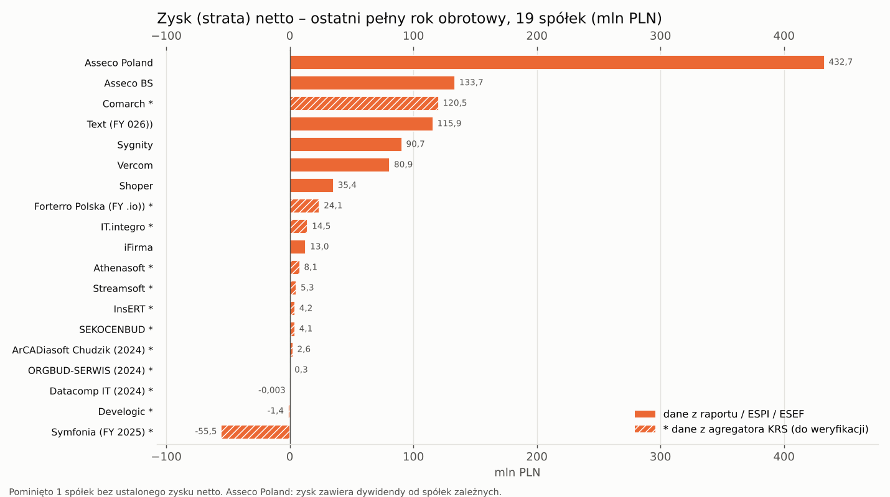
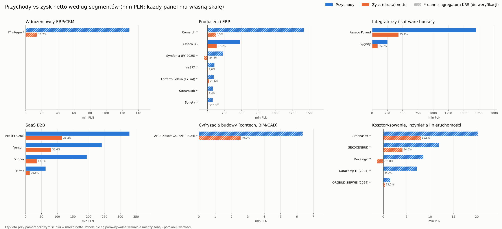

# Polskie spółki IT dla przedsiębiorstw i cyfryzacja budownictwa

*Stan na 20.11.2026 · 20 podmiotów · kwoty w tys. PLN · dane jednostkowe, o ile nie zaznaczono inaczej. `*` = dane z agregatora KRS/prasy, do weryfikacji.*

Pliki: [`raport_spolki_it_polska.html`](raport_spolki_it_polska.html) (wersja interaktywna) · [`spolki_it_polska_dane_finansowe.csv`](spolki_it_polska_dane_finansowe.csv) · [`charts/`](charts/) · [`reports/`](reports/)

## 1. Metodologia

**Zakres.** Zestawienie obejmuje firmy IT dla przedsiębiorstw działające w Polsce, ze szczególnym uwzględnieniem cyfryzacji budownictwa. Powstało w dwóch rundach: 20 spółek w pierwszej, ok. 80 w drugiej (biura projektowe, wdrożeniowcy, contech, kosztorysowanie, chmura i cyberbezpieczeństwo). Firmy pogrupowano w 9 segmentów.

**Identyfikacja (KRS, NIP, REGON).** Oficjalne API KRS i przeglądarka RDF blokowały adres IP środowiska badawczego. Numery ustalono ze źródeł wtórnych: stopek i regulaminów stron firm, rejestr.io, imsig.pl (MSiG), krs-pobierz.pl, aleo.com, bizraport.pl i raportów ESPI. **Żaden numer nie został potwierdzony bezpośrednio w eKRS.** Przed użyciem formalnym należy je sprawdzić w wyszukiwarce KRS.

**Dane finansowe mają dwa poziomy wiarygodności.**

- **raport** – liczby odczytane z formularza RR ESPI/EBI, sprawozdania ESEF lub raportu rocznego (głównie spółki z GPW i NewConnect);
- **agregator*** – liczby ze sprawozdań złożonych do KRS, odczytane pośrednio z serwisów agregujących (rejestr.io, bizraport, aleo, firmy.ai, okredo i in.) lub z prasy. Nie zostały zweryfikowane z dokumentem, a status badania przez biegłego jest nieznany.

**Rok obrotowy.** Ostatni pełny rok: 2025, gdy był dostępny, w przeciwnym razie 2024. Wyjątki (np. rok kończący się 31.03 lub 30.09) są zaznaczone. Nie użyto okresów częściowych. Dane są jednostkowe (spółka matka), chyba że kolumna typ raportu mówi inaczej.

**Związek z budownictwem** oceniono w skali: rdzeń / oferta dedykowana / pośredni / marginalny / brak. Każda ocena ma źródło w karcie firmy.

**Wskaźniki.** Marża netto = zysk netto / przychody. EBITDA obliczona jako EBIT + amortyzacja jest oznaczona.

## 2. Segmenty

| Segment | Spółek | Suma przychodów | Mediana przychodów | Mediana marży netto | Rdzeń / oferta budowlana |
|---|---:|---:|---:|---:|---:|
| Biura projektowe (BIM) | 0 | 0 | nie ustalono | n/d | 0 |
| Wdrożeniowcy ERP/CRM | 1 | 128 935 | 128 935 | 11,2% | 0 |
| Producenci ERP | 7 | 2 483 361 | 103 887 | 7,4% | 2 |
| Integratorzy i software house'y | 2 | 1 955 859 | 977 930 | 30,7% | 0 |
| SaaS B2B | 4 | 826 794 | 217 166 | 27,1% | 0 |
| Obieg dokumentów / BPM / KSeF | 0 | 0 | nie ustalono | n/d | 0 |
| Cyfryzacja budowy (contech, BIM/CAD) | 1 | 6 354 | 6 354 | 40,2% | 1 |
| Kosztorysowanie, inżynieria i nieruchomości | 5 | 49 480 | 8 600 | 22,5% | 5 |
| Chmura / data center / cyberbezpieczeństwo | 0 | 0 | nie ustalono | n/d | 0 |

## 3. Tabela zbiorcza

| # | Firma | KRS | Segment | Główny produkt / usługa | Budownictwo | Rok | Przychody | Zysk netto | Marża | Dane |
|---|---|---|---|---|---|---|---:|---:|---:|---|
| 1 | Asseco Poland S.A. | 0000033391 | Integratorzy i software house'y | Własne systemy dla bankowości, ubezpieczeń, administracji, zdrowia, energetyki; wdrożenia ERP (m.in. Microsoft Dynamics) | pośredni | 2025 | 1 703 400 | 432 700 | 25,4% | [link](https://money2.wpcdn.pl/gielda/gpw/raporty/2026/03/20260331_191944_0510033759_YE25_Sprawozdanie_jednostkowe_Asseco_Poland.xhtml) |
| 2 | Comarch S.A. | 0000057567 | Producenci ERP | Comarch ERP XL / Optima / Altum, CRM i lojalność, OSS/BSS, systemy dla finansów i zdrowia, chmura/data center | pośredni | 2025 | 1 417 910* | 120 493* | 8,5% | [link](https://www.comarch.pl/files-pl/file_1234/Comarch-Raport-Roczny-2025.pdf) |
| 3 | Asseco Business Solutions S.A. | 0000028257 | Producenci ERP | Macrologic ERP, Softlab ERP, WAPRO ERP (KSeF), Asseco HR, Mobile Touch (SFA), e-commerce B2B | oferta dedykowana | 2025 | 478 358 | 133 689 | 27,9% | [link](https://assecobs.pl/wp-content/uploads/2025/04/Jednostkowe_Sprawozdanie_finansowe_ABS_2025.xhtml) |
| 4 | Text S.A. | 0000290756 | SaaS B2B | LiveChat, ChatBot, HelpDesk, KnowledgeBase, OpenWidget - SaaS do obsługi klienta i sprzedaży z AI | marginalny | 2025/26 (01.04.2025-31.03.2026) | 329 073 | 115 935 | 35,2% | [link](https://investor.text.com/uploads/txt_spraw_zarzadu-2026-03-31-1-pl.xhtml) |
| 5 | Sygnity S.A. | 0000008162 | Integratorzy i software house'y | Systemy dedykowane i własne dla administracji publicznej, finansów, energetyki; utrzymanie i outsourcing | brak | 2025 | 252 459 | 90 690 | 35,9% | [link](https://money2.wpcdn.pl/gielda/gpw/raporty/2026/03/20260324_204010_1904899437_JSF-Sygnity-2025-12-31-1-pl.xhtml) |
| 6 | Vercom S.A. | 0000535618 | SaaS B2B | Platformy komunikacji API: SMSAPI, EmailLabs, Mailjet (e-mail i SMS transakcyjne/marketingowe) | brak | 2025 | 240 864 | 80 885 | 33,6% | [link](https://money2.wpcdn.pl/gielda/gpw/raporty/2026/03/20260318_065948_1206312055_JSF_vrc-2025-12-31-1-pl.xhtml) |
| 7 | Symfonia sp. z o.o. | 0000228956 | Producenci ERP | Symfonia ERP (FK, kadry-płace, handel, produkcja), rozwiązania chmurowe; od 12.2025 Develogic ERP dla budownictwa | oferta dedykowana | 01.10.2024-30.09.2025 | 227 960* | -55 537* | -24,4% | [link](https://rejestr.io/krs/228956/symfonia/sprawozdania) |
| 8 | Shoper S.A. | 0000395171 | SaaS B2B | Platforma SaaS do sklepów internetowych (abonament) z płatnościami, logistyką i marketingiem | marginalny | 2025 | 193 467 | 35 409 | 18,3% | [link](https://money2.wpcdn.pl/gielda/gpw/raporty/2026/03/20260318_070317_0996477630_JSF-Shoper-2025-12-31.xhtml) |
| 9 | IT.integro sp. z o.o. | 0000014040 | Wdrożeniowcy ERP/CRM | Wdrożenia Microsoft Dynamics 365 Business Central; ponad 30 aplikacji na Microsoft AppSource | brak | 2025 | 128 935* | 14 479* | 11,2% | [link](https://rejestr.io/krs/14040/it-integro) |
| 10 | InsERT S.A. | 0000306888 | Producenci ERP | Subiekt, Rachmistrz, Rewizor, Gratyfikant (linie GT i nexo), integracja z KSeF | brak | 2025 | 103 887* | 4 174* | 4,0% | [link](https://rejestr.io/krs/306888/insert/sprawozdania) |
| 11 | Forterro Polska sp. z o.o. | 0000705385 | Producenci ERP | BPSC ERP (dawniej Impuls EVO): finanse, HR, produkcja/MES, sprzedaż, logistyka, CRM, zarządzanie projektami | brak | 2025 (prawdopodobnie - wg etykiety rejestr.io) | 93 963* | 24 058* | 25,6% | [link](https://rejestr.io/krs/705385/forterro-polska) |
| 12 | Streamsoft sp. z o.o. sp.k. | 0000443818 | Producenci ERP | Streamsoft Verto, Streamsoft Prestiż (finanse, kadry-płace, handel, logistyka, produkcja, BI) | marginalny | 2025 | 84 700* | 5 304* | 6,3% | [link](https://rejestr.io/krs/443818) |
| 13 | Soneta sp. z o.o. | 0000109244 | Producenci ERP | enova365 (FK, kadry-płace, handel/magazyn, CRM, workflow, BI), TRIVA | pośredni | 2025 | 76 583* | nie ustalono | nie ustalono | [link](https://sprawozdaniaonline.pl/SprawozdaniaFinansowe/0000109244/SONETA-SPOLKA-Z-OGRANICZONA-ODPOWIEDZIALNOSCIA) |
| 14 | iFirma S.A. | 0000281947 | SaaS B2B | ifirma.pl - księgowość i fakturowanie online z integracją KSeF; usługi biura rachunkowego | brak | 2025 | 63 390 | 13 017 | 20,5% | [link](https://www.ifirma.pl/wp-content/raporty-xml/SAR-2025/raportroczny-SAR_08RoczneSF2025.xhtml) |
| 15 | Athenasoft sp. z o.o. | 0000035122 | Kosztorysowanie, inżynieria i nieruchomości | Norma EXPERT, Norma STANDARD 2, Norma PRO; baza cen INTERCENBUD | rdzeń | 2025 | 20 212* | 8 051* | 39,8% | [link](https://rejestr.io/krs/35122/athenasoft) |
| 16 | SEKOCENBUD sp. z o.o. | 0000092639 | Kosztorysowanie, inżynieria i nieruchomości | System cen SEKOCENBUD (biuletyny, SEKOCENBUD NET), program kosztorysowy SeKo | rdzeń | 2025 | 11 925* | 4 132* | 34,6% | [link](https://rejestr.io/krs/92639/sekocenbud) |
| 17 | Develogic sp. z o.o. | 0000873823 | Kosztorysowanie, inżynieria i nieruchomości | Develogic ERP: budżetowanie inwestycji, zakupy i umowy z podwykonawcami, zarządzanie budową, CRM i sprzedaż lokali, finanse | rdzeń | 2025 | 8 600* | -1 375* | -16,0% | [link](https://rejestr.io/krs/873823/develogic) |
| 18 | Datacomp IT sp. z o.o. | 0000936569 | Kosztorysowanie, inżynieria i nieruchomości | ZUZIA (kosztorysowanie robót budowlanych, instalacyjnych, drogowych, telekom.), ZUZIAbim | rdzeń | 2024 | 7 232* | -3* | -0,0% | [link](https://rejestr.io/krs/936569/datacomp-it) |
| 19 | ArCADiasoft Chudzik sp. j. | 0000316955 | Cyfryzacja budowy (contech, BIM/CAD) | ArCADia BIM (architektura, instalacje, konstrukcje), ArCADia-RAMA, INTERsoft | rdzeń | 2024 | 6 354* | 2 554* | 40,2% | [link](https://rejestr.io/krs/316955/arcadiasoft-chudzik) |
| 20 | ORGBUD-SERWIS sp. z o.o. | 0000153986 | Kosztorysowanie, inżynieria i nieruchomości | Informatory cenowe dla budownictwa, kursy kosztorysowania, dystrybucja programu KOBRA, księgarnia techniczna | rdzeń | 2024 | 1 511* | 340* | 22,5% | [link](https://rejestr.io/krs/153986/orgbud-serwis) |

## 4. Wykresy

## 5. Analiza

(analiza zostanie uzupełniona)

## 6. Firmy – dane szczegółowe

### Wdrożeniowcy ERP/CRM (1)

**IT.integro sp. z o.o.** — Integrator / wdrożeniowiec ERP (partner Microsoft Dynamics 365) + ISV
- KRS 0000014040 · NIP 7780021279 · REGON 632507882 · ul. Ząbkowicka 12, 60-166 Poznań (wg KRS; część serwisów podaje adres w Warszawie) · https://itintegro.com
- Partner Microsoft Dynamics od 1991 r.; wdraża Business Central w Polsce i ponad 60 krajach; obsługuje usługi profesjonalne, handel/dystrybucję, produkcję i logistykę.
- Budownictwo (brak): Brak potwierdzonego związku
- Finanse 2025 (jednostkowe (agregator: bizraport/aleo), status badania nie ustalono; agregator*): przychody 128 935, zysk brutto ze sprzedaży nie ustalono, EBIT 15 400, EBITDA nie ustalono, zysk netto 14 479; dane: https://rejestr.io/krs/14040/it-integro
- Uwagi: Przychody = przychody netto ze sprzedaży produktów ok. 128,9 mln zł (razem ok. 132,9 mln zł); EBIT ok. 15,4 mln zł. Źródła: https://www.bizraport.pl/krs/0000014040/it-integro-spolka-z-ograniczona-odpowiedzialnoscia, https://aleo.com/int/company/it.-integro-spolka-z-ograniczona-odpowiedzialnoscia

### Producenci ERP (7)

**Comarch S.A.** — Producent ERP/SaaS + integrator IT (od 26.03.2025 poza GPW)
- KRS 0000057567 · NIP 6770065406 · REGON 350527377 · al. Jana Pawła II 39A, 31-864 Kraków · https://www.comarch.pl
- Polski producent oprogramowania i integrator. Linie ERP dla MŚP i dużych firm (XL, Optima, Altum, w tym w chmurze), systemy dla telekomów, bankowości, ubezpieczeń, handlu, sektora publicznego i zdrowia; własne centra danych.
- Budownictwo (pośredni): Pośredni: case studies Comarch ERP XL/CDN XL w firmach budowlanych ALSTAL Grupa Budowlana (https://www.comarch.pl/files-pl/file_111/ALSTALGB-CS.pdf) i ELMO SA (https://www.comarch.pl/files-pl/file_115/ELMO-SA.pdf); brak dedykowanego modułu budowlanego
- Finanse 2025 (jednostkowe (agregator, dane z KRS); grupa: skonsolidowane z raportu rocznego; agregator*): przychody 1 417 910, zysk brutto ze sprzedaży nie ustalono, EBIT nie ustalono, EBITDA nie ustalono, zysk netto 120 493; dane: https://www.comarch.pl/files-pl/file_1234/Comarch-Raport-Roczny-2025.pdf; plik: `reports/Comarch_2025_raport_roczny.pdf`
- Uwagi: Raport roczny 2025 (PDF) podaje tylko dane Grupy: przychody 1 714 mln zł (+6% r/r), EBITDA 381 mln zł, zakontraktowanie 1 935 mln zł - zweryfikowane w PDF. Dane jednostkowe 2025 (przychody netto 1 417 910 tys., zysk netto 120 493 tys.) pochodzą z bizraport.pl (sprawozdanie z KRS) i nie zostały zweryfikowane w dokumencie źródłowym. Kontrolnie: jednostkowe 2024 wg QSr 4/2024: przychody 1 341 703 tys., zysk netto 112 402 tys. (https://www.comarch.pl/files-pl/file_793/QSr_4_2024.pdf).

**Asseco Business Solutions S.A.** — Dostawca ERP / producent SaaS (GPW: ABS)
- KRS 0000028257 · NIP 5222612717 · REGON 017293003 · ul. Konrada Wallenroda 4C, 20-607 Lublin · https://assecobs.pl
- Producent własnych systemów ERP dla MŚP i dużych firm (on-premise i chmura), systemów HR, mobilnych systemów sprzedaży i platform B2B; klienci z produkcji, dystrybucji, FMCG, usług i biur rachunkowych.
- Budownictwo (oferta dedykowana): Bezpośredni (oferta branżowa): strona 'ERP dla budownictwa' - budżety i harmonogramy projektów, kosztorysy, rezerwacja sprzętu, rozliczanie per projekt/budowa, faktury powiązane z protokołami odbioru (https://assecobs.pl/erp/construction/?lang=en)
- Finanse 2025 (jednostkowe (MSSF), badane; raport): przychody 478 358, zysk brutto ze sprzedaży 212 308, EBIT 145 803, EBITDA 186 377, zysk netto 133 689; dane: https://assecobs.pl/wp-content/uploads/2025/04/Jednostkowe_Sprawozdanie_finansowe_ABS_2025.xhtml; plik: `reports/Asseco_Business_Solutions_2025_jednostkowe_sprawozdanie_finansowe.pdf`
- Uwagi: Wybrane dane: https://assecobs.pl/wp-content/uploads/2025/04/2025_Wybrane_dane_finansowe_Asseco_Business_Solutions.xhtml. Skonsolidowane 2025: przychody ok. 476,8 mln zł, zysk netto ok. 132,7-132,9 mln zł (prezentacja wyników).

**Symfonia sp. z o.o.** — Dostawca ERP / HR / SaaS (dawniej Sage Symfonia; właściciel: Accel-KKR)
- KRS 0000228956 · NIP 5262831503 · REGON 140045209 · Al. Jerozolimskie 132, 02-305 Warszawa · https://symfonia.pl
- Producent oprogramowania ERP, HR i księgowego dla MŚP i średnich firm; rośnie przez akwizycje (Polska, Rumunia, Austria); wdrożenia własne i przez partnerów.
- Budownictwo (oferta dedykowana): Silny: przejęcie Develogic (ERP dla deweloperów i GW) w grudniu 2025 (https://symfonia.pl/blog/aktualnosci-symfonii/develogic-dolacza-do-grupy-symfonia-nowy-etap-na-drodze-do-cyfryzacji-branzy-budowlanej/), strona 'ERP dla firm budowlanych' (https://symfonia.pl/erp/erp-dla-firm-budowlanych/), referencje Karmar, Marvipol
- Finanse 01.10.2024-30.09.2025 (jednostkowe (agregator: firmy.ai/rejestr.io), status badania nie ustalono; agregator*): przychody 227 960, zysk brutto ze sprzedaży nie ustalono, EBIT nie ustalono, EBITDA 29 640, zysk netto -55 537; dane: https://rejestr.io/krs/228956/symfonia/sprawozdania
- Uwagi: Rok obrotowy do 30 września. Rozbieżność: strata -55,5 mln zł (jednostkowa wg firmy.ai/rejestr.io) vs -37,5 mln zł (skonsolidowana wg bizraport.pl). Grupa Symfonia: ok. 250 mln zł przychodu za rok do 30.09.2024 (https://itwiz.pl/grupa-symfonia-z-blisko-250-mln-zl-przychodu-za-2024-rok/). Źródła: https://firmy.ai/KRS/0000228956, https://www.bizraport.pl/krs/0000228956/symfonia-spolka-z-ograniczona-odpowiedzialnoscia

**InsERT S.A.** — Dostawca ERP / oprogramowania księgowego dla MŚP
- KRS 0000306888 · NIP 8981945134 · REGON 932283479 · ul. Jerzmanowska 2, 54-519 Wrocław · https://www.insert.com.pl
- Producent masowego oprogramowania dla mikro i małych firm oraz biur rachunkowych (sprzedaż/magazyn, księgowość, kadry-płace); dystrybucja przez sieć partnerów.
- Budownictwo (brak): Brak dedykowanego modułu (jedynie rekomendacje partnerów dla małych firm remontowych)
- Finanse 2025 (jednostkowe (agregator: bizraport/rejestr.io), status badania nie ustalono; agregator*): przychody 103 887, zysk brutto ze sprzedaży nie ustalono, EBIT 4 460, EBITDA nie ustalono, zysk netto 4 174; dane: https://rejestr.io/krs/306888/insert/sprawozdania
- Uwagi: Przychody = przychody operacyjne ok. 103,9 mln zł (przychody ogółem 104,2 mln zł); pozycja 'przychody netto ze sprzedaży' nie została wyodrębniona. 2024: przychody ok. 91,3-91,6 mln zł, zysk netto 4,3 mln zł. Źródło: https://www.bizraport.pl/krs/0000306888/insert-spolka-akcyjna

**Forterro Polska sp. z o.o. (dawniej BPSC)** — Dostawca i wdrożeniowiec ERP/MES (Grupa Forterro)
- KRS 0000705385 · NIP 6340134346 · REGON 003469134 · Al. Walentego Roździeńskiego 188H, 40-203 Katowice · https://www.bpsc.com.pl
- Producent i wdrożeniowiec własnego systemu ERP, głównie dla przemysłu (m.in. Famur, Tauron, GH Cranes); od 2025 r. pod nazwą Forterro Polska.
- Budownictwo (brak): Brak potwierdzonego związku (referencje z przemysłu)
- Finanse 2025 (prawdopodobnie - wg etykiety rejestr.io) (jednostkowe (agregator: rejestr.io/bizraport), status badania nie ustalono; agregator*): przychody 93 963, zysk brutto ze sprzedaży nie ustalono, EBIT 28 371, EBITDA nie ustalono, zysk netto 24 058; dane: https://rejestr.io/krs/705385/forterro-polska
- Uwagi: Przychody netto ze sprzedaży 93 963 tys. (przychody ogółem 96 859 tys.). Rok przypisany na podstawie rejestr.io ('dane za 2025'); bizraport nie podaje roku. Źródło: https://www.bizraport.pl/krs/0000705385/forterro-polska-spolka-z-ograniczona-odpowiedzialnoscia; zmiana nazwy: https://www.bpsc.com.pl/pl/aktualnosci/forterro-polska-zamiast-bpsc

**Streamsoft sp. z o.o. sp.k.** — Dostawca i wdrożeniowiec ERP (MŚP i średnie firmy)
- KRS 0000443818 · NIP 9291851723 · REGON 081108705 · Al. Wojska Polskiego 11, 65-077 Zielona Góra · https://streamsoft.pl
- Producent ERP z ponad 5000 klientów; wdrożenia bezpośrednie i przez partnerów, m.in. dystrybucja stali (Centrostal), stolarka okienna (Plastixal).
- Budownictwo (marginalny): Pośredni/marginalny: klienci z branży materiałów budowlanych (Centrostal, Plastixal), brak klientów-wykonawców
- Finanse 2025 (jednostkowe (agregator: bizraport/aleo), status badania nie ustalono; agregator*): przychody 84 700, zysk brutto ze sprzedaży nie ustalono, EBIT 6 530, EBITDA nie ustalono, zysk netto 5 304; dane: https://rejestr.io/krs/443818
- Uwagi: Rozbieżność: analizafirm.pl podaje przychody netto 92 410 tys. i zysk netto ok. 6 780 tys. Komplementariusz: Streamsoft sp. z o.o. (KRS 0000434736). Źródła: https://www.bizraport.pl/krs/0000443818/streamsoft-spolka-z-ograniczona-odpowiedzialnoscia-spolka-komandytowa, https://analizafirm.pl/firma/0000443818/streamsoft

**Soneta sp. z o.o. (enova365)** — Dostawca ERP / HR (kanał partnerski)
- KRS 0000109244 · NIP 6792705304 · REGON 356381673 · ul. J. Kustronia 44A, 30-432 Kraków · https://www.enova.pl
- Producent systemu ERP enova365 sprzedawanego przez sieć partnerów wdrożeniowych firmom MŚP i większym w wielu branżach.
- Budownictwo (pośredni): Pośredni (przez partnerów): system zarządzania budową na enova365 dla BPBP S.A. (https://www.enova.pl/content/uploads/2025/09/enova365-bpbp-s.a.-case-study-mg-rozszerzone.pdf), wdrożenie PEUiM (https://www.enova.pl/content/uploads/2026/01/peuim.pdf), Corleonis (wynajem żurawi)
- Finanse 2025 (jednostkowe (agregator: sprawozdaniaonline.pl), status badania nie ustalono; agregator*): przychody 76 583, zysk brutto ze sprzedaży nie ustalono, EBIT nie ustalono, EBITDA nie ustalono, zysk netto nie ustalono; dane: https://sprawozdaniaonline.pl/SprawozdaniaFinansowe/0000109244/SONETA-SPOLKA-Z-OGRANICZONA-ODPOWIEDZIALNOSCIA
- Uwagi: Zysk netto 2025 nie ustalono (EMIS podaje jedynie dynamikę +106% r/r). 2023: przychody ok. 61,7 mln zł, zysk netto 8 051 tys. zł (gowork.pl). Spółka z grupy Asseco.

### Integratorzy i software house'y (2)

**Asseco Poland S.A.** — Integrator IT / producent oprogramowania (GPW: ACP)
- KRS 0000033391 · NIP 5220003782 · REGON 010334578 · ul. Olchowa 14, 35-322 Rzeszów · https://pl.asseco.com
- Największy polski producent oprogramowania i spółka matka międzynarodowej Grupy Asseco. Projektuje, wdraża i utrzymuje systemy dla finansów, sektora publicznego (m.in. ZUS), ochrony zdrowia, utilities i przedsiębiorstw.
- Budownictwo (pośredni): Pośredni: case study wdrożenia Microsoft Dynamics AX z modyfikacjami branżowymi (rejestr umów, kaucje gwarancyjne inwestor/podwykonawca) w Eiffage Budownictwo Mitex S.A. (https://pl.asseco.com/en/case-study/eiffage-budownictwo-mitex-sa-microsoft-dynamix-ax-60)
- Finanse 2025 (jednostkowe (MSSF), badane; raport): przychody 1 703 400, zysk brutto ze sprzedaży 551 200, EBIT 342 600, EBITDA 414 300, zysk netto 432 700; dane: https://money2.wpcdn.pl/gielda/gpw/raporty/2026/03/20260331_191944_0510033759_YE25_Sprawozdanie_jednostkowe_Asseco_Poland.xhtml; plik: `reports/Asseco_Poland_2025_jednostkowe_sprawozdanie_finansowe.pdf`
- Uwagi: Przychody = 'przychody operacyjne' MSSF. Zysk netto zawiera wysokie przychody finansowe (dywidendy od spółek zależnych) - dlatego zysk netto > EBIT. Skonsolidowane 2025: przychody 16 779,8 mln zł, zysk netto przypisany akcjonariuszom 1 138,7 mln zł (z zyskiem ok. 499 mln zł ze sprzedaży akcji Sapiens). ESPI RR: https://www.money.pl/gielda/raporty/raport,plsoftb00016,7271046741824577.html

**Sygnity S.A.** — Integrator IT / konsultant IT (GPW: SGN)
- KRS 0000008162 · NIP 5860005293 · REGON 190407926 · ul. Postępu 17B, 02-676 Warszawa · https://www.sygnity.pl
- Integrator i producent oprogramowania, głównie dla administracji centralnej i samorządowej, bankowości, ubezpieczeń, energetyki i przedsiębiorstw; budowa systemów dedykowanych, utrzymanie, outsourcing.
- Budownictwo (brak): Brak potwierdzonego związku
- Finanse 2025 (jednostkowe (MSSF), badane; raport): przychody 252 459, zysk brutto ze sprzedaży 118 336, EBIT 87 099, EBITDA 92 351, zysk netto 90 690; dane: https://money2.wpcdn.pl/gielda/gpw/raporty/2026/03/20260324_204010_1904899437_JSF-Sygnity-2025-12-31-1-pl.xhtml; plik: `reports/Sygnity_2025_jednostkowe_sprawozdanie_finansowe.pdf`
- Uwagi: ESPI RR: https://www.money.pl/gielda/raporty/raport,plcmpld00016,7268229468722241.html. Skonsolidowane 2025: przychody 350 256 tys., EBIT 89 482 tys., zysk netto 77 260 tys. (wg komunikatów; nie weryfikowano w SSF).

### SaaS B2B (4)

**Text S.A. (dawniej LiveChat Software S.A.)** — Producent SaaS (GPW: TXT)
- KRS 0000290756 · NIP 8992447196 · REGON 932803200 · ul. Zwycięska 47, 53-033 Wrocław · https://www.text.com
- Producent globalnych aplikacji SaaS do komunikacji z klientem; sprzedaż głównie za granicą (USD), klienci z wielu branż.
- Budownictwo (marginalny): Marginalny: strona marketingowa 'LiveChat for construction companies' (https://www.livechat.com/solutions/construction-companies/); brak potwierdzonych wdrożeń
- Finanse 2025/26 (01.04.2025-31.03.2026) (jednostkowe (MSR od 01.04.2024), badane; raport): przychody 329 073, zysk brutto ze sprzedaży 222 320, EBIT 126 258, EBITDA 152 654, zysk netto 115 935; dane: https://investor.text.com/uploads/txt_spraw_zarzadu-2026-03-31-1-pl.xhtml; plik: `reports/Text_2025-26_sprawozdanie_zarzadu.pdf`
- Uwagi: Rok obrotowy kończy się 31 marca - nieporównywalny 1:1 z rokiem kalendarzowym. Skonsolidowane 2025/26: zysk netto 116,6 mln zł, EBITDA 153,3 mln zł.

**Vercom S.A.** — Producent SaaS / CPaaS (GPW: VRC)
- KRS 0000535618 · NIP 7811765125 · REGON 300061423 · ul. Wierzbięcice 1B, 61-569 Poznań · https://vercom.pl
- Dostawca platform CPaaS do automatyzacji komunikacji e-mail/SMS z klientami; obsługuje e-commerce, handel, finanse i firmy technologiczne w Polsce i za granicą.
- Budownictwo (brak): Brak potwierdzonego związku
- Finanse 2025 (jednostkowe (MSSF), badane; raport): przychody 240 864, zysk brutto ze sprzedaży nie ustalono, EBIT 72 834, EBITDA 80 810, zysk netto 80 885; dane: https://money2.wpcdn.pl/gielda/gpw/raporty/2026/03/20260318_065948_1206312055_JSF_vrc-2025-12-31-1-pl.xhtml; plik: `reports/Vercom_2025_jednostkowe_sprawozdanie_finansowe.pdf`
- Uwagi: Spadek przychodów jednostkowych r/r (288 004 -> 240 864 tys.). Skonsolidowane 2025: przychody 471 152 tys., zysk netto akcjonariuszy 89 866 tys. ESPI RR: https://www.money.pl/gielda/raporty/raport,plvrcm000016,7266106906333761.html

**Shoper S.A. (od 01.09.2026 przejęta przez cyber_Folks S.A.)** — Producent SaaS (e-commerce)
- KRS 0000395171 · NIP 9452156998 · REGON 121495203 · ul. Pawia 9, 31-154 Kraków (do połączenia) · https://www.shoper.pl
- Polska platforma SaaS e-commerce dla MŚP; segment Subscriptions i Solutions (płatności, wysyłki, marketing).
- Budownictwo (marginalny): Marginalny: poradnik sprzedaży artykułów budowlanych online, klienci-sklepy z wyrobami dla budownictwa (np. e-armet.pl); brak modułu branżowego
- Finanse 2025 (jednostkowe (MSSF), badane; raport): przychody 193 467, zysk brutto ze sprzedaży nie ustalono, EBIT 45 187, EBITDA 61 366, zysk netto 35 409; dane: https://money2.wpcdn.pl/gielda/gpw/raporty/2026/03/20260318_070317_0996477630_JSF-Shoper-2025-12-31.xhtml; plik: `reports/Shoper_2025_jednostkowe_sprawozdanie_finansowe.pdf`
- Uwagi: Połączenie z cyber_Folks S.A. (KRS 0000685595) zarejestrowane 01.09.2026 - Shoper S.A. jako podmiot przejmowany przestaje istnieć; FY2025 to ostatni pełny rok samodzielny. Skonsolidowane 2025: przychody 217 974 tys., zysk netto 43 083 tys. ESPI RR: https://www.money.pl/gielda/raporty/raport,plshpr000021,7266106714673729.html

**iFirma S.A.** — Producent SaaS (księgowość, fakturowanie, KSeF) + biuro rachunkowe online (GPW: IFI)
- KRS 0000281947 · NIP 8981647572 · REGON 931082394 · ul. Grabiszyńska 241G, 53-234 Wrocław · https://www.ifirma.pl
- Internetowa księgowość i fakturowanie w modelu SaaS dla JDG i małych spółek, z bezpłatną integracją z KSeF (wysyłka faktur sprzedaży, import zakupowych) i usługami biura rachunkowego.
- Budownictwo (brak): Brak dedykowanego modułu (obsługa KSeF ogólnobranżowa)
- Finanse 2025 (jednostkowe (UoR), badane (4Audyt); raport): przychody 63 390, zysk brutto ze sprzedaży nie ustalono, EBIT 15 455, EBITDA 15 926, zysk netto 13 017; dane: https://www.ifirma.pl/wp-content/raporty-xml/SAR-2025/raportroczny-SAR_08RoczneSF2025.xhtml; plik: `reports/iFirma_2025_sprawozdanie_finansowe.pdf`
- Uwagi: Spółka publikuje wyłącznie raport jednostkowy. ESPI RR: https://www.money.pl/gielda/raporty/raport,plpwrmd00011,7266460758348353.html

### Cyfryzacja budowy (contech, BIM/CAD) (1)

**ArCADiasoft Chudzik sp. j.** — Dostawca rozwiązania budowlanego (BIM / projektowanie konstrukcji)
- KRS 0000316955 · NIP 7251676810 · REGON 471726120 · ul. Sienkiewicza 85/87, 90-057 Łódź · https://www.arcadiasoft.pl
- Polski producent oprogramowania BIM/CAD dla architektów, projektantów instalacji i konstruktorów; użytkownicy to głównie biura projektowe.
- Budownictwo (rdzeń): Rdzeń działalności: BIM i projektowanie budowlane (https://trade.gov.pl/en/?p=56696)
- Finanse 2024 (jednostkowe (agregator: bizraport), status badania nie ustalono; agregator*): przychody 6 354, zysk brutto ze sprzedaży nie ustalono, EBIT nie ustalono, EBITDA nie ustalono, zysk netto 2 554; dane: https://rejestr.io/krs/316955/arcadiasoft-chudzik
- Uwagi: Spółka jawna (wpisana do rejestru przedsiębiorców KRS). Przychody = przychody operacyjne. Aleo podaje inne etykiety lat (prawdopodobnie przesunięte). Powiązana INTERSOFT sp. z o.o. (KRS 0000126422).

### Kosztorysowanie, inżynieria i nieruchomości (5)

**Athenasoft sp. z o.o. (Norma, Intercenbud)** — Dostawca rozwiązania budowlanego (kosztorysowanie + cenniki)
- KRS 0000035122 · NIP 1131896687 · REGON 012924870 · ul. Leszczynowa 7, 03-197 Warszawa · https://ath.pl
- Producent wiodącego w Polsce oprogramowania kosztorysowego Norma oraz operator bazy cenowej INTERCENBUD; użytkownicy: kosztorysanci, projektanci, wykonawcy, inwestorzy, inspektorzy nadzoru, rzeczoznawcy.
- Budownictwo (rdzeń): Rdzeń działalności: kosztorysowanie i cenniki budowlane (https://ath.pl/pl-pl/produkty/baza-cen-intercenbud, https://blog.intercenbud.pl/kontakt/)
- Finanse 2025 (jednostkowe (agregator: bizraport/rejestr.io), status badania nie ustalono; agregator*): przychody 20 212, zysk brutto ze sprzedaży nie ustalono, EBIT nie ustalono, EBITDA nie ustalono, zysk netto 8 051; dane: https://rejestr.io/krs/35122/athenasoft
- Uwagi: Przychody netto ze sprzedaży 20 211,9 tys. (bizraport); rejestr.io ok. 20 980 tys. (prawdopodobnie przychody ogółem). Zysk netto 8 051,1 tys. - zgodny w dwóch serwisach. Etykieta roku 2025 niezweryfikowana datą złożenia. Intercenbud to marka Athenasoft, nie odrębna spółka.

**SEKOCENBUD sp. z o.o.** — Dostawca rozwiązania budowlanego (cenniki + kosztorysowanie)
- KRS 0000092639 · NIP 5260210441 · REGON 001266562 · ul. Puławska 182, 02-670 Warszawa · https://sekocenbud.pl
- Wydawca systemu informacji cenowej SEKOCENBUD (biuletyny drukowane i elektroniczne, portal cenowy) oraz programu kosztorysowego SeKo; do 30.06.2023 jako OWEOB 'Promocja' sp. z o.o.
- Budownictwo (rdzeń): Rdzeń działalności: ceny i kosztorysowanie robót budowlanych, wykorzystywane m.in. przez inwestorów publicznych (https://sekocenbud.pl/o-firmie/)
- Finanse 2025 (jednostkowe (agregator: rejestr.io), status badania nie ustalono; agregator*): przychody 11 925, zysk brutto ze sprzedaży nie ustalono, EBIT nie ustalono, EBITDA nie ustalono, zysk netto 4 132; dane: https://rejestr.io/krs/92639/sekocenbud
- Uwagi: 2024: przychody ok. 11,2 mln zł, zysk ok. 3,9 mln zł (aleo); 2023: 10 501 / 3 826 tys. (bizraport).

**Develogic sp. z o.o.** — Dostawca ERP dla budownictwa i deweloperów (od 12.2025 w Grupie Symfonia)
- KRS 0000873823 · NIP 8971731779 · REGON 020562490 · Poznań (adres ulicy nie potwierdzony w KRS) · https://develogic.pl
- ERP dla deweloperów, generalnych wykonawców, podwykonawców i inwestorów; sprzedawany wspólnie jako 'Symfonia + Develogic'.
- Budownictwo (rdzeń): Rdzeń działalności: ERP dla deweloperów i GW (https://symfonia.pl/oprogramowanie/branza-budowlana/)
- Finanse 2025 (jednostkowe (agregator: rejestr.io/nipregon), status badania nie ustalono; agregator*): przychody 8 600, zysk brutto ze sprzedaży nie ustalono, EBIT nie ustalono, EBITDA nie ustalono, zysk netto -1 375; dane: https://rejestr.io/krs/873823/develogic
- Uwagi: Przychody ok. 8,6 mln zł (zaokrąglone przez rejestr.io). 2024: przychody 7 886,6 tys., zysk netto 59,5 tys. (nipregon.pl). Średnia pewność przypisania marki do tego KRS (inny serwis podaje KRS 0000979250 - niezweryfikowane).

**Datacomp IT sp. z o.o. (ZUZIA)** — Dostawca rozwiązania budowlanego (kosztorysowanie, BIM 5D)
- KRS 0000936569 · NIP 6793228148 · REGON nie ustalono · Kraków (adres siedziby w KRS nie potwierdzony) · https://datacomp.com.pl
- Producent i sprzedawca pakietu kosztorysowego ZUZIA i ZUZIAbim (BIM + kosztorys) w modelu subskrypcji; klienci: kosztorysanci, wykonawcy, biura projektowe.
- Budownictwo (rdzeń): Rdzeń działalności: kosztorysowanie i BIM 5D (https://sklep.datacomp.com.pl/regulamin-sklepu-internetowego-datacomp/)
- Finanse 2024 (jednostkowe (agregator: okredo/gowork), status badania nie ustalono; agregator*): przychody 7 232, zysk brutto ze sprzedaży nie ustalono, EBIT nie ustalono, EBITDA nie ustalono, zysk netto -3; dane: https://rejestr.io/krs/936569/datacomp-it
- Uwagi: REGON nie ustalono; NIP z regulaminu sklepu (niepodwójnie sprawdzony). Bizraport podaje (bez roku, możliwie 2025): przychody 8 162,5 tys., strata 166,7 tys. Pierwotny producent DATACOMP sp. z o.o. (KRS 0000193067) w likwidacji.

**ORGBUD-SERWIS sp. z o.o.** — Dostawca rozwiązania budowlanego (cenniki, szkolenia, dystrybucja programów kosztorysowych)
- KRS 0000153986 · NIP 7780045280 · REGON 004866423 · ul. Stablewskiego 43, Poznań · https://orgbud.pl
- Poznański wydawca informacji cenowych dla budownictwa, organizator szkoleń kosztorysowych i dystrybutor oprogramowania kosztorysowego.
- Budownictwo (rdzeń): Rdzeń działalności: cenniki i kosztorysowanie (https://orgbud.pl/kontakt/)
- Finanse 2024 (jednostkowe (agregator: rejestr.io), status badania nie ustalono; agregator*): przychody 1 511, zysk brutto ze sprzedaży nie ustalono, EBIT nie ustalono, EBITDA nie ustalono, zysk netto 340; dane: https://rejestr.io/krs/153986/orgbud-serwis
- Uwagi: Mała spółka; bizraport podaje 1 447,0 / 273,9 tys. bez wskazania roku. Firma głównie odsprzedaje, a nie rozwija oprogramowanie.

## 7. Ograniczenia danych

- **Identyfikatory nie zweryfikowane w eKRS** (blokada IP). Tam, gdzie pewność jest niższa, opisano to w uwagach przy firmie.
- **Większość danych finansowych pochodzi z agregatorów.** Status badania nie jest znany, etykiety lat bywają przesunięte, a serwisy czasem się różnią. Rozbieżności opisano w uwagach.
- **Brak plików PDF dla spółek prywatnych.** E-sprawozdania XML są dostępne tylko w RDF, który był zablokowany. Lokalne PDF-y mają tylko spółki giełdowe z pierwszej rundy.
- **Różne lata i definicje.** Lata obrotowe różnią się między firmami. Przychody operacyjne (MSSF) to nie to samo co przychody netto ze sprzedaży (UoR), a zysku brutto ze sprzedaży nie ma w układzie rodzajowym.
- **Spółki zależne grup zagranicznych** (np. biura projektowe, dostawcy BIM/CAD) raportują w Polsce tylko polską spółkę. Jej przychody nie odzwierciedlają skali grupy, a część oddziałów nie publikuje danych.
- **Spółki osobowe i JDG** (część producentów oprogramowania kosztorysowego) nie mają KRS ani publicznych sprawozdań, dlatego je pominięto.
- **Zdarzenia po dniu bilansowym**: połączenia i przejęcia (np. Shoper → cyber_Folks, Develogic → Symfonia).
- Załącznik wspomniany w pierwszym poleceniu nie był dostępny. Raport opiera się wyłącznie na źródłach publicznych.

## 8. Weryfikacja oficjalna

- https://wyszukiwarka-krs.ms.gov.pl/
- https://rdf-przegladarka.ms.gov.pl/
