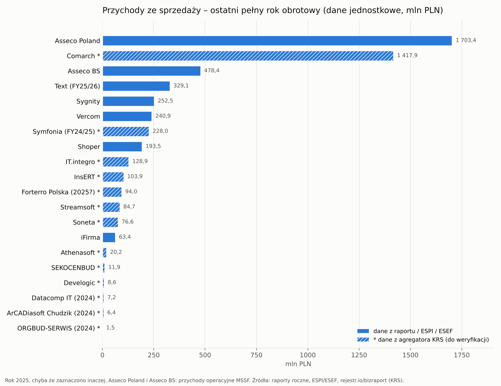

# Polskie spółki IT dla przedsiębiorstw: ERP, SaaS, wdrożenia i oprogramowanie dla budownictwa

*Stan wiedzy na 20.11.2026. Kwoty w tys. PLN, chyba że zaznaczono inaczej. Dane finansowe są jednostkowe (spółka matka), o ile nie zaznaczono inaczej.*

Pliki towarzyszące:
- dane: [`spolki_it_polska_dane_finansowe.csv`](spolki_it_polska_dane_finansowe.csv)
- wykresy: [`charts/`](charts/)
- pobrane raporty: [`reports/`](reports/)
- skrypt generujący CSV i wykresy: [`build.py`](build.py)

---

## 1. Metodologia

1. **Dobór spółek.** Wybrano 20 podmiotów w czterech grupach:
   - spółki IT z GPW (integratorzy i producenci ERP),
   - producenci SaaS z GPW,
   - prywatni dostawcy i wdrożeniowcy ERP,
   - producenci oprogramowania dla budownictwa (kosztorysowanie, cenniki, BIM, ERP dla deweloperów i GW).

   Kryteria: znacząca działalność w Polsce, oferta B2B, a w grupie budowlanej związek z budownictwem potwierdzony źródłem.
2. **Identyfikacja (KRS/NIP/REGON).** Oficjalne API KRS (`api-krs.ms.gov.pl`) i przeglądarka RDF (`rdf-przegladarka.ms.gov.pl`) zwracały z kontenera badawczego stronę „Przerwa techniczna” lub błąd 403. Prawdopodobnie blokują adresy IP spoza Polski.
   - Numery KRS, NIP i REGON ustalono więc z kilku niezależnych źródeł wtórnych: rejestr.io, imsig.pl (MSiG), bizraport.pl, aleo.com, stopek i regulaminów stron spółek oraz raportów ESPI.
   - Dla każdej spółki źródła były ze sobą zgodne. Wyjątki opisano w uwagach.
   - Mimo to **żaden numer nie został potwierdzony bezpośrednio w eKRS**. Przed użyciem formalnym (umowy, due diligence) zalecana jest weryfikacja w https://wyszukiwarka-krs.ms.gov.pl/.
3. **Dane finansowe, dwa poziomy wiarygodności.**
   - **Pierwotne** (8 spółek giełdowych i Comarch). Dane odczytano bezpośrednio z raportów rocznych:
     - formularze RR ESPI,
     - jednostkowe sprawozdania finansowe w formacie ESEF (xhtml) opublikowane przez GPW, czyli załączniki z serwera money2.wpcdn.pl (strony ESPI money.pl),
     - strony relacji inwestorskich.

     Zysk brutto ze sprzedaży i amortyzację (do EBITDA) odczytano ze sprawozdań ESEF.
   - **Agregator** (spółki prywatne, oznaczone `*` na wykresach i zakreskowane). Dane pochodzą ze sprawozdań złożonych do KRS, ale odczytano je pośrednio, z serwisów rejestr.io, bizraport.pl, aleo.com, firmy.ai, okredo.com i sprawozdaniaonline.pl (przez wyniki wyszukiwania; strony tych serwisów są dla automatów zablokowane).
     - Tych liczb nie zweryfikowano z dokumentem źródłowym.
     - Status badania przez biegłego nie jest znany.
4. **Rok obrotowy.** Dla każdej spółki użyto ostatniego pełnego roku obrotowego:
   - 2025 tam, gdzie był dostępny;
   - 2024 dla trzech małych spółek, dla których nie znaleziono danych za 2025;
   - inne lata obrotowe: Text S.A. 04.2025–03.2026, Symfonia 10.2024–09.2025.

   Nie użyto danych za okresy częściowe (kwartały, półrocza).
5. **Pobranie raportów.** Pliki PDF zapisano w `reports/`.
   - Sprawozdania opublikowane wyłącznie w formacie ESEF (xhtml) wyrenderowano do PDF przeglądarką Chromium bez modyfikacji treści. Oryginalne linki xhtml podano w tabeli.
   - Dla spółek prywatnych pliki PDF nie były dostępne (RDF zablokowany), patrz sekcja 5.
6. **Wskaźniki.** Marża netto = zysk netto / przychody. Tam, gdzie spółka nie raportuje EBITDA, obliczono ją jako EBIT + amortyzacja z rachunku przepływów i tak ją oznaczono.

---

## 2. Lista spółek (20)

Legenda związku z budownictwem:
- **RDZEŃ**: budownictwo to główny rynek.
- **DEDYKOWANA OFERTA**: spółka ma osobny produkt lub ofertę dla budownictwa.
- **POŚREDNI**: potwierdzone wdrożenia u firm budowlanych, ale bez produktu branżowego.
- **MARGINALNY / BRAK**: związek śladowy lub żaden.

### A. Spółki giełdowe (dane pierwotne)

**1. Asseco Poland S.A.**
- **Rejestr:** spółka akcyjna, KRS 0000033391, NIP 5220003782, REGON 010334578.
- **Siedziba:** ul. Olchowa 14, 35-322 Rzeszów. **WWW:** https://pl.asseco.com
- **Kategoria:** integrator IT / producent oprogramowania.
- **Działalność:** największy polski producent oprogramowania, spółka matka Grupy Asseco. Tworzy i wdraża systemy dla bankowości, ubezpieczeń, administracji (m.in. ZUS), ochrony zdrowia i energetyki. Wdraża też ERP, m.in. Microsoft Dynamics.
- **Budownictwo – POŚREDNI:** wdrożenie Dynamics AX z modyfikacjami budowlanymi (rejestr umów, kaucje gwarancyjne inwestor/podwykonawca) w Eiffage Budownictwo Mitex ([case study](https://pl.asseco.com/en/case-study/eiffage-budownictwo-mitex-sa-microsoft-dynamix-ax-60)).
- **Finanse 2025** (jednostkowe, MSSF, badane, publ. 31.03.2026):

  | Pozycja | tys. PLN |
  |---|---|
  | Przychody operacyjne | 1 703 400 |
  | Zysk brutto ze sprzedaży | 551 200 |
  | EBIT | 342 600 |
  | Zysk netto | 432 700 |
  | EBITDA (obliczona) | ≈414 300 |
  | Marża netto | 25,4% |

  Zysk netto przewyższa EBIT dzięki dywidendom od spółek zależnych. Dane skonsolidowane: przychody 16 779,8 mln zł, zysk netto przypisany akcjonariuszom 1 138,7 mln zł.
- **Źródła:** [sprawozdanie ESEF](https://money2.wpcdn.pl/gielda/gpw/raporty/2026/03/20260331_191944_0510033759_YE25_Sprawozdanie_jednostkowe_Asseco_Poland.xhtml), [formularz RR (money.pl)](https://www.money.pl/gielda/raporty/raport,plsoftb00016,7271046741824577.html), [KRS – rejestr.io](https://rejestr.io/krs/33391).

**2. Comarch S.A.**
- **Rejestr:** spółka akcyjna, KRS 0000057567, NIP 6770065406, REGON 350527377.
- **Siedziba:** al. Jana Pawła II 39A, 31-864 Kraków. **WWW:** https://www.comarch.pl
- **Kategoria:** producent ERP/SaaS + integrator. Spółka utraciła status publiczny 26.03.2025.
- **Działalność:** ERP (Comarch ERP XL, Optima, Altum, także w chmurze), CRM i programy lojalnościowe, OSS/BSS dla telekomów, systemy dla finansów, zdrowia i sektora publicznego, własne centra danych.
- **Budownictwo – POŚREDNI:** case studies ERP u firm budowlanych [ALSTAL Grupa Budowlana](https://www.comarch.pl/files-pl/file_111/ALSTALGB-CS.pdf) i [ELMO SA](https://www.comarch.pl/files-pl/file_115/ELMO-SA.pdf).
- **Finanse 2025:**
  - *Grupa* (z [raportu rocznego PDF](https://www.comarch.pl/files-pl/file_1234/Comarch-Raport-Roczny-2025.pdf), s. 24): przychody 1 714 mln zł (+6% r/r), EBITDA 381 mln zł, zakontraktowanie 1 935 mln zł.
  - *Jednostkowe* (agregator [bizraport.pl](https://www.bizraport.pl/krs/0000057567/comarch-spolka-akcyjna), niezweryfikowane): przychody netto 1 417 910 tys., zysk netto 120 493 tys., marża 8,5%.
  - *Kontrolnie, jednostkowe 2024* ([QSr 4/2024](https://www.comarch.pl/files-pl/file_793/QSr_4_2024.pdf)): przychody 1 341 703 tys., zysk netto 112 402 tys.
- **Źródło KRS:** [rejestr.io](https://rejestr.io/krs/57567).

**3. Asseco Business Solutions S.A.**
- **Rejestr:** spółka akcyjna, KRS 0000028257, NIP 5222612717, REGON 017293003.
- **Siedziba:** ul. Konrada Wallenroda 4C, 20-607 Lublin. **WWW:** https://assecobs.pl
- **Kategoria:** dostawca ERP / producent SaaS.
- **Działalność:** własne ERP (Macrologic, Softlab, WAPRO z obsługą KSeF), Asseco HR, system mobilnej sprzedaży Mobile Touch, platformy B2B; sprzedaż on-premise i w chmurze.
- **Budownictwo – DEDYKOWANA OFERTA:** [ERP dla budownictwa](https://assecobs.pl/erp/construction/?lang=en). Obejmuje budżety i harmonogramy projektów, kosztorysy, rezerwację sprzętu, rozliczanie per budowa i faktury powiązane z protokołami odbioru.
- **Finanse 2025** (jednostkowe, MSSF, badane, publ. 04.03.2026):

  | Pozycja | tys. PLN |
  |---|---|
  | Przychody operacyjne | 478 358 |
  | Zysk brutto ze sprzedaży | 212 308 |
  | EBIT | 145 803 |
  | Zysk netto | 133 689 |
  | EBITDA (obliczona) | 186 377 |
  | Marża netto | 27,9% |
- **Źródła:** [sprawozdanie ESEF](https://assecobs.pl/wp-content/uploads/2025/04/Jednostkowe_Sprawozdanie_finansowe_ABS_2025.xhtml), [wybrane dane](https://assecobs.pl/wp-content/uploads/2025/04/2025_Wybrane_dane_finansowe_Asseco_Business_Solutions.xhtml), [KRS – rejestr.io](https://rejestr.io/krs/28257).

**4. Sygnity S.A.**
- **Rejestr:** spółka akcyjna, KRS 0000008162, NIP 5860005293, REGON 190407926.
- **Siedziba:** ul. Postępu 17B, 02-676 Warszawa. **WWW:** https://www.sygnity.pl
- **Kategoria:** integrator / konsultant IT.
- **Działalność:** systemy dedykowane i własne dla administracji publicznej, finansów i energetyki; utrzymanie i outsourcing.
- **Budownictwo – BRAK** potwierdzonego związku.
- **Finanse 2025** (jednostkowe, MSSF, badane, publ. 24.03.2026):

  | Pozycja | tys. PLN |
  |---|---|
  | Przychody | 252 459 |
  | Zysk brutto ze sprzedaży | 118 336 |
  | EBIT | 87 099 |
  | Zysk netto | 90 690 |
  | EBITDA (obliczona) | 92 351 |
  | Marża netto | 35,9% |
- **Źródła:** [sprawozdanie ESEF](https://money2.wpcdn.pl/gielda/gpw/raporty/2026/03/20260324_204010_1904899437_JSF-Sygnity-2025-12-31-1-pl.xhtml), [formularz RR](https://www.money.pl/gielda/raporty/raport,plcmpld00016,7268229468722241.html), [KRS – rejestr.io](https://rejestr.io/krs/8162).

**5. Vercom S.A.**
- **Rejestr:** spółka akcyjna, KRS 0000535618, NIP 7811765125, REGON 300061423.
- **Siedziba:** ul. Wierzbięcice 1B, 61-569 Poznań. **WWW:** https://vercom.pl
- **Kategoria:** producent SaaS/CPaaS.
- **Działalność:** platformy API do komunikacji e-mail i SMS: SMSAPI, EmailLabs, Mailjet.
- **Budownictwo – BRAK.**
- **Finanse 2025** (jednostkowe, MSSF, badane, publ. 18.03.2026):

  | Pozycja | tys. PLN |
  |---|---|
  | Przychody | 240 864 |
  | EBIT | 72 834 |
  | Zysk netto | 80 885 |
  | EBITDA (obliczona) | 80 810 |
  | Marża netto | 33,6% |

  Rachunek jest w układzie rodzajowym, więc nie ma pozycji „zysk brutto ze sprzedaży”. Dane skonsolidowane: przychody 471 152 tys., zysk netto akcjonariuszy 89 866 tys.
- **Źródła:** [sprawozdanie ESEF](https://money2.wpcdn.pl/gielda/gpw/raporty/2026/03/20260318_065948_1206312055_JSF_vrc-2025-12-31-1-pl.xhtml), [sprawozdanie zarządu PDF](https://money2.wpcdn.pl/gielda/gpw/raporty/2026/03/20260318_065948_1206312055_Sprawozdanie_Zarzadu_Vercom_2025.pdf), [KRS – rejestr.io](https://rejestr.io/krs/535618).

**6. Shoper S.A.**
- **Rejestr:** spółka akcyjna, KRS 0000395171, NIP 9452156998, REGON 121495203. **Od 01.09.2026 połączona z cyber_Folks S.A.** (KRS 0000685595).
- **Siedziba:** ul. Pawia 9, 31-154 Kraków. **WWW:** https://www.shoper.pl
- **Kategoria:** producent SaaS (platforma e-commerce dla MŚP).
- **Budownictwo – MARGINALNY:** poradnik sprzedaży artykułów budowlanych i klienci-sklepy budowlane; brak modułu branżowego.
- **Finanse 2025** (jednostkowe, MSSF, badane, publ. 18.03.2026):

  | Pozycja | tys. PLN |
  |---|---|
  | Przychody | 193 467 |
  | EBIT | 45 187 |
  | EBITDA (raportowana) | 61 366 |
  | Zysk netto | 35 409 |
  | Marża netto | 18,3% |

  Dane skonsolidowane: przychody 217 974 tys., zysk netto 43 083 tys.
- **Źródła:** [sprawozdanie ESEF](https://money2.wpcdn.pl/gielda/gpw/raporty/2026/03/20260318_070317_0996477630_JSF-Shoper-2025-12-31.xhtml), [formularz RR](https://www.money.pl/gielda/raporty/raport,plshpr000021,7266106714673729.html), [informacja o połączeniu](https://www.biznesradar.pl/a/150574,cyber-folks-sa-26-2026-wpis-polaczenia-cyber-folks-s-a-z-shoper-s-a-podwyzszenia-kapitalu-zakladowego-oraz-zmiany-statutu-w-zwia).

**7. Text S.A.** (dawniej LiveChat Software S.A.)
- **Rejestr:** spółka akcyjna, KRS 0000290756, NIP 8992447196, REGON 932803200.
- **Siedziba:** ul. Zwycięska 47, 53-033 Wrocław. **WWW:** https://www.text.com
- **Kategoria:** producent SaaS.
- **Działalność:** aplikacje LiveChat, ChatBot, HelpDesk i KnowledgeBase; sprzedaż głównie zagraniczna.
- **Budownictwo – MARGINALNY:** wyłącznie [strona marketingowa](https://www.livechat.com/solutions/construction-companies/).
- **Finanse za rok obrotowy 04.2025–03.2026** (jednostkowe, MSR, badane, publ. 26.06.2026):

  | Pozycja | tys. PLN |
  |---|---|
  | Przychody | 329 073 |
  | Zysk brutto ze sprzedaży | 222 320 |
  | EBIT | 126 258 |
  | EBITDA (raportowana) | 152 654 |
  | Zysk netto | 115 935 |
  | Marża netto | 35,2% |
- **Źródła:** [sprawozdanie zarządu ESEF](https://investor.text.com/uploads/txt_spraw_zarzadu-2026-03-31-1-pl.xhtml), [KRS – rejestr.io](https://rejestr.io/krs/290756).

**8. iFirma S.A.**
- **Rejestr:** spółka akcyjna, KRS 0000281947, NIP 8981647572, REGON 931082394.
- **Siedziba:** ul. Grabiszyńska 241G, 53-234 Wrocław. **WWW:** https://www.ifirma.pl
- **Kategoria:** producent SaaS (księgowość i fakturowanie online z integracją KSeF) + biuro rachunkowe.
- **Budownictwo – BRAK** modułu branżowego.
- **Finanse 2025** (jednostkowe, UoR, badane przez 4Audyt, publ. 20.03.2026):

  | Pozycja | tys. PLN |
  |---|---|
  | Przychody netto | 63 390 |
  | EBIT | 15 455 |
  | Zysk netto | 13 017 |
  | EBITDA (obliczona) | 15 926 |
  | Marża netto | 20,5% |
- **Źródła:** [sprawozdanie ESEF](https://www.ifirma.pl/wp-content/raporty-xml/SAR-2025/raportroczny-SAR_08RoczneSF2025.xhtml), [formularz RR](https://www.money.pl/gielda/raporty/raport,plpwrmd00011,7266460758348353.html), [KRS – rejestr.io](https://rejestr.io/krs/281947).

### B. Prywatni dostawcy i wdrożeniowcy ERP (dane z agregatorów, do weryfikacji)

**9. Symfonia sp. z o.o.**
- **Rejestr:** KRS 0000228956, NIP 5262831503, REGON 140045209.
- **Siedziba:** Al. Jerozolimskie 132, 02-305 Warszawa. **WWW:** https://symfonia.pl
- **Kategoria:** dostawca ERP/HR/SaaS dla MŚP i średnich firm. Dawniej Sage Symfonia, obecnie własność Accel-KKR.
- **Budownictwo – DEDYKOWANA OFERTA:**
  - w grudniu 2025 przejęła [Develogic](https://symfonia.pl/blog/aktualnosci-symfonii/develogic-dolacza-do-grupy-symfonia-nowy-etap-na-drodze-do-cyfryzacji-branzy-budowlanej/) (ERP dla deweloperów i generalnych wykonawców);
  - prowadzi stronę [ERP dla firm budowlanych](https://symfonia.pl/erp/erp-dla-firm-budowlanych/).
- **Finanse za rok obrotowy 10.2024–09.2025** (jednostkowe, wg [firmy.ai](https://firmy.ai/KRS/0000228956)):
  - przychody 227 960 tys.,
  - **strata netto −55 537 tys.** (marża −24,4%),
  - EBITDA ok. 29 640 tys.

  Według [bizraport](https://www.bizraport.pl/krs/0000228956/symfonia-spolka-z-ograniczona-odpowiedzialnoscia) skonsolidowana strata wyniosła −37,5 mln zł.

**10. IT.integro sp. z o.o.**
- **Rejestr:** KRS 0000014040, NIP 7780021279, REGON 632507882.
- **Siedziba:** ul. Ząbkowicka 12, 60-166 Poznań. **WWW:** https://itintegro.com
- **Kategoria:** integrator / wdrożeniowiec ERP. Partner Microsoft Dynamics 365 Business Central, publikuje ponad 30 aplikacji na Microsoft AppSource.
- **Budownictwo – BRAK.**
- **Finanse 2025** (agregator): przychody netto ok. 128 935 tys., EBIT ok. 15 400 tys., zysk netto 14 479 tys., marża 11,2%.
- **Źródła:** [bizraport](https://www.bizraport.pl/krs/0000014040/it-integro-spolka-z-ograniczona-odpowiedzialnoscia), [rejestr.io](https://rejestr.io/krs/14040).

**11. InsERT S.A.**
- **Rejestr:** KRS 0000306888, NIP 8981945134, REGON 932283479.
- **Siedziba:** ul. Jerzmanowska 2, 54-519 Wrocław. **WWW:** https://www.insert.com.pl
- **Kategoria:** oprogramowanie ERP i księgowe dla MŚP: Subiekt, Rewizor, Gratyfikant (linie GT i nexo), obsługa KSeF.
- **Budownictwo – BRAK** modułu branżowego.
- **Finanse 2025** (agregator): przychody operacyjne ok. 103 887 tys., EBIT ok. 4 460 tys., zysk netto 4 174 tys., marża 4,0%.
- **Źródła:** [bizraport](https://www.bizraport.pl/krs/0000306888/insert-spolka-akcyjna), [rejestr.io](https://rejestr.io/krs/306888).

**12. Forterro Polska sp. z o.o.** (dawniej BPSC)
- **Rejestr:** KRS 0000705385, NIP 6340134346, REGON 003469134.
- **Siedziba:** Al. Roździeńskiego 188H, 40-203 Katowice. **WWW:** https://www.bpsc.com.pl
- **Kategoria:** producent i wdrożeniowiec ERP/MES. Produkt BPSC ERP (dawniej Impuls EVO), klienci głównie z przemysłu.
- **Budownictwo – BRAK.**
- **Finanse, prawdopodobnie 2025** (agregator): przychody netto 93 963 tys., EBIT 28 371 tys., zysk netto 24 058 tys., marża 25,6%. Etykietę roku podaje tylko rejestr.io.
- **Źródła:** [bizraport](https://www.bizraport.pl/krs/0000705385/forterro-polska-spolka-z-ograniczona-odpowiedzialnoscia), [zmiana nazwy](https://www.bpsc.com.pl/pl/aktualnosci/forterro-polska-zamiast-bpsc).

**13. Streamsoft sp. z o.o. sp.k.**
- **Rejestr:** KRS 0000443818, NIP 9291851723, REGON 081108705.
- **Siedziba:** Al. Wojska Polskiego 11, 65-077 Zielona Góra. **WWW:** https://streamsoft.pl
- **Kategoria:** dostawca ERP (Streamsoft Verto i Prestiż).
- **Budownictwo – MARGINALNY:** klienci z branży materiałów budowlanych (Centrostal, Plastixal).
- **Finanse 2025** (agregator): przychody 84 700 tys., EBIT ok. 6 530 tys., zysk netto 5 304 tys., marża 6,3%. Według [analizafirm](https://analizafirm.pl/firma/0000443818/streamsoft) przychody wyniosły 92 410 tys., a zysk netto ok. 6 780 tys.

**14. Soneta sp. z o.o.** (enova365, Grupa Asseco)
- **Rejestr:** KRS 0000109244, NIP 6792705304, REGON 356381673.
- **Siedziba:** ul. Kustronia 44A, 30-432 Kraków. **WWW:** https://www.enova.pl
- **Kategoria:** producent ERP/HR enova365, sprzedawanego przez partnerów.
- **Budownictwo – POŚREDNI:** wdrożenia partnerów, m.in. system zarządzania budową dla [BPBP S.A.](https://www.enova.pl/content/uploads/2025/09/enova365-bpbp-s.a.-case-study-mg-rozszerzone.pdf) i projekt [PEUiM](https://www.enova.pl/content/uploads/2026/01/peuim.pdf).
- **Finanse 2025** (agregator [sprawozdaniaonline](https://sprawozdaniaonline.pl/SprawozdaniaFinansowe/0000109244/SONETA-SPOLKA-Z-OGRANICZONA-ODPOWIEDZIALNOSCIA)):
  - przychody 76 583 tys.,
  - **zysk netto: nie ustalono** (EMIS podaje tylko dynamikę +106% r/r),
  - dla porównania 2023: zysk netto 8 051 tys.

### C. Oprogramowanie i dane dla budownictwa (dane z agregatorów, do weryfikacji)

**15. Athenasoft sp. z o.o.**
- **Rejestr:** KRS 0000035122, NIP 1131896687, REGON 012924870.
- **Siedziba:** ul. Leszczynowa 7, 03-197 Warszawa. **WWW:** https://ath.pl
- **Działalność:** kosztorysowanie (Norma EXPERT, STANDARD, PRO) i baza cen INTERCENBUD. Intercenbud to marka Athenasoft, nie osobna spółka.
- **Budownictwo – RDZEŃ.**
- **Finanse 2025** (agregator): przychody netto 20 212 tys., zysk netto 8 051 tys., marża 39,8%.
- **Źródła:** [bizraport](https://www.bizraport.pl/krs/0000035122/athenasoft-spolka-z-ograniczona-odpowiedzialnoscia), [Intercenbud – produkt](https://ath.pl/pl-pl/produkty/baza-cen-intercenbud).

**16. SEKOCENBUD sp. z o.o.** (do 2023 r. OWEOB „Promocja”)
- **Rejestr:** KRS 0000092639, NIP 5260210441, REGON 001266562.
- **Siedziba:** ul. Puławska 182, 02-670 Warszawa. **WWW:** https://sekocenbud.pl
- **Działalność:** system cen SEKOCENBUD i program kosztorysowy SeKo.
- **Budownictwo – RDZEŃ.**
- **Finanse 2025** (agregator [rejestr.io](https://rejestr.io/krs/92639)): przychody 11 925 tys., zysk netto 4 132 tys., marża 34,6%.

**17. Develogic sp. z o.o.**
- **Rejestr:** KRS 0000873823, NIP 8971731779, REGON 020562490.
- **Siedziba:** Poznań. **WWW:** https://develogic.pl
- **Działalność:** ERP dla deweloperów i generalnych wykonawców: budżety inwestycji, umowy z podwykonawcami, zarządzanie budową, sprzedaż lokali. Od grudnia 2025 w Grupie Symfonia.
- **Budownictwo – RDZEŃ.**
- **Finanse 2025** (agregator): przychody ok. 8 600 tys., strata netto −1 375 tys.
- **Źródła:** [rejestr.io](https://rejestr.io/krs/873823), [nipregon](https://nipregon.pl/firma/develogic-spolka-z-ograniczona-odpowiedzialnoscia-nip-8971731779).
- **Uwaga:** średnia pewność, że marka Develogic należy do tego numeru KRS.

**18. Datacomp IT sp. z o.o.**
- **Rejestr:** KRS 0000936569, NIP 6793228148, **REGON nie ustalono**.
- **Siedziba:** Kraków. **WWW:** https://datacomp.com.pl
- **Działalność:** kosztorysowanie ZUZIA oraz ZUZIAbim (BIM 5D).
- **Budownictwo – RDZEŃ.**
- **Finanse 2024** (agregator [okredo](https://okredo.com/pl-pl/firma/datacomp-it-spolka-z-ograniczona-odpowiedzialnoscia-krs-0000936569)): przychody 7 232 tys., wynik netto −3 tys. (ok. 0).

**19. ArCADiasoft Chudzik sp. j.**
- **Rejestr:** spółka jawna wpisana do KRS, KRS 0000316955, NIP 7251676810, REGON 471726120.
- **Siedziba:** ul. Sienkiewicza 85/87, 90-057 Łódź. **WWW:** https://www.arcadiasoft.pl
- **Działalność:** ArCADia BIM (architektura, instalacje, konstrukcje) oraz moduły ArCADia-RAMA i INTERsoft.
- **Budownictwo – RDZEŃ.**
- **Finanse 2024** (agregator [bizraport](https://www.bizraport.pl/krs/0000316955/arcadiasoft-chudzik-spolka-jawna)): przychody operacyjne 6 354 tys., zysk netto 2 554 tys., marża 40,2%.

**20. ORGBUD-SERWIS sp. z o.o.**
- **Rejestr:** KRS 0000153986, NIP 7780045280, REGON 004866423.
- **Siedziba:** ul. Stablewskiego 43, Poznań. **WWW:** https://orgbud.pl
- **Działalność:** informatory cenowe dla budownictwa, szkolenia z kosztorysowania, dystrybucja programów kosztorysowych.
- **Budownictwo – RDZEŃ.**
- **Finanse 2024** (agregator [rejestr.io](https://rejestr.io/krs/153986)): przychody 1 511 tys., zysk netto 340 tys., marża 22,5%.

**Odrzucony kandydat:** Simple S.A. (SIMPLE.ERP, KRS 0000065743). Spółka nie jest już notowana (wykup przez TSS Europe). Nie znaleziono kwot za 2024 ani 2025, jedynie dynamikę z EMIS, więc nie spełniła wymogu danych.

---

## 3. Tabela zbiorcza

Przychody i zysk netto w tys. PLN, dane jednostkowe. `*` oznacza dane z agregatora KRS, niezweryfikowane z dokumentem.

| # | Spółka | KRS | Kategoria | Główny produkt / usługa | Związek z budownictwem | Rok | Przychody | Zysk netto | Marża netto | Raport |
|---|---|---|---|---|---|---|---:|---:|---:|---|
| 1 | Asseco Poland S.A. | 0000033391 | Integrator / producent oprogramowania | Systemy dla finansów, administracji, zdrowia; wdrożenia ERP | pośredni | 2025 | 1 703 400 | 432 700 | 25,4% | [ESEF](https://money2.wpcdn.pl/gielda/gpw/raporty/2026/03/20260331_191944_0510033759_YE25_Sprawozdanie_jednostkowe_Asseco_Poland.xhtml) |
| 2 | Comarch S.A. | 0000057567 | Producent ERP/SaaS + integrator | Comarch ERP XL/Optima/Altum, CRM, telco | pośredni | 2025 | 1 417 910* | 120 493* | 8,5%* | [PDF (grupa)](https://www.comarch.pl/files-pl/file_1234/Comarch-Raport-Roczny-2025.pdf) |
| 3 | Asseco Business Solutions S.A. | 0000028257 | Dostawca ERP / SaaS | Macrologic, Softlab, WAPRO ERP, Asseco HR | dedykowana oferta | 2025 | 478 358 | 133 689 | 27,9% | [ESEF](https://assecobs.pl/wp-content/uploads/2025/04/Jednostkowe_Sprawozdanie_finansowe_ABS_2025.xhtml) |
| 4 | Text S.A. | 0000290756 | Producent SaaS | LiveChat, ChatBot, HelpDesk | marginalny | 04.2025–03.2026 | 329 073 | 115 935 | 35,2% | [ESEF](https://investor.text.com/uploads/txt_spraw_zarzadu-2026-03-31-1-pl.xhtml) |
| 5 | Sygnity S.A. | 0000008162 | Integrator / konsultant IT | Systemy dla administracji i finansów | brak | 2025 | 252 459 | 90 690 | 35,9% | [ESEF](https://money2.wpcdn.pl/gielda/gpw/raporty/2026/03/20260324_204010_1904899437_JSF-Sygnity-2025-12-31-1-pl.xhtml) |
| 6 | Vercom S.A. | 0000535618 | Producent SaaS/CPaaS | SMSAPI, EmailLabs, Mailjet | brak | 2025 | 240 864 | 80 885 | 33,6% | [ESEF](https://money2.wpcdn.pl/gielda/gpw/raporty/2026/03/20260318_065948_1206312055_JSF_vrc-2025-12-31-1-pl.xhtml) |
| 7 | Symfonia sp. z o.o. | 0000228956 | Dostawca ERP/HR/SaaS | Symfonia ERP; Develogic dla budownictwa | dedykowana oferta | 10.2024–09.2025 | 227 960* | −55 537* | −24,4%* | [rejestr.io](https://rejestr.io/krs/228956/symfonia/sprawozdania) |
| 8 | Shoper S.A. | 0000395171 | Producent SaaS (e-commerce) | Platforma sklepów internetowych | marginalny | 2025 | 193 467 | 35 409 | 18,3% | [ESEF](https://money2.wpcdn.pl/gielda/gpw/raporty/2026/03/20260318_070317_0996477630_JSF-Shoper-2025-12-31.xhtml) |
| 9 | IT.integro sp. z o.o. | 0000014040 | Integrator ERP (MS Dynamics) | Business Central + aplikacje AppSource | brak | 2025 | 128 935* | 14 479* | 11,2%* | [rejestr.io](https://rejestr.io/krs/14040) |
| 10 | InsERT S.A. | 0000306888 | Dostawca ERP dla MŚP | Subiekt, Rewizor, Gratyfikant (nexo/GT) | brak | 2025 | 103 887* | 4 174* | 4,0%* | [rejestr.io](https://rejestr.io/krs/306888/insert/sprawozdania) |
| 11 | Forterro Polska sp. z o.o. | 0000705385 | Dostawca i wdrożeniowiec ERP/MES | BPSC ERP (ex Impuls) | brak | 2025 (prawdop.) | 93 963* | 24 058* | 25,6%* | [rejestr.io](https://rejestr.io/krs/705385) |
| 12 | Streamsoft sp. z o.o. sp.k. | 0000443818 | Dostawca ERP | Streamsoft Verto, Prestiż | marginalny | 2025 | 84 700* | 5 304* | 6,3%* | [rejestr.io](https://rejestr.io/krs/443818) |
| 13 | Soneta sp. z o.o. | 0000109244 | Dostawca ERP/HR | enova365 | pośredni | 2025 | 76 583* | nie ustalono | nie ustalono | [sprawozdaniaonline](https://sprawozdaniaonline.pl/SprawozdaniaFinansowe/0000109244/SONETA-SPOLKA-Z-OGRANICZONA-ODPOWIEDZIALNOSCIA) |
| 14 | iFirma S.A. | 0000281947 | Producent SaaS (księgowość, KSeF) | ifirma.pl | brak | 2025 | 63 390 | 13 017 | 20,5% | [ESEF](https://www.ifirma.pl/wp-content/raporty-xml/SAR-2025/raportroczny-SAR_08RoczneSF2025.xhtml) |
| 15 | Athenasoft sp. z o.o. | 0000035122 | Rozwiązanie budowlane | Norma (kosztorysy), Intercenbud (ceny) | **rdzeń** | 2025 | 20 212* | 8 051* | 39,8%* | [rejestr.io](https://rejestr.io/krs/35122) |
| 16 | SEKOCENBUD sp. z o.o. | 0000092639 | Rozwiązanie budowlane | Ceny SEKOCENBUD, SeKo | **rdzeń** | 2025 | 11 925* | 4 132* | 34,6%* | [rejestr.io](https://rejestr.io/krs/92639) |
| 17 | Develogic sp. z o.o. | 0000873823 | ERP dla budownictwa | ERP dla deweloperów i GW | **rdzeń** | 2025 | 8 600* | −1 375* | −16,0%* | [rejestr.io](https://rejestr.io/krs/873823) |
| 18 | Datacomp IT sp. z o.o. | 0000936569 | Rozwiązanie budowlane | ZUZIA, ZUZIAbim | **rdzeń** | 2024 | 7 232* | −3* | ≈0%* | [rejestr.io](https://rejestr.io/krs/936569) |
| 19 | ArCADiasoft Chudzik sp. j. | 0000316955 | Rozwiązanie budowlane (BIM) | ArCADia BIM, RAMA | **rdzeń** | 2024 | 6 354* | 2 554* | 40,2%* | [rejestr.io](https://rejestr.io/krs/316955) |
| 20 | ORGBUD-SERWIS sp. z o.o. | 0000153986 | Rozwiązanie budowlane (ceny, szkolenia) | Cenniki, kursy, KOBRA | **rdzeń** | 2024 | 1 511* | 340* | 22,5%* | [rejestr.io](https://rejestr.io/krs/153986) |

### Wykresy

---

## 4. Analiza

**Największe przychody (jednostkowe).**
- Asseco Poland (1,70 mld zł) i Comarch (ok. 1,42 mld zł*, Grupa 1,71 mld zł) wyraźnie wyprzedzają resztę.
- Za nimi są:
  - Asseco Business Solutions: 478 mln zł,
  - Text: 329 mln zł,
  - Sygnity: 252 mln zł,
  - Vercom: 241 mln zł,
  - Symfonia: 228 mln zł*.
- Na poziomie grup kolejność się zmienia. Asseco ma 16,8 mld zł przychodów skonsolidowanych, a Vercom skonsolidowany (471 mln zł) wyprzedza Text.

**Najwyższa marża netto.**
- *Dane pierwotne:* Sygnity 35,9%, Text 35,2%, Vercom 33,6%, Asseco BS 27,9%, Asseco Poland 25,4%.
  - U Sygnity i Vercom zysk netto przewyższa EBIT dzięki przychodom finansowym.
  - U Asseco Poland zysk netto zawiera dywidendy od spółek zależnych.
  - Na poziomie operacyjnym (EBIT / przychody) najlepsze są Text (38,4%), Sygnity (34,5%) i ABS (30,5%).
- *Dane z agregatorów:* bardzo wysokie marże mają małe firmy budowlane: ArCADiasoft 40,2% i Athenasoft 39,8%. Te liczby wymagają potwierdzenia.
- *Straty:* Symfonia (−24,4%) i Develogic (−16,0%), czyli właśnie te podmioty, które konsolidują rynek ERP dla budownictwa.

**Najsilniejszy związek z budownictwem.**
- *Rdzeń działalności.* Najsilniej z budownictwem związane są małe, wyspecjalizowane firmy:
  - Athenasoft (Norma + Intercenbud), lider kosztorysowania,
  - SEKOCENBUD (ceny i program SeKo),
  - Datacomp IT (ZUZIA, BIM 5D),
  - Develogic (ERP dla deweloperów i GW),
  - ArCADiasoft (BIM),
  - Orgbud-Serwis (cenniki i szkolenia).

  Łącznie ich przychody to ok. 56 mln zł, mniej niż jedna średnia spółka SaaS z GPW.
- *Dedykowana oferta u dużych dostawców ERP:*
  - Symfonia, przez przejęcie Develogic, to najwyraźniejszy ruch konsolidacyjny w segmencie ERP dla budownictwa;
  - Asseco Business Solutions ma ofertę „ERP dla budownictwa” w Macrologic, Softlab i WAPRO.
- *Związek pośredni:* Comarch, Asseco Poland i enova365 (Soneta) mają wdrożenia u wykonawców, ale bez produktu branżowego.

**Integratorzy vs SaaS vs ERP.**
- *Integratorzy i wdrożeniowcy:* Asseco Poland, Sygnity, IT.integro (Microsoft Dynamics) oraz częściowo Comarch i Forterro.
- *Czyści producenci SaaS:* Text, Vercom, Shoper i iFirma. Mają najwyższe marże i model abonamentowy, ale żaden nie ma produktu dla budownictwa.
- *Producenci ERP (licencja, chmura, kanał partnerski):* ABS, Symfonia, InsERT, Soneta, Streamsoft, Forterro i Comarch.
- *Wniosek dla segmentu budowlanego:* rynek dzieli się na dwie części. Jedna to wyspecjalizowane, małe i rentowne narzędzia (kosztorysowanie, ceny, BIM). Druga to moduły w ogólnych ERP. Pełnego, skalowalnego ERP/SaaS „end-to-end” dla generalnego wykonawcy, obejmującego kosztorys, budżet, podwykonawców, rozliczanie robót i flotę, jest w Polsce niewiele: Develogic jest mały i nierentowny, a Symfonia go dopiero integruje. To potencjalna nisza rynkowa.

---

## 5. Ograniczenia danych

1. **KRS, NIP i REGON nie zweryfikowane w eKRS.**
   - Oficjalne API KRS i RDF zwracały „Przerwa techniczna” lub 403 dla IP kontenera.
   - Identyfikatory pochodzą ze zgodnych źródeł wtórnych.
   - **Datacomp IT:** REGON nie ustalono, a NIP pochodzi tylko z regulaminu sklepu.
   - **Develogic:** średnia pewność przypisania marki do numeru KRS.
2. **Dane z agregatorów dla 12 spółek prywatnych.**
   - Liczby ze sprawozdań złożonych do KRS odczytano pośrednio. Nie było dostępu do PDF ani XML sprawozdań.
   - Status badania nie jest znany.
   - Etykiety lat bywają w serwisach przesunięte; tak jest m.in. w aleo.com przy ArCADiasoft.
   - Rozbieżności między serwisami opisano w kolumnie `uzupelniajace_uwagi` w CSV (Symfonia, Streamsoft, Orgbud, Datacomp).
3. **Brak plików PDF dla spółek prywatnych.** Sprawozdania w KRS są w formacie XML (e-sprawozdania) i są dostępne tylko przez RDF, który był zablokowany.
4. **Comarch.**
   - Spółka jest poza giełdą od 03.2025.
   - Raport roczny 2025 zawiera wyłącznie wybrane dane Grupy, bez zysku netto.
   - Dane jednostkowe 2025 pochodzą z agregatora.
5. **Różne lata obrotowe.**
   - Text kończy rok 31.03, Symfonia 30.09.
   - Datacomp IT, ArCADiasoft i Orgbud: najnowsze dostępne dane to 2024.
   - Forterro: rok 2025 przypisano na podstawie jednego źródła.
6. **Różne definicje przychodów.**
   - Asseco Poland i ABS raportują „przychody operacyjne” (MSSF).
   - InsERT i ArCADiasoft: „przychody operacyjne” z agregatora.
   - Pozostałe spółki: przychody netto ze sprzedaży.
   - Zysk brutto ze sprzedaży nie występuje w układzie rodzajowym (Vercom, Shoper) ani w uproszczonym rachunku UoR (iFirma).
7. **EBITDA.** Raportowana tylko przez Text i Shoper. Dla Asseco Poland, ABS, Sygnity, Vercom i iFirma obliczono ją jako EBIT + amortyzacja.
8. **Zdarzenia po dniu bilansowym.**
   - Shoper połączony z cyber_Folks 01.09.2026.
   - Develogic przejęty przez Symfonię w 12.2025.
   - Formularze RR Vercom, Text i iFirma mają na Bankier.pl oznaczenie korekty. Dane odczytano z aktualnych wersji ESEF.
9. **Ograniczony dostęp do serwisów.** bankier.pl, rejestr.io, inwestor.asseco.com i parkiet.com (treść ESPI) blokowały dostęp automatyczny. Dane ESPI odczytano z money.pl.
10. **Załącznik.** Załącznik wspomniany w poleceniu nie był dostępny w sesji. Raport przygotowano wyłącznie na podstawie źródeł publicznych.

---

## 6. Pobrane raporty (`reports/`)

| Plik | Zawartość | Źródło |
|---|---|---|
| `Asseco_Poland_2025_jednostkowe_sprawozdanie_finansowe.pdf` | Jednostkowe SF 2025 (render ESEF) | [xhtml](https://money2.wpcdn.pl/gielda/gpw/raporty/2026/03/20260331_191944_0510033759_YE25_Sprawozdanie_jednostkowe_Asseco_Poland.xhtml) |
| `Asseco_Business_Solutions_2025_jednostkowe_sprawozdanie_finansowe.pdf` | Jednostkowe SF 2025 (render ESEF) | [xhtml](https://assecobs.pl/wp-content/uploads/2025/04/Jednostkowe_Sprawozdanie_finansowe_ABS_2025.xhtml) |
| `Asseco_Business_Solutions_2025_prezentacja_wynikow.pdf` | Prezentacja wyników 2025 | [pdf](https://assecobs.pl/wp-content/uploads/2025/05/Asseco-Business-Solutions-Prezentacja-wynikow-finansowych-za-rok-2025-1.pdf) |
| `Comarch_2025_raport_roczny.pdf` | Raport roczny 2025 (dane Grupy) | [pdf](https://www.comarch.pl/files-pl/file_1234/Comarch-Raport-Roczny-2025.pdf) |
| `Sygnity_2025_jednostkowe_sprawozdanie_finansowe.pdf` | Jednostkowe SF 2025 (render ESEF) | [xhtml](https://money2.wpcdn.pl/gielda/gpw/raporty/2026/03/20260324_204010_1904899437_JSF-Sygnity-2025-12-31-1-pl.xhtml) |
| `Vercom_2025_jednostkowe_sprawozdanie_finansowe.pdf` | Jednostkowe SF 2025 (render ESEF) | [xhtml](https://money2.wpcdn.pl/gielda/gpw/raporty/2026/03/20260318_065948_1206312055_JSF_vrc-2025-12-31-1-pl.xhtml) |
| `Vercom_2025_sprawozdanie_zarzadu.pdf` | Raport Grupy / sprawozdanie zarządu 2025 | [pdf](https://money2.wpcdn.pl/gielda/gpw/raporty/2026/03/20260318_065948_1206312055_Sprawozdanie_Zarzadu_Vercom_2025.pdf) |
| `Shoper_2025_jednostkowe_sprawozdanie_finansowe.pdf` | Jednostkowe SF 2025 (render ESEF) | [xhtml](https://money2.wpcdn.pl/gielda/gpw/raporty/2026/03/20260318_070317_0996477630_JSF-Shoper-2025-12-31.xhtml) |
| `Text_2025-26_sprawozdanie_zarzadu.pdf` | Sprawozdanie zarządu FY2025/26 (render ESEF) | [xhtml](https://investor.text.com/uploads/txt_spraw_zarzadu-2026-03-31-1-pl.xhtml) |
| `iFirma_2025_sprawozdanie_finansowe.pdf` | SF 2025 (render ESEF) | [xhtml](https://www.ifirma.pl/wp-content/raporty-xml/SAR-2025/raportroczny-SAR_08RoczneSF2025.xhtml) |

## 7. Wszystkie źródła

**Raporty i ESPI (dane pierwotne)**
- Asseco Poland:
  - formularz RR: https://www.money.pl/gielda/raporty/raport,plsoftb00016,7271046741824577.html
  - prezentacja wyników: https://inwestor.asseco.com/files/investor/uploads/Prezentacja_wynikow_finansowych_Grupy_Asseco_za_2025_rok.pdf
- Sygnity – formularz RR: https://www.money.pl/gielda/raporty/raport,plcmpld00016,7268229468722241.html
- Vercom – formularz RR: https://www.money.pl/gielda/raporty/raport,plvrcm000016,7266106906333761.html
- Shoper – formularz RR: https://www.money.pl/gielda/raporty/raport,plshpr000021,7266106714673729.html
- iFirma – formularz RR: https://www.money.pl/gielda/raporty/raport,plpwrmd00011,7266460758348353.html
- Asseco BS:
  - relacje inwestorskie: https://assecobs.pl/relacje-inwestorskie/raporty-okresowe/
  - wybrane dane finansowe: https://assecobs.pl/wp-content/uploads/2025/04/2025_Wybrane_dane_finansowe_Asseco_Business_Solutions.xhtml
- Text:
  - relacje inwestorskie: https://investor.text.com
  - wyniki FY2025/26: https://www.biznesradar.pl/a/148900,text-w-2025-26-329-1-mln-zl-przychodow-116-6-mln-zl-zysku-netto-i-83-12-mln-usd-arr
- Comarch:
  - raporty roczne: https://www.comarch.pl/relacje-inwestorskie/raporty-roczne-1/
  - QSr 4/2024: https://www.comarch.pl/files-pl/file_793/QSr_4_2024.pdf
  - wyniki 2025: https://strefainwestorow.pl/wiadomosci/20260416/comarch-z-rekordowymi-wynikami-i-portfelem-zamowien-mocno-stawia-na-ai
- Połączenie cyber_Folks z Shoper: https://www.biznesradar.pl/a/150574,cyber-folks-sa-26-2026-wpis-polaczenia-cyber-folks-s-a-z-shoper-s-a-podwyzszenia-kapitalu-zakladowego-oraz-zmiany-statutu-w-zwia

**Rejestry i agregatory (KRS, NIP, REGON, dane spółek prywatnych)**
- Profile rejestr.io: https://rejestr.io/krs/{numer} (linki przy każdej spółce w CSV)
- Profile bizraport.pl:
  - InsERT: https://www.bizraport.pl/krs/0000306888/insert-spolka-akcyjna
  - Symfonia: https://www.bizraport.pl/krs/0000228956/symfonia-spolka-z-ograniczona-odpowiedzialnoscia
  - Soneta: https://www.bizraport.pl/krs/0000109244/soneta-spolka-z-ograniczona-odpowiedzialnoscia
  - Forterro Polska: https://www.bizraport.pl/krs/0000705385/forterro-polska-spolka-z-ograniczona-odpowiedzialnoscia
  - IT.integro: https://www.bizraport.pl/krs/0000014040/it-integro-spolka-z-ograniczona-odpowiedzialnoscia
  - Streamsoft: https://www.bizraport.pl/krs/0000443818/streamsoft-spolka-z-ograniczona-odpowiedzialnoscia-spolka-komandytowa
  - Athenasoft: https://www.bizraport.pl/krs/0000035122/athenasoft-spolka-z-ograniczona-odpowiedzialnoscia
  - SEKOCENBUD: https://www.bizraport.pl/krs/0000092639/sekocenbud-spolka-z-ograniczona-odpowiedzialnoscia
  - ORGBUD-SERWIS: https://www.bizraport.pl/krs/0000153986/orgbud-serwis-spolka-z-ograniczona-odpowiedzialnoscia
  - Datacomp IT: https://www.bizraport.pl/krs/0000936569/datacomp-it-spolka-z-ograniczona-odpowiedzialnoscia
  - ArCADiasoft: https://www.bizraport.pl/krs/0000316955/arcadiasoft-chudzik-spolka-jawna
  - Develogic: https://www.bizraport.pl/krs/0000873823/develogic-spolka-z-ograniczona-odpowiedzialnoscia
  - Comarch: https://www.bizraport.pl/krs/0000057567/comarch-spolka-akcyjna
- Pozostałe serwisy:
  - firmy.ai (Symfonia): https://firmy.ai/KRS/0000228956
  - analizafirm.pl (Streamsoft): https://analizafirm.pl/firma/0000443818/streamsoft
  - sprawozdaniaonline.pl (Soneta): https://sprawozdaniaonline.pl/SprawozdaniaFinansowe/0000109244/SONETA-SPOLKA-Z-OGRANICZONA-ODPOWIEDZIALNOSCIA
  - okredo.com (Datacomp IT): https://okredo.com/pl-pl/firma/datacomp-it-spolka-z-ograniczona-odpowiedzialnoscia-krs-0000936569
  - nipregon.pl (Develogic): https://nipregon.pl/firma/develogic-spolka-z-ograniczona-odpowiedzialnoscia-nip-8971731779
  - imsig.pl (ogłoszenia MSiG): https://www.imsig.pl/krs/0000028257, https://www.imsig.pl/krs/0000228956/sprawozdania
- Oficjalna weryfikacja (zalecana):
  - wyszukiwarka KRS: https://wyszukiwarka-krs.ms.gov.pl/
  - przeglądarka dokumentów finansowych (RDF): https://rdf-przegladarka.ms.gov.pl/

**Związek z budownictwem i opis działalności**
- Asseco BS – ERP dla budownictwa: https://assecobs.pl/erp/construction/?lang=en
- Asseco Poland – Eiffage Budownictwo Mitex: https://pl.asseco.com/en/case-study/eiffage-budownictwo-mitex-sa-microsoft-dynamix-ax-60
- Comarch – case studies ALSTAL i ELMO: https://www.comarch.pl/files-pl/file_111/ALSTALGB-CS.pdf, https://www.comarch.pl/files-pl/file_115/ELMO-SA.pdf
- Symfonia:
  - przejęcie Develogic: https://symfonia.pl/blog/aktualnosci-symfonii/develogic-dolacza-do-grupy-symfonia-nowy-etap-na-drodze-do-cyfryzacji-branzy-budowlanej/
  - ERP dla firm budowlanych: https://symfonia.pl/erp/erp-dla-firm-budowlanych/
  - oferta dla branży budowlanej: https://symfonia.pl/oprogramowanie/branza-budowlana/
- enova365 (Soneta) – case studies BPBP i PEUiM: https://www.enova.pl/content/uploads/2025/09/enova365-bpbp-s.a.-case-study-mg-rozszerzone.pdf, https://www.enova.pl/content/uploads/2026/01/peuim.pdf
- Athenasoft / Intercenbud: https://ath.pl/pl-pl/produkty/baza-cen-intercenbud, https://blog.intercenbud.pl/kontakt/
- SEKOCENBUD: https://sekocenbud.pl/o-firmie/
- Datacomp (ZUZIA) – regulamin sklepu: https://sklep.datacomp.com.pl/regulamin-sklepu-internetowego-datacomp/
- ArCADiasoft: https://trade.gov.pl/en/?p=56696
- ORGBUD-SERWIS: https://orgbud.pl/kontakt/
- Text (LiveChat) – strona dla firm budowlanych: https://www.livechat.com/solutions/construction-companies/
- Forterro Polska – zmiana nazwy BPSC: https://www.bpsc.com.pl/pl/aktualnosci/forterro-polska-zamiast-bpsc
- iFirma – KSeF: https://www.ifirma.pl/ksef/
